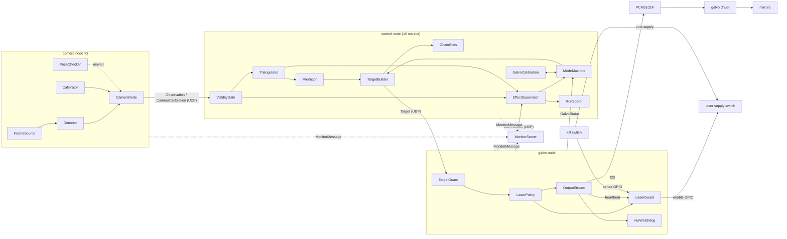
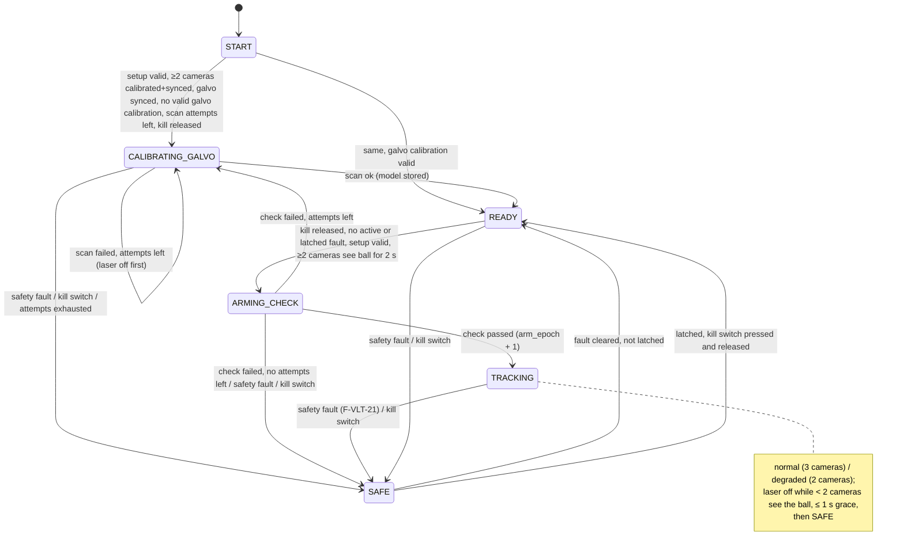

# VLT Concept — Consolidated Requirements

_Sections 0–12 of the MANIFEST document structure. Together with `30-synthesis.md` (Sections 13–16) this is the source of truth for the feature's code: a fresh agent, given only these files and `CONTEXT.md`, must be able to regenerate the implementation. IDs carry the feature code (`F-VLT-1`) and never change after `done`; reruns append, never renumber._

## 0. Synthesis Context

- **Development path:** A — frontloaded (cold start from a problem statement).
- **Synthesis dependencies:** none.
- **Synthesis scope:** the complete software of all node types (camera, control, galvo), the calibration procedures, the node setup scripts and the monitoring server on the laptop. Hardware (converter board, kill switch, laser) is specified by its interface only; the hardware watchdog remains out of scope (§7).
- **Field of application:** distributed real-time system (+ embedded, hardware) — checklists: Cross-cutting, DRS, Embedded, Hardware, By Technology, General Robustness (Software).

### Register trace

not relevant — no register

### Requirements review — 2026-11-06

F-VLT-22 … F-VLT-24 and NF-VLT-22 are proposed additions from a review of the existing requirements, not sponsor-approved decisions. OQ-9 … OQ-14 identify implementation blockers and conflicting interpretations; their owners and affected requirements are listed in §8. Existing sponsor decisions remain in place. In particular, the measurement and recovery rules are not implementation-ready until OQ-9 … OQ-12 are settled. No architecture is introduced by this review.

### DRS completeness review — 2026-11-10

Review of the whole requirement set against the DRS checklist (coverage table in §9) and against itself. All items below are **proposals pending the PM review**, not sponsor-approved decisions.

- **Added (proposed):** F-VLT-25 (galvo status feedback), F-VLT-26 (actuator-effect monitoring), F-VLT-27 (fusion plausibility), F-VLT-28 (start-up, ground state, shutdown), F-VLT-29 (safety event log); NF-VLT-23 (fault hypothesis), NF-VLT-24 (global time base), NF-VLT-25 (fail-safe laser enable), NF-VLT-26 (real-time transaction classes), NF-VLT-27 (state-message semantics and load hypothesis), NF-VLT-28 (node platform and isolated network), NF-VLT-29 (independent timing measurement).
- **Inconsistencies corrected in place (confirm at PM review):** F-VLT-20 / `synced` / `clock_sync_limit_ms` used a per-node 1 ms limit, which allows 2 ms between two nodes and so breaks the pairwise bound of NF-VLT-5 — now π/2 = 0.5 ms per node. F-VLT-16 would alarm on every laser-off transition, because frames exposed before the switch-off took effect still show the spot — action-delay window added. F-VLT-8 narrowed to control/galvo restarts, in line with the sponsor's degraded-mode decision (F-VLT-11/17); the full recovery policy stays in OQ-11. F-VLT-18 now checks the pairwise bound.
- **Acceptance sharpened:** F-VLT-1 (spot on the ball as a separate case — the laser is a hidden channel into ball detection), F-VLT-4 (tail bound, not only median), F-VLT-11 (camera absent vs. ball not seen), F-VLT-15 (defined output at power-up).
- **Wrong or contradictory requirements exposed, decision needed:** the hit rule of F-VLT-7 is degenerate if read as a 3D distance (OQ-9, extended); F-VLT-14 cannot meet "resumes ≤ 1 s" in `button` mode, because the target timeout puts the system into the safe state, and re-arming then needs a button press (OQ-8, extended); the galvo calibration (F-VLT-13) and the F-VLT-5 acceptance need the laser on without a ball, which F-VLT-8 forbids (OQ-13, extended).
- **New open questions:** OQ-15 (activation and cadence of the loop), OQ-16 (on-chip watchdog as a no-hardware mitigation of the dropped NF-VLT-4), OQ-17 (prediction model without pendulum assumption).
- **Sponsor decision 2026-11-10:** the pendulum exists only for a reproducible setup; no plausibility check or rejection may rely on pendulum motion (F-VLT-27 revised accordingly).

### Sponsor decisions — 2026-11-10

- Also proposed: U-VLT-6 (chain delay statistics per stage and end to end).
- Later the same day: automatic calibration (ADR-VLT-012, superseding ADR-VLT-004, F-VLT-12/13/31). OQ-13 resolved by defining the cube frame and the rest position (§2); marker map and setup-revision contents move to the architecture. Proposed for integration and debugging: U-VLT-4 (system health overview incl. clock counters), U-VLT-5 (fused position drawn into camera images), F-VLT-32 (session recording and replay), F-VLT-33 (dry-run modes), NF-VLT-31 (nodes testable against simulated peers).
- Later the same day (requirements review, gap G1): no arming button. The kill switch is the only physical control; arming, disarming, galvo scan and arming check are decided by the control node software (ADR-VLT-013). Rewritten: U-VLT-2, F-VLT-8/11/13/21/30/31; arming-button integration point and `arm_mode` / `arm_button_*` keys obsolete; added `galvo_scan_max_attempts`. Proposed (PM review pending): latched safe state after alarms or repeated safety faults, cleared by pressing and releasing the kill switch (F-VLT-21).
- Later the same day (review gap G2): the monitoring laptop is required to operate the demo and is the only status display; no local indicators. Added U-VLT-7 (state shown on connect, stale nodes flagged, diagnostics also logged locally); F-VLT-29 log contents extended.
- Later the same day (review gap G3): admin access over key-only SSH is allowed, separate from control of the loop, which has no command interface (ADR-VLT-014, amends ADR-VLT-003). NF-VLT-10 rewritten; NF-VLT-28 allows a team machine for administration outside acceptance runs.

### Gate 1 preparation — 2026-11-10 (rev 13)

Checked against the report requirements and the lecture's own DRS checklist ([L] p. 287–288, 18 items; §9).

- **Requirements vs. architecture:** the rule of [L] p. 287 is applied: given items are requirements, items we choose belong in the architecture. Design detail removed from §3–§5 is listed in §10 (*Moved out of the requirements*) as input for the architecture; nothing was dropped.
- **Every requirement** now has a reason and, where it contains a time, a unit and a lecture page [L].
- **IDs:** U-VLT-1 … 7 became F-VLT-34 … 40 (mapping in §4).
- **Values set (proposed):** F-VLT-26 (20 mm outside the cube; 50 mm for 500 ms), F-VLT-27 (10 px), F-VLT-28 (60 s).
- **Review gaps closed (proposed):** G4 → NF-VLT-32 (layout); G5 → F-VLT-7 (rest position, release after a hold towards rest, frame-to-update mapping) and F-VLT-1 (image radius ± 2 px); NF-VLT-21 adds hand-carried ball frames.
- **Lecture checklist gaps closed (proposed):** item 2/10 → F-VLT-41 (modes and mode changes); item 6 → NF-VLT-33 (periods, WCET, phase sensitivity); item 15 → NF-VLT-34 (reaction matrix, coverage 100 %, ≥ 10 injections per row).
- **Open-question owners** are sub-team roles (§8).

### Hardware selection — 2026-11-10 (rev 14)

Galvo set, PCM5102A I2S DAC and Laserfuchs Class 2 laser selected (ADR-VLT-015); OQ-2 and OQ-5 resolved, OQ-4 extended by level matching. Team decision: converter link faults are detected by effect monitoring (F-VLT-26, ≈ 600 ms), no read-back. Rewritten: F-VLT-15, NF-VLT-16; adjusted: NF-VLT-2, F-VLT-21, NF-VLT-23, reaction matrix, §6.

Galvo specs from the listing (rev 15): ±5 V input at 0.33 V/°, ±15° optical standard (±30° max), small-step response ≤ 0.5 ms, ±12 V supply; no pattern board listed. The DAC covers ≈ 59 % of the input range, so NF-VLT-32 now requires the cube to fit the usable scan angle; F-VLT-19 is conditional; OQ-4 narrowed to wiring, supply, pattern board, level matching and measurement on delivery.

### Effect supervision and shutdown origins — 2026-11-12 (rev 16)

Taken from the camera-team review (requirement part only; the camera handoff, timing budget and reference plan move to the architecture). Changes in meaning: (1) new F-VLT-42 — optical-effect watchdog in every laser-on mode (ADR-VLT-019); (2) F-VLT-26 — a spot outside the cube shuts down without the 500 ms wait (T3), the 500 ms for a large aiming error count from the first qualifying exposure, a measurement ≤ 50 mm clears the episode, a missing measurement does not; (3) NF-VLT-26 — new transaction classes T6 (effect supervision, 500 ms + ≤ 100 ms) and T7 (galvo hang, ≤ 1 s total), each with a stated origin (ADR-VLT-018); (4) converter link faults — the blanket "detected within 600 ms" is withdrawn; a fault is covered only through an observable effect, a fault without one is a residual limitation (F-VLT-15/21, NF-VLT-23, reaction matrix, ADR-VLT-015); (5) F-VLT-13/31 — loss of the measurable spot fails the scan or check with the laser off; an unmeasurable check point never passes; (6) F-VLT-8, F-VLT-29, NF-VLT-29/30/34 — follow-ups of (1)–(4); (7) OQ-4 — a draft layout needs ≈ ±14.2° usable optical half-angle, the bare DAC gives ≈ ±8.9°. No other requirement wording is changed.


OQ-6, OQ-8, OQ-9, OQ-10, OQ-11, OQ-15, OQ-16, OQ-17 decided; OQ-12 decided for the deadline classes (numeric limits still open); OQ-14 decided for degraded mode (envelope and error budget still open); OQ-13 open for team discussion. New ADRs: ADR-VLT-005 … ADR-VLT-011. Rewritten: F-VLT-3/4/5/6/7/8/11/13/21, NF-VLT-1/2/18, NF-VLT-23 (hang), NF-VLT-26 (decided). F-VLT-14 deferred. Added: F-VLT-30 (kill-switch sense), NF-VLT-30 (on-chip watchdog). The other requirements proposed on 2026-11-10 remain proposals until the PM review.
### Camera hardware — 2026-11-12 (rev 19)

The camera is given: Raspberry Pi Camera Module v2.1 (Sony IMX219, rolling shutter, 62.2° × 48.8°) on Raspberry Pi 3 Model B+ (photos of the boards). OQ-1 resolved; §6 updated. OQ-3, OQ-7, OQ-12 and OQ-14 marked as deferred to the architecture, each with its proposal; The galvo output chain works on the bench without a pattern board (photos), so OQ-4 is deferred to the architecture as well; F-VLT-19 evidence → [evidenced]. No question that blocks a requirement remains open. No requirement wording changed. Consequence for the M3 proposals: the 640 × 480 high-rate mode is cropped (≈ 26.5° × 20°) — see §11.6.

### Report review — 2026-11-12 (rev 20)

Consistency fixes from a review of the M2 report; no requirement changes meaning. The galvo, DAC and laser are given hardware (ADR-VLT-015 reworded; "selected" → "given" in F-VLT-19, NF-VLT-2, NF-VLT-16). F-VLT-22: limit values are set in the architecture. F-VLT-42 cites ADR-VLT-018/019. NF-VLT-14 no longer names repository paths. NF-VLT-24 and NF-VLT-26 (T1) refer to NF-VLT-5 and NF-VLT-18 instead of restating them. Reaction matrix: one camera lost uses the observation-age limit, T3 only below two cameras. §8: F-VLT-14 row consistent with its deferral. Checklist row 18 deferred to the M3 test concept with its reason. Terms: sponsor, setup documentation. Review references (G2, G4) removed.
### Start-up and operating envelope — 2026-11-12 (rev 21)

F-VLT-28 now allows the galvo scan of F-VLT-13 during start-up (the two contradicted each other on a first start; F-VLT-8 already listed the exception): ready within 60 s with a stored galvo calibration, otherwise 60 s plus 60 s per scan attempt. NF-VLT-1 gets the operating envelope from the OQ-14 proposal (release from 100 … 300 mm, ≤ 1000 mm/s, ≤ 4000 mm/s², room lighting), decided 2026-11-12; F-VLT-4/22 and NF-VLT-32 refer to it; OQ-3 and OQ-14 keep only cube size and the error budget. New §8 *Known risks*: R-1 camera mode vs. the 30 ms deadline.

### Review follow-up — 2026-11-12 (rev 22)

NF-VLT-1: the lowest release in the acceptance runs is ≈ 120 mm, because F-VLT-7 starts a run only above 100 mm; "ordinary room lighting" is defined (normal ceiling lights, no extra lamps, no direct sunlight on the cube) and recorded with each run. F-VLT-28: both scans failing ends in the safe state within the same bound; acceptance adds success on the second scan (≤ 180 s) and two failed scans (safe state ≤ 180 s, no third scan).

### Gate 1 approved — 2026-11-17 (rev 23)

The sponsor approved the requirements of rev 22 at Gate 1 (2026-11-12). The "Proposed" markers were removed from the requirement rows of §3–§5 and from F-VLT-21; wording otherwise unchanged. OQ-3/4/7/12/14 and R-1 stay open into the architecture; the change requests under §11 are not approved with Gate 1.

Architecture start (same rev): the sponsor fixed the implementation language — Python 3 on every node (ADR-VLT-023); new risk R-2 (galvo output stream and camera detection timing in Python) in §8.

### Architecture — 2026-11-17 (rev 24)

§11 filled: module tree (Python, ADR-VLT-023), slices S1–S8, module specifications, pipeline flow, interfaces, state machine, testability, scaling strategy and traceability matrix; transactions T6, T7, kill switch, arming check and galvo scan budgeted; integration tests completed. §12 consistency review: 2 MISMATCH (A-1 target expiry, A-4 schema fields), 3 DANGLING (A-3 switch-off delay, A-5 = R-1, A-6 = R-2). No requirement changed.

### Simulators — 2026-11-17 (rev 25)

On user request: simulators named by the boundary they replace. Node simulators (`CameraNodeSim`, `GalvoNodeSim`, `ControlNodeSim`, was CameraSim/GalvoSim/ControlSim) stay in `sim/` with the new shared `Scenario` and `Replay`; hardware simulators live with the node that uses them: `camera/sim_camera.py` (SimFrameSource, camera team), `galvo/sim_galvo_hw.py` (SimOutputStream, SimGpio, SimWatchdog, laser team), `common/sim_clock.py` (SimClock). LaserGuard receives its pins as objects. No requirement and no §12 verdict changed.

## 1. Purpose

A lab demo that shows multi-camera 3D tracking. Three Raspberry Pi cameras stand at right angles around a cube; a ball swings on a string through the cube. The system computes the 3D position of the ball and steers a laser through a galvo mirror pair so that the spot stays on the ball. The cameras also see the spot, so the system measures its own aiming error. Built and operated by a team of 11 students, presented once to other students.

## 2. Ubiquitous Language & Context

Full dictionary in `CONTEXT.md`. Delta introduced by this feature:

| Term | Meaning | Used in code as |
| --- | --- | --- |
| cube | the tracking volume and its coordinate system: right-handed, in mm; origin at the floor corner marked "0" on the frame, x and y along the floor edges marked "X" and "Y", z up. All positions in requirements and tests are given in it. | `Cube`, cube coordinates in mm |
| ball | the tracked object, ≈ 5 cm diameter, on a ≈ 1 m string | `ball` |
| spot | the laser spot as seen by the cameras | `spot` |
| camera node / control node / galvo node | the three node types (ADR-VLT-001) | `camera`, `control`, `galvo` |
| observation | one camera's detection result for one frame: ball and spot image positions plus exposure time | `Observation` |
| ball state | fused 3D ball position (and velocity) at a time | `BallState` |
| target | the cube point the galvo node shall aim at, with its validity time and laser flag | `Target` |
| aiming error | distance in mm from the fused ball centre to the laser beam line (galvo origin → spot in 3D); unmeasurable when the spot cannot be placed in 3D (ADR-VLT-005) | `aiming_error_mm` |
| hit | a fusion slot in which, in at least one camera that sees both, the spot lies inside the ball's image disc (ADR-VLT-005) | `hit` |
| run | from release (ball displaced > 100 mm starts moving) until the amplitude falls below 50 mm; aborted when the safe state ends it (ADR-VLT-006) | `Run` |
| hit rate | time with a hit ÷ run duration; gaps count as misses (ADR-VLT-006) | `hit_rate` |
| fusion slot | one period of the fixed-rate fusion, aligned to the shared clock (ADR-VLT-009) | `FusionSlot` |
| arming epoch | counter incremented at every arming; the galvo node needs a newer one after a safety fault (ADR-VLT-007) | `arm_epoch` |
| rest position | the ball centre while the ball hangs still | `rest_position_mm` |
| amplitude | the ball's maximum horizontal distance from its rest position over the last swing | `amplitude_mm` |
| armed | the state in which the system may switch the laser on | `armed` |
| safe state | laser off; galvo node ignores targets until re-armed | `SAFE` |
| degraded | tracking with exactly two camera nodes delivering the ball | `DEGRADED` |
| camera calibration / galvo calibration | stored results of the automatic calibrations (ADR-VLT-012) | `camera_calibration`, `galvo_calibration` |
| reference data set | recorded, annotated frames of all cameras used by the automated tests (NF-VLT-21) | `reference_data` |
| monitoring laptop | observe-only sink for monitoring data (ADR-VLT-003) | `monitor` |
| kill switch | physical switch cutting the laser supply independent of software | — |
| sponsor | the product-owner role of the project: sets the goal of the demo and decided the questions marked "sponsor"; for the team its decisions are given | — |
| setup documentation | the team's record of the built setup: hardware list, wiring, laser-safety procedure and responsible role; delivered with the demo | — |

## 3. Functional Requirements

_Rev 13 (cleanup for Gate 1): requirements state what is given and observable. Where we choose how something is done, it belongs in the architecture (lecture [L] p. 287). Design detail removed from these rows is kept in §10 as input for the architecture. Every row gives a reason; every requirement with a time names its unit and a lecture source [L] (slides "Distributed Real-Time Systems" WS26, PDF page numbers). The former user-interaction requirements U-VLT-1 … 7 are functional requirements F-VLT-34 … 40 (§4). Since rev 23 no row carries a "Proposed" marker: all requirements of §3–§5 were approved at Gate 1 (2026-11-12, concept rev 22)._

| ID | Requirement | Reason · lecture basis | Acceptance (falsifiable) | Origin | Evidence |
| --- | --- | --- | --- | --- | --- |
| F-VLT-1 | Each camera node detects the ball in every captured frame and sends the control node an observation. The observation contains the ball's image position and image radius (or "not seen") and the exposure time in the shared clock. | Fusion and prediction need the time of the measurement, not the arrival time. The hit decision (F-VLT-7) needs the ball's image disc. [L] p. 111–114 (observation, update delay). | On the reference data set (NF-VLT-21): the detected ball position lies within 3 px of the annotation in ≥ 95 % of the frames with an annotated ball, and the detected image radius lies within 2 px of the annotation in ≥ 95 % of them; frames without the ball report "not seen". The 3 px / 2 px / 95 % bounds also hold when evaluated only over frames with the spot on the ball. Automated test without hardware; the same test on a camera node gives identical results. | intake d-1 · team review · DRS review 2026-11-10 · review G5 (radius) | [evidenced] / radius bound [estimated] |
| F-VLT-2 | Each camera node detects the laser spot in every captured frame and reports its image position (or "not seen") in the same observation. | The effect of the actuator must be observed, not only commanded. [L] p. 206–207 (end-to-end protocol). | On the reference data set: the detected spot lies within 3 px of the annotation in ≥ 95 % of the frames with an annotated spot; frames recorded with the laser off report "not seen" in ≥ 99 %. Automated test without hardware; identical results on a camera node. | intake d-2 · team review | [evidenced] / thresholds [estimated] |
| F-VLT-3 | The control node computes the ball's 3D position in cube coordinates for one common instant from the observations of at least two camera nodes and the camera calibration. Observations taken at different times are first brought to that instant using their exposure times. New positions are produced at a fixed period aligned to the shared clock (ADR-VLT-009). | The 3D position is a real-time image of a moving entity: only observations that refer to the same instant may be combined. [L] p. 97–98 (timestamps across nodes), 113–116 (RT image, temporal accuracy), 185 (time-triggered). | On the reference data set: for the resting positions the computed position lies within 10 mm of the hand-measured position with 3 cameras and within 15 mm with any 2 cameras (automated, no hardware). Over a 10-min run the start times of the position updates deviate ≤ 1 ms from the configured period grid. | intake d-3 · team review · ADR-VLT-009 | [evidenced] / thresholds [estimated] |
| F-VLT-4 | The control node aims at the position the ball will have when the spot is placed (compensating the loop delay), not at the last measured position. The prediction must not assume a pendulum motion (ADR-VLT-011). | At 1 m/s the ball moves ≈ 30 mm during a 30 ms loop, more than its radius of 25 mm. [L] p. 114 (update delay), 116–120 (temporal accuracy). | Replay of the recorded swings of the reference data set: the predicted position for the placement time deviates ≤ 10 mm (median) and ≤ 20 mm (95th percentile) from the recorded position at that time. Replay of a synthetic straight-line and circular motion within the operating envelope (NF-VLT-1) meets the same bounds. | intake d-4 · DRS review · ADR-VLT-011 | [estimated] |
| F-VLT-5 | The galvo node points the beam at each commanded cube point using the galvo calibration and places the spot at the time requested by the control node. Between two targets it keeps following the motion predicted by the control node. It never uses a target after the target's validity has expired (ADR-VLT-009). | A correct estimate has no value without a correct and timely physical aim; an expired target is an RT image that is no longer temporally accurate. [L] p. 116 (temporal accuracy), 146–148 (permanence, action delay). | Laser aimed at 9 known cube points: the spot lands within 5 mm of each. Replay of a target stream with known motion: between targets the output follows the predicted motion within 0.5 mm; the first output of each target is applied within 1 ms of its requested time; an expired target is never applied. | intake d-5 · ADR-VLT-009 | [evidenced] / thresholds [estimated] |
| F-VLT-6 | The control node computes the aiming error for every position update: the distance in mm from the fused ball centre to the laser beam line (galvo origin → spot in 3D). The spot in 3D is the near intersection of a camera's line of sight to the spot with the ball sphere (measured ball radius) when the spot lies inside the ball's image disc, or the triangulated spot when at least two cameras see it off the ball. Otherwise the aiming error is reported as unmeasurable, never as 0 (ADR-VLT-005). | The system must measure its own result to be self-checking; the metric is fixed by ADR-VLT-005. [L] p. 206–207 (end-to-end protocol). | On the reference data set: the computed aiming error lies within 5 mm of the error derived with the same geometry from the annotations and the hand-measured or fused 3D ball position; frames with a spot seen by one camera off the ball report unmeasurable. | intake d-6 · team review · ADR-VLT-005 | [evidenced] / threshold [estimated] |
| F-VLT-7 | The control node detects runs and reports their result. **Rest position:** part of the setup, measured once by hand. Whenever the ball hangs still (speed < 20 mm/s for ≥ 3 s) within 30 mm of the stored value, the control node updates it to the measured position. Without a known rest position no run starts. **Start (release):** the ball was held still (speed < 20 mm/s for ≥ 0.5 s) more than 100 mm from rest, then starts moving towards the rest position faster than 100 mm/s. Carrying the ball outward by hand doesn't start a run. **End:** the amplitude (largest horizontal distance from rest over the last swing period, ≈ 2 s) falls below 50 mm. **Hit:** in each position update, each camera's observation with the exposure time closest to the update time is used, if it is at most one frame period away. The update is a hit if, in at least one of these observations, ball and spot are both seen and the spot lies inside the ball's image disc (ADR-VLT-005). **Score:** hit rate = time with a hit ÷ run duration. Every update weighs the same. An update without valid ball state, without target or with the laser off is a miss. A run ended by the safe state is reported as aborted (ADR-VLT-006). The result reports duration, hit time, gap time and outcome. All thresholds are configurable; the values above are the defaults. | The demo goal (NF-VLT-1) needs a repeatable, unbiased evaluation that judges the measured effect, not the target. [L] p. 111–113 (observations), 206 (end-to-end protocol). | Replay of a recorded run of the reference data set, including holding the ball before release and gaps without valid position: start and end detected within one swing period (≈ 2 s) of the annotated moments; reported hit rate equals the hand count ± 1 %; gap time equals the injected gaps. Holding the ball at 150 mm for 5 s does not start a run. Carrying the ball outward by hand at 200 mm/s, with and without pauses of 1 s, does not start a run. A stored rest position 50 mm off: no run starts, and a diagnostic is shown. | intake d-7 · ADR-VLT-005/006 · review G5 | [evidenced] / thresholds [estimated] |
| F-VLT-8 | The laser is off at start-up, during the restart of the control node or the galvo node, whenever the system is not armed and whenever no valid ball state is available. The restart of a single camera node is governed by F-VLT-11/17 (ADR-VLT-007). Exceptions: the galvo calibration scan (F-VLT-13) and the arming check (F-VLT-31) (ADR-VLT-012/013). Whenever the laser is on, F-VLT-42 applies. | Actuation is allowed only with valid prerequisites; every node starts in a safe ground state. [L] p. 79 (ground state), 217 (safety), 52–53 (hard deadline). | Power-up, control/galvo node restarts and covering the ball: a photodiode at the galvo output shows the laser off within 100 ms in every case, and no on-pulse occurs during start-up. A camera node restart with the other two tracking: behaviour per F-VLT-11. | intake d-10 · ADR-VLT-007/019 | [evidenced] |
| F-VLT-9 | The galvo node clamps every aim to the cube volume, regardless of the target it receives. | Received values must not bypass the local actuator limits. [L] p. 247 (fault-tolerant actuators). | Targets outside the cube (incl. NaN, ±∞, far out of range): the commanded mirror angles never leave the cube's angle envelope; NaN/∞ targets switch the laser off. | intake d-11 | [evidenced] |
| F-VLT-10 | The galvo node switches the laser off when it has not received a fresh valid target for 100 ms, measured with its local clock. | Loss of the commanding node or the network must not leave the laser on (transaction T2, hard, NF-VLT-26). [L] p. 52–53 (deadlines), 163 (monitoring the message flow). | Stop the control node or unplug its cable while tracking: laser off ≤ 100 ms + 10 ms after the last target (photodiode). Invalid messages do not restart the timeout. | intake d-12 | [evidenced] / value [estimated] |
| F-VLT-11 | With exactly two camera nodes delivering the ball, tracking continues in degraded mode without re-arming. A camera "delivers" when its latest observation is valid (F-VLT-22/23) and sees the ball. The control node distinguishes and reports per camera (F-VLT-34): *absent* (no valid observation within the observation-age limit), *unsynced*, *present, ball not seen* and *present, ball seen*. If fewer than two cameras see the ball while at least two are present, the laser is off, and tracking resumes without re-arming if two see it again within 1 s. Otherwise, and whenever fewer than two cameras are present, the safe state is entered (ADR-VLT-007). | One camera fault is tolerated (k = 1, NF-VLT-23); the system needs to know which nodes are active to enter degraded mode. [L] p. 60 (fault hypothesis), 243 (membership, degraded mode). | Cover one camera, then stop one camera: tracking continues in both cases, mode = degraded naming that camera, and the reported camera status differs (ball not seen vs. absent). Cover the ball for two cameras for 0.5 s: laser off ≤ 100 ms, resumes without re-arming; for 2 s: safe state, re-arming needed. Stop two cameras: safe state. | intake d-15 · DRS review · ADR-VLT-007 | [evidenced] / 1 s [estimated] |
| F-VLT-12 | Camera calibration is automatic (ADR-VLT-012). The reference is a set of markers fixed to the cube frame at positions measured once by hand. At every start each camera node calibrates itself without operator action. While running, a camera that has moved is detected, treated as absent (F-VLT-11) and named in a diagnostic. A camera that can't confirm its calibration at start stays absent. | Repeated setup tests need calibration in seconds; a moved camera would corrupt the fusion without any visible sign. [L] p. 162 (error detection), 240 (reintegration). | After an automatic calibration the F-VLT-3 acceptance passes, with a marker reprojection error ≤ 0.5 px. Calibration at start completes in ≤ 10 s per camera. Turning one camera by a few degrees during tracking: that camera is excluded within 1 s, tracking continues degraded; after a restart in the new position it calibrates itself again and F-VLT-3 passes. | intake d-25 · ADR-VLT-012 | [estimated] |
| F-VLT-13 | Galvo calibration is an automatic scan (ADR-VLT-012). The galvo steps a grid of spots onto the cube's floor and walls, the cameras measure every spot seen by at least two of them, and a model of the galvo is fitted to the measurements. The control node starts the scan by itself when no valid galvo calibration exists or the arming check fails (F-VLT-31); there is no operator trigger (ADR-VLT-013). The laser is on only during the scan. Pressing the kill switch or any safety fault (F-VLT-21) aborts the scan with the laser off. Loss of the measurable spot (F-VLT-42) fails the scan; the laser is off before any further scan. After 2 consecutive failed scans (configurable), no further scan starts until the system is restarted, and a diagnostic names the reason. Commanded angles stay within the galvo limits of the cube (F-VLT-9). The result is stored and used until the next scan. | The galvo must be calibrated without manual work and without uncontrolled laser use. [L] p. 217 (safety), 254 (reaction matrix). | Start without a galvo calibration: the scan starts by itself, completes in ≤ 60 s and reports the model residual; afterwards F-VLT-5 passes. Pressing the kill switch mid-scan: scan aborted, previous calibration kept. Spot covered so that every scan fails: each scan fails by F-VLT-42 with the laser off before the next one; after 2 attempts no further scan, laser off, diagnostic shown. After restart the same calibration is loaded. | intake d-26 · ADR-VLT-005/012/013/019 | [estimated] / spot visibility depends on OQ-7 |
| F-VLT-14 | deferred by the sponsor (2026-11-10, OQ-8) — was: optional redundant control node with takeover ≤ 1 s. | Conflicts with re-arming after the target timeout and needs a membership protocol and a second clock reference. [L] p. 231–234 (replication), 243. | — | intake d-29 | — |
| F-VLT-15 | The galvo node drives the galvo driver's X/Y inputs within the driver's input specification, through the converter board (PCM5102A I2S DAC, given hardware, ADR-VLT-015). From power-up, after a galvo node reset and whenever its output stops, the output holds the mirrors at the centre. If the output stream is interrupted (e.g. the output buffer runs empty), the galvo node switches the laser off within 100 ms. A broken link to the converter board isn't checked separately and can't be read back: it is detected only when it produces an effect that F-VLT-26 or F-VLT-42 detects; a fault without such an effect has no guaranteed detection time (ADR-VLT-015/018). | The actuator needs a defined output in the ground state; an interrupted output must not keep the laser on at an uncontrolled aim. [L] p. 79 (ground state), 202 (I/O error handling), 206 (end-to-end protocol). | Full-range X/Y sweep measured at the driver input stays within the driver's specified range and covers the cube's angle envelope. Power-cycling the galvo node keeps the driver input at the centre value throughout boot (scope trace); unplugging the I2S clock puts the mirrors at the centre. Starving the output stream (test profile): laser off within 100 ms (photodiode). Unplugging the I2S data line while armed, in a scene where this produces a persistent aiming error > 50 mm or loss of the measurable spot: laser off and alarm within 600 ms from the origin stated in F-VLT-26/42, with the time of the electrical fault recorded separately. A fault without such an effect is recorded as outside the detection guarantee. (open: OQ-4) | intake d-36 · DRS review · ADR-VLT-015/018 | [evidenced] / output facts from the TI datasheet |
| F-VLT-16 | If a camera sees the spot in a frame whose exposure started later than the actual laser-off time reported by the galvo node (F-VLT-25), plus the laser switch-off delay, plus one frame period, the system raises an alarm and enters the safe state (latched, F-VLT-21). Spots in frames exposed within that action-delay window after a switch-off don't raise the alarm. | The effect is monitored, not the target; a message may be acted on only after its action delay. [L] p. 146–148 (permanence, action delay), 206 (end-to-end protocol). | Inject a spot-like light (second pointer) while disarmed: alarm shown, safe state. Switch the laser off 20 × during tracking (kill switch, covering the ball): no alarm. | intake d-38 · DRS review | [estimated] |
| F-VLT-17 | A restarted camera node rejoins the running system without restarting other nodes. | A recoverable camera outage must not stop the demo. [L] p. 79 (h-state, ground state), 240 (reintegration). Transaction T5, no deadline (NF-VLT-26). | Restart one camera node during tracking: it delivers observations again after its clock is synchronized; mode returns from degraded to normal. | intake d-39 | [estimated] |
| F-VLT-18 | Every node measures its clock offset to the shared clock and reports it. The monitoring display derives the worst pairwise offset (max − min over all synchronized nodes) and flags it when it exceeds π = 1 ms (NF-VLT-24). | The precision of the global time must be measured, not assumed. [L] p. 92 (precision), 100 (synchronization condition). | Values appear on the display for all 5 nodes, updated at least once per second, together with the worst pairwise offset. The independent cross-check of NF-VLT-5 (LED flash) is still required, because these are the nodes' own estimates. | intake d-17 · DRS review | [evidenced] |
| F-VLT-19 | If the galvo set contains its own pattern player, it is disabled or bypassed so that only the galvo node drives the mirrors. (The given set lists only galvo and driver, ADR-VLT-015; on the bench no pattern board is in the chain.) | No second, uncontrolled source may drive the actuator. [L] p. 247. | With the galvo node stopped, the mirrors don't move and no pattern is projected. | §9 galvo kit | [evidenced] |
| F-VLT-20 | A node's observations or targets are used only while its clock is synchronized within 0.5 ms (π/2) of the clock reference (NF-VLT-24); until then the laser stays off. | Timestamps of unsynchronized nodes can't be compared. [L] p. 92, 97 (reasonableness), 100. | Start the system with clock synchronization disabled on one camera: its observations are ignored. Disabled on all cameras or on the galvo node: the laser stays off. Offset forced to 0.6 ms on one camera (test profile): its observations are ignored. | §9 · DRS review | [estimated] |
| F-VLT-21 | After a safety fault, the laser stays off until the control node arms again per F-VLT-35. Safety faults are: kill switch pressed (F-VLT-30), target timeout, galvo or control restart, sync loss leaving fewer than two usable cameras or on the galvo node, alarm (F-VLT-16/26, or F-VLT-42 while tracking; a converter link fault counts through its observed effect, ADR-VLT-015/018), interrupted galvo output stream (F-VLT-15), fewer than two cameras present, and ball not seen by two cameras for > 1 s. Re-arming happens only after the fault has cleared and ≥ 2 cameras have seen the ball continuously for 2 s (configurable) (ADR-VLT-007/013). The galvo node itself refuses to switch the laser on after a safety fault until it has seen a new arming, even if status reports between the nodes were lost. (ADR-VLT-013) An alarm, or 3 safety faults within 60 s (configurable), latches the safe state; the latch clears only when the kill switch is pressed and released. Loss of the measurable spot during a galvo scan or arming check is not an alarm: it fails that scan or check (F-VLT-13/31/42). | Safety-relevant shutdowns need a deliberate resume; without an arming button, the kill switch provides the deliberate act. [L] p. 217 (safety), 254 (reaction matrix). | For each listed fault: the laser stays off after the fault clears until the 2 s hold-off has passed. Suppress all galvo status reports and inject a target timeout: the galvo node still keeps the laser off for targets from before the fault. Inject an alarm (including F-VLT-42 while tracking), or 3 target timeouts within 60 s: the system stays safe after the hold-off and re-arms only after the kill switch was pressed and released. Spot loss during a scan or check: that scan or check fails, no latch. | §9 · ADR-VLT-007/013/019 | [estimated] |
| F-VLT-22 | Data used for fusion and aiming must meet explicit limits: observation age, difference of exposure times between cameras, prediction horizon and target validity. A new target based on expired observations is not fresh. Clock synchronization is checked throughout operation, including the age of the sync status. Invalid data is excluded, and the laser-off rules apply when no valid input remains. A correction of the shared clock must not extend the local target timeout (F-VLT-10). The limits are derived from the process: tolerated position error ÷ maximum ball speed of the operating envelope (NF-VLT-1). Their values are chosen by the team and set in the architecture (OQ-12). | An RT image may only be used while it is temporally accurate. [L] p. 116–120 (temporal accuracy, phase sensitivity), 146–148 (permanence). | Replay delayed observations, a stream of targets based on old frames, expired targets, lost sync and a clock step: invalid inputs never drive the laser, a healthy pair of cameras can still track, and the local target timeout is not extended by a clock change. Boundary tests use the limits agreed in OQ-12. | requirements review 2026-11-06 | [estimated] / limits [unknown] |
| F-VLT-23 | Receivers check every message between camera, control and galvo nodes. A message with the wrong format or version, an unknown sender, or non-finite values can't update the accepted state or refresh a timeout. The same holds for duplicates, out-of-order messages and messages from before the sender's restart. Under a burst, memory stays bounded, and old messages are dropped, not processed late. | Independently developed nodes must agree on what is current; a stale message must never look fresh. [L] p. 137 (communication errors), 146 (permanence), 237 (idempotent messages). | Contract tests inject wrong versions or senders, truncated messages, NaN/∞, duplicates, reordering and a sender restart; only current valid inputs update the state. A burst beyond capacity: memory bounded, expired messages discarded per F-VLT-22. | requirements review 2026-11-06 | [estimated] |
| F-VLT-24 | Before arming, configuration and calibration are validated together. Units and coordinate convention, camera identities and image modes, finite parameters and cross-field limits must agree, and all nodes must use the same setup. Missing, corrupt or incompatible files keep the laser off and produce a specific diagnostic (local log and monitoring, F-VLT-40). Nodes don't combine data or targets from different setups. | Wrong calibration looks like a valid measurement but produces a wrong aim. [L] p. 162 (error detection), 289 (information representation, units). | Remove or corrupt a file, swap camera calibrations, change the image mode or the setup on one node, set invalid limits: arming is refused with a diagnostic; incompatible peer data is rejected. A matching validated setup passes F-VLT-3/5 after restart. | requirements review 2026-11-06 | [estimated] |
| F-VLT-25 | The control node knows the actual laser state and the reason for laser-off, as reported by the galvo node, within 50 ms of every change and at least every 50 ms. It uses the actual state, not its own command, for F-VLT-16 and hit counting. When the galvo node restarts, the control node enters the safe state, so a restarted galvo node never switches the laser on without re-arming. | The effect at the actuator is the evidence, not the target; a reintegrated galvo node must not resume an old armed state. [L] p. 206–207 (end-to-end protocol), 240 (reintegration). | Restart the galvo node while armed and tracking: laser stays off until re-armed; the display shows the galvo restart. Force each laser-off reason: reported within 50 ms. Stop the status reports: control node enters the safe state within 100 ms + 10 ms. | DRS review | [estimated] |
| F-VLT-26 | While armed, the control node monitors the effect of the actuator. If the spot is seen more than 20 mm outside the cube volume, the system switches the laser off within 100 ms without waiting (T3), raises an alarm and enters the safe state (latched, F-VLT-21). If the aiming error stays above 50 mm for 500 ms while the ball is tracked and the laser is on, counted from the exposure of the first frame above 50 mm, the system does the same within a further 100 ms (T6, ≤ 600 ms in total). A measured aiming error ≤ 50 mm ends the episode; a missing or unmeasurable error does not end it and is handled by F-VLT-42. Both values are configurable; they are set so that normal tracking (NF-VLT-1) never trips them. | A blocked or misaimed actuator must be detected by its effect. [L] p. 206–207 (end-to-end protocol), 247 (fault-tolerant actuators). | Block one mirror mechanically (or load a calibration with an offset in a test profile) while armed: laser off and alarm within 500 ms + 100 ms of the first frame above 50 mm. Spot projected outside the cube by a second pointer: alarm and laser off within 100 ms, without a 500 ms wait. An error ≤ 50 mm before 500 ms ends the episode; frames without a measurable error do not. Three normal runs: no false trip. | DRS checklist (safety-relevant actuator) · ADR-VLT-018 | [estimated] |
| F-VLT-27 | Before an observation is used for the ball state, the control node checks its plausibility. With three cameras, a camera whose observation disagrees with the other two by more than 10 px (reprojection, configurable) is excluded for that update and counted as not delivering. A ball state outside the cube volume is not aimed at. No pendulum motion model is used. Rejected updates count as gaps, never silently as hits. | A value failure of one camera must not move the aim; with three cameras it can be outvoted. [L] p. 230–232 (TMR, voters). | Replay with one camera reporting a false ball (synthetic offset of 30 px): that camera is excluded and the 3D error stays within F-VLT-3 limits; a ball state outside the cube is not aimed at; rejection counts are reported per run. | DRS checklist (fault hypothesis) | [estimated] |
| F-VLT-28 | The nodes can be powered and started in any order. Each node starts in a defined ground state: laser off, mirrors at centre, unarmed, no ball state, no history from a previous session. The system reaches "ready to arm" without manual sequencing within 60 s after the last node is up, including clock synchronization and camera calibration, when a valid galvo calibration is stored. Without one, the galvo scan (F-VLT-13) follows, and "ready to arm" is reached when a scan succeeds: within 60 s plus 60 s per scan attempt (at most 2 attempts). If both attempts fail, the system ends in the safe state with the laser off and a diagnostic (F-VLT-13) within the same bound. During start-up the laser is on only while that scan runs (F-VLT-8). A controlled shutdown switches the laser off and centres the mirrors before the galvo node stops. | Start and restart must be defined; the ground state is the safe point for start-up and reintegration. [L] p. 79 (ground state), 186 (mode changes), 240. | Power up the five nodes in three different orders with a valid galvo calibration stored: ready to arm in every case within 60 s after the last node is up; laser off throughout (photodiode). Power up without a galvo calibration: the laser is on only while the scan runs (photodiode against log), and ready to arm within 120 s after the last node is up when the first scan succeeds. First scan forced to fail, second succeeds: ready to arm within 180 s. Both scans forced to fail: safe state, laser off and diagnostic within 180 s, no third scan. Documented shutdown: laser off before the mirrors stop being driven. | DRS checklist (reintegration) | [estimated] |
| F-VLT-29 | The control node and the galvo node log every mode and safety transition with the shared time and the node's local time. Logged events: arm, disarm, safe state with reason, safety latch set or cleared, kill switch, degraded with camera, alarm, sync lost or regained, arming refused with reason, galvo scan started, failed or given up, setup invalid, and run start and end with result. Camera nodes log their own diagnostics (calibration failed, moved camera) the same way. For F-VLT-42 the log also holds the watchdog origin, the expiry and the time of the laser-off request. The log contains no images, is written without blocking the loop, and its size per session is bounded. | Every detected error must leave evidence for the fault-injection campaign and for faults without the laptop. [L] p. 254 (log column of the reaction matrix), 284 (fault injection). | After a fault-injection session every injected fault appears in the log with its reason, in the right order. Log writing throttled to the SD card's worst case does not change loop timing (NF-VLT-18). | DRS review · F-VLT-40 | [estimated] |
| F-VLT-30 | Software senses the kill switch (galvo node) and reports it; a broken sense wire reads as pressed. Pressing the kill switch puts the system into the safe state within 100 ms (ADR-VLT-007). The kill switch is the operator's only physical control: pressing it disarms, and releasing it allows re-arming per F-VLT-35 (ADR-VLT-013). The supply interruption itself stays independent of software (NF-VLT-3). | The software must not stay armed across a kill-switch press, and the operator needs one deliberate physical control. [L] p. 217 (safety), 52–53 (hard deadline). | Press the kill switch during tracking: laser off immediately (hardware), display shows it within 100 ms, safe state; release: laser stays off until the control node re-arms after the 2 s hold-off. Unplug the sense wire: reported as pressed. | sponsor 2026-11-10 · ADR-VLT-007/013 | [estimated] |
| F-VLT-31 | Before every arming the galvo node projects 3 check points onto floor or walls (points hidden by the ball are replaced) and the cameras measure them. If any lies more than 5 mm from its commanded position, a point can't be measured, or F-VLT-42 expires, arming is refused with the laser off, a diagnostic names the reason, and the control node starts a galvo scan by itself (F-VLT-13) (ADR-VLT-012/013). The check takes ≤ 1 s with the laser on inside the cube and runs without an operator. | A moved galvo would aim wrongly at the ball; the error must be detected before the laser is used. [L] p. 162 (error detection), 206. | Shift the galvo mounting slightly (or load a calibration with an offset): arming refused with the diagnostic, a scan starts by itself, afterwards the check passes and the system arms. Hide a check point so that it can't be measured: the check fails, the system does not arm. Correct calibration: arming succeeds and the check takes ≤ 1 s (photodiode, log). | sponsor 2026-11-10 · ADR-VLT-012/013/019 | [estimated] |
| F-VLT-32 | On request in the configuration, the control node records a session: every observation, target, galvo status report, mode event and timestamp the loop uses, no images. Recording never blocks the loop and its size per session is bounded. A recorded session can be fed into the hardware-free replay (NF-VLT-22) and yields the same decisions. | Faults seen on the real setup must be reproducible offline, without the probe effect of extra instrumentation. [L] p. 281 (cluster simulation), 282 (probe effect). | Record a 10-min session and replay it offline: mode changes, validity decisions and run results identical; NF-VLT-18 unchanged with recording on; recording stops at its size limit without affecting the loop. | sponsor 2026-11-10 | [estimated] |
| F-VLT-33 | Two dry-run modes are set in the configuration. In *laser disabled*, the whole loop runs and the mirrors move, but the laser stays off. In *galvo disabled*, only tracking and monitoring run, with no galvo output. The display shows the active mode. | The loop must be testable during integration without laser risk. [L] p. 267–269 (design for testability, test doubles). | In each mode a full run produces tracking and monitoring data; a photodiode shows the laser never on; in *galvo disabled* the galvo output stays at centre. | sponsor 2026-11-10 | [estimated] |
| F-VLT-34 | (was U-VLT-1) The monitoring laptop shows live: mode (F-VLT-41), current aiming error, hit rate of the current and last run, camera status per node (F-VLT-11), galvo status and laser-off reason (F-VLT-25), clock offset per node and worst pairwise offset (F-VLT-18), and the camera images with the detected ball and spot marked. | The operator's only status display (F-VLT-40). Monitoring is a soft real-time function (T4). [L] p. 52 (soft deadline), 128 (composability). | During a run every listed value is visible and updates at least once per second; images at ≥ 1 per second per camera. | intake d-18 | [evidenced] |
| F-VLT-35 | (was U-VLT-2) Arming and disarming are decided by the control node software (ADR-VLT-013). The only physical operator control is the kill switch (NF-VLT-3, F-VLT-30); there is no arming button. The control node arms when all of these hold: the kill switch is released, no safety fault is active or latched (F-VLT-21), the setup is valid (F-VLT-24), ≥ 2 cameras have seen the ball continuously for 2 s, and the arming check passes (F-VLT-31). The same rule applies at start and after a safety fault. The system disarms on every safety fault and when the kill switch is pressed. No network command or other control path arms, disarms or starts a calibration. | One defined, local control path; the laser comes on only with all prerequisites met. [L] p. 186 (mode changes), 217 (safety). | After start and after every safety fault: the laser switches on only after ≥ 2 cameras have seen the ball for 2 s and the arming check has passed; with the kill switch pressed or the setup invalid it never arms. Pressing the kill switch disarms. No network command arms or disarms (NF-VLT-10); the setup has no physical operator input other than the kill switch (inspection). | intake d-24 · ADR-VLT-013 | [evidenced] |
| F-VLT-36 | (was U-VLT-3) dropped by the sponsor at the PM review (2026-11-02) — was: "recalibration recommended" hint on a systematic aiming error. | Replaced by the arming check, which starts a galvo scan by itself (F-VLT-31). | — | intake d-27 | — |
| F-VLT-37 | (was U-VLT-4) A system health overview on the monitoring laptop shows per node: status, software version, setup identity, clock state (synchronized, offset, clock stepped or stopped since start), CPU and RAM, message rates in and out, dropped and rejected messages, and the latency per stage of the tracking chain (median and 99th percentile over the last second; full statistics in F-VLT-39). Every value that has a limit in these requirements is shown with that limit and highlighted when outside. Highlighted too: different versions or setups between nodes, and a clock that stops, jumps or runs at a different rate than the others. | Integration faults must point to the node and stage that cause them. [L] p. 163 (monitoring the message flow), 266 (monitor the budget in operation). | Inject one fault each — unsynced camera, clock step on one node, frozen node process, overloaded camera node, wrong software version, delayed messages: within 2 s the highlighted value names the faulty node and stage. All values update at least once per second; NF-VLT-6/8 still hold. | sponsor 2026-11-10 | [estimated] |
| F-VLT-38 | (was U-VLT-5) The fused 3D ball position, the predicted aim point and the measured spot are drawn into every camera image on the monitoring laptop, next to that camera's own detection. | A wrong calibration becomes visible at a glance. [L] p. 162 (error detection). | Shift one camera's calibration by 5 px: its image shows the drawn position visibly off the detected ball while the other two match; with a correct setup drawn and detected positions agree within the F-VLT-3 tolerance. | sponsor 2026-11-10 | [estimated] |
| F-VLT-39 | (was U-VLT-6) Chain delay statistics. For every position update the delay of each stage of the tracking chain is traced: capture and readout, detection, camera → control transmission, waiting for the position update, fusion and prediction, control → galvo transmission, waiting until placement, galvo output. Stages that run per camera are traced per camera. Mirror settling, which the nodes can't see, comes from the independent measurement (NF-VLT-29). For each stage and end to end, the monitoring laptop shows count, minimum, maximum, mean, standard deviation (jitter), median, 95th and 99th percentile. Three windows: last second, current run, whole session (resettable on the laptop). It also shows each stage's share of the end-to-end delay and a histogram with the 30 ms limit (NF-VLT-18) and each stage budget marked. Deadline misses and discarded targets are counted. At the end of each run and session the statistics are saved on the laptop as a file (numbers only) for the test report. | The deadline is met only if every stage stays in its budget; maxima and their distribution must be visible. [L] p. 39–40 (budget per stage), 68 (action duration statistics), 266 (testing the temporal domain). | 10-min run: statistics for all stages and windows shown and saved; the sum of stage means equals the end-to-end mean within 1 ms; adding a 5 ms delay in one stage (test profile) shows in that stage's statistics and share within 2 s, not in the others; values agree with the logged per-stage timestamps of NF-VLT-18. | sponsor 2026-11-10 | [estimated] |
| F-VLT-40 | (was U-VLT-7) Operating the demo requires the monitoring laptop: it is the operator's only status display, and no node has a local indicator (sponsor decision 2026-11-10). Without the laptop the system still tracks and stays safe (NF-VLT-7), but the operator sees only the laser. Therefore: (a) within 2 s of connecting or reconnecting, the laptop shows the current state of every node. That covers mode, armed or safe, an active safety latch with its cause, the kill switch, and the reason the system is not armed. It also shows the diagnostics and alarms since the node started, not only events after the connection. (b) A node from which no monitoring data has arrived for 2 s is shown as stale, and its last values are marked as not current. (c) Every diagnostic and alarm shown on the laptop is also written to the local log (F-VLT-29). | The only display must never show an old state as current. [L] p. 52 (soft deadline), 163 (monitoring the message flow). | Start without the laptop, inject an alarm and an invalid setup on one camera, then connect the laptop: within 2 s it shows the latch with its cause, the setup error naming the camera, and why the system is not armed. Stop one node's monitoring sender: shown as stale within 2 s. After a session without the laptop every injected fault is in the log. | sponsor 2026-11-10 (G2) | [estimated] |
| F-VLT-41 | The system has these operating modes, shown on the display (F-VLT-34) and logged (F-VLT-29). **Start** (ground state, calibrating cameras, synchronizing clocks). **Calibrating galvo** (F-VLT-13). **Ready** (not armed, all prerequisites met except the ball). **Arming check** (F-VLT-31). **Tracking**, normal or degraded (F-VLT-11). **Safe**, latched or not (F-VLT-21). The configurations are: normal, dry run *laser disabled*, dry run *galvo disabled* (F-VLT-33), with or without session recording (F-VLT-32). Changes towards laser off take effect within the deadlines of NF-VLT-26. The laser can come on only through *arming check* → *tracking*, or in *calibrating galvo*. A configuration takes effect only at a node start. No other mode or transition exists. | Modes and mode changes must be listed so that every transition is tested; switching configuration at runtime is unsafe. [L] p. 186 (mode changes take effect at the ground state), 287 (modes of operation and configurations). | In the fault-injection campaign (NF-VLT-23) and three normal runs, the logged mode sequence contains only the listed transitions; the laser is never on in a mode other than *arming check*, *tracking* or *calibrating galvo* (photodiode against log); changing the configuration of a running node has no effect until restart. | lecture checklist p. 287 (modes, mode changes) | [estimated] |
| F-VLT-42 | Whenever the laser is on (galvo scan, arming check, tracking), the control node checks that the spot is measurable. From the first laser-on placement, a measurable spot must be seen within 500 ms and then at least every 500 ms while the laser stays on. While tracking, "measurable" means a valid aiming error (F-VLT-6); during a scan or check it means a spot located in 3D by at least two cameras, without a ball. A missing spot, a spot off the ball seen by one camera only, and stale or rejected observations do not count. The interval is measured on a local monotonic clock; clock corrections, new targets and mode changes with the laser on don't restart it. When it expires the laser is off within 100 ms (T6, ≤ 600 ms in total), and a later measurement can't cancel this. Tracking: alarm and safe state (latched, F-VLT-21). Galvo scan: the scan fails (F-VLT-13). Arming check: the check fails (F-VLT-31). A faster shutdown (ball lost, sync loss, kill switch, output stop) always wins. The value 500 ms is configurable for test profiles only (ADR-VLT-018/019). | The laser must not stay on when its effect can't be measured: F-VLT-26 only reacts to a measured error, so a spot that can't be measured had no time limit. [L] p. 206–207 (end-to-end protocol, effect monitoring), 254 (reaction matrix). | Replay and fault tests: no spot from the first emission, spot lost later, spot off the ball seen by one camera, stale or duplicate observations, a clock step and a target change during the interval, a valid measurement just before and just after expiry. In each case the laser is off ≤ 600 ms after the stated origin (photodiode, NF-VLT-29), with the outcome of the current mode; invalid data never extends the interval. No alarm while the laser is actually off. | review 2026-11-11 · ADR-VLT-019 | [estimated] / feasibility depends on the camera (OQ-1) |

## 4. User Interaction Requirements

Merged into §3 at rev 13 so that the report uses only F- and NF- IDs: U-VLT-1 → F-VLT-34, U-VLT-2 → F-VLT-35, U-VLT-3 → F-VLT-36 (dropped), U-VLT-4 → F-VLT-37, U-VLT-5 → F-VLT-38, U-VLT-6 → F-VLT-39, U-VLT-7 → F-VLT-40. Earlier history entries in §0 keep the old IDs.

## 5. Non-Functional Requirements

| ID | Requirement | Reason · lecture basis | Acceptance / measure | Origin | Evidence |
| --- | --- | --- | --- | --- | --- |
| NF-VLT-1 | Acceptance of the demo: in a run (F-VLT-7), the hit rate from release until the amplitude is below 50 mm is at least 80 %. This holds with all three cameras and with each of the three two-camera pairs (degraded mode; sponsor, OQ-14). **Operating envelope** (OQ-14, decided 2026-11-12): the ball (≈ 5 cm on a ≈ 1 m string) is released by hand from a horizontal deflection of 100 … 300 mm from its rest position; ball speed up to 1000 mm/s and acceleration up to 4000 mm/s²; ordinary room lighting: the room's normal ceiling lights, no extra lamps and no direct sunlight on the cube. | The demo's purpose, stated as a measurable goal. [L] p. 20 (falsifiable acceptance). | System-reported hit rate ≥ 80 % in 3 of 3 consecutive runs with three cameras and in 3 of 3 consecutive runs for each camera pair (third camera stopped); each set of three runs is released from ≈ 120 mm, ≈ 200 mm and ≈ 300 mm (measured by the system at release; F-VLT-7 starts a run only above 100 mm); an aborted run counts as failed; the lighting (lights on, no extra lamps, no direct sunlight on the cube) is recorded with each run. | intake d-8 · sponsor (OQ-14) · ADR-VLT-006 | [evidenced] |
| NF-VLT-2 | Laser safety (IEC 60825-1): the laser is visible and at most Class 2 (≤ 1 mW). The student team is responsible for laser safety in the lab (OQ-6). Before the first laser-on test it records a laser-safety procedure that also covers laser-on without an operator action (arming check, galvo scan, ADR-VLT-013). | Safety requirement of a lab demo with a laser. [L] p. 217 (safety). | Given laser: Laserfuchs LFD650-1-12, 650 nm, 1 mW, Class 2 per manufacturer (ADR-VLT-015). The label on the delivered module shows Class 2 or lower; recorded in the setup documentation together with the team's laser-safety procedure and the responsible team role. | intake d-9 · sponsor (OQ-6) | [evidenced] |
| NF-VLT-3 | A physical kill switch cuts the laser supply independent of all software. | When every electronic layer fails, a path that needs no computer remains. [L] p. 248. | Kill switch pressed during tracking: laser off immediately, with all nodes still running. | intake d-13 | [evidenced] |
| NF-VLT-4 | dropped by the sponsor at the PM review (2026-11-02) — was: external hardware watchdog; replaced by NF-VLT-30. | See NF-VLT-30. | — | intake d-14 | — |
| NF-VLT-5 | All nodes share one clock synchronized over Ethernet (software clock synchronization, ADR-VLT-002) with an offset ≤ 1 ms between any two nodes; every observation carries its exposure time in that clock. | Observations from different cameras must refer to comparable physical times. [L] p. 82 (why clock synchronization), 92 (precision π). | The worst pairwise offset per F-VLT-18 stays ≤ 1 ms during a 10-min run (each node ≤ 0.5 ms to the clock reference). Cross-check: one LED flash seen by all cameras yields exposure times within 1 ms + one frame period. | intake d-16 | [evidenced] |
| NF-VLT-6 | Sending monitoring data never blocks the tracking loop; under back-pressure monitoring data is dropped, not queued. | Monitoring must not change the timing of the loop. [L] p. 128 (composability), 161 (non-blocking write). | Monitoring server paused (SIGSTOP) during a run: loop timing (NF-VLT-18) unchanged, node memory does not grow. | intake d-19 | [evidenced] |
| NF-VLT-7 | Tracking and safety behave identically with and without the monitoring laptop connected. | Safety must not depend on an observer. [L] p. 128 (composability). | NF-VLT-1 and F-VLT-8 … F-VLT-11 pass with the laptop absent. | intake d-20 | [evidenced] |
| NF-VLT-8 | Monitoring traffic of all nodes together stays ≤ 20 Mbit/s; camera images are sent at ≤ 5 per second, ≤ 320 × 240 px. | Monitoring shares the network with the loop and clock synchronization. [L] p. 60 (load hypothesis), 138 (thrashing). | Switch port counters or capture over a 10-min run: total monitoring traffic ≤ 20 Mbit/s. | intake d-21 | [estimated], confirmed by sponsor |
| NF-VLT-9 | Loop timing (NF-VLT-18) and the demo acceptance (NF-VLT-1) are verified both with monitoring on (at its maximum rate) and off. | Instrumentation can change what it measures. [L] p. 128, 282 (probe effect). | Both measurements recorded in the test report. | intake d-22 | [evidenced] |
| NF-VLT-10 | No network message controls the running loop. The loop processes on every node have no command interface, and nothing over the network arms, disarms, starts a calibration or changes running behaviour. The monitoring software is observe-only (ADR-VLT-003). Separately, admin access is allowed (ADR-VLT-014): authenticated SSH, key only with no password login, from devices on the demo network (NF-VLT-28). It covers installing and updating software, starting, stopping and restarting node software, reboot and shutdown, editing configuration and calibration files, and fetching logs, recordings and statistics. Configuration and calibration changes take effect only when the node software restarts, and that restart follows the existing rules (F-VLT-8/17/21). | Security: only the defined local path controls the laser; the team still needs to administer five headless nodes. [L] p. 218 (security). | Port scan of every node: listening ports only for SSH, clock synchronization and the loop's own messages, which accept only loop messages from their expected senders (F-VLT-23). SSH with a password is refused. Editing the configuration of a running node: behaviour unchanged until restart. Restarting the galvo software over SSH while armed: safe state, re-arming per F-VLT-35. | intake d-23 · ADR-VLT-003/014 | [evidenced] |
| NF-VLT-11 | Camera images are shown live only and are not stored by default (GDPR). | Personal data may appear in camera images. | After a run, no image files on any node or on the laptop unless storage was explicitly enabled in the configuration. Exception: the reference data set (NF-VLT-21). | intake d-28 | [evidenced] |
| NF-VLT-12 | The system runs continuously for 10 minutes (several runs) without a restart. | A presentation consists of several runs in one session. [L] p. 266 (high-water mark over long runs). | 10-min soak: no node restart, no memory growth > 10 %, NF-VLT-1 still met in the last run. | intake d-30, sponsor | [evidenced] |
| NF-VLT-13 | Every node can be set up reproducibly from the repository by a script. Code is version-controlled and reviewed before merge, and every node's code has automated tests. | Project standard: versioning, frozen tools. [L] p. 289. | A fresh SD card set up only with the documented script runs the node; the test suite runs with one target. | intake d-31 | [evidenced] |
| NF-VLT-14 | The source code has one module per node type (camera, control, galvo) and one for the monitoring server. | Project standard: well-structured project documents and sources. [L] p. 289. | Inspection of the source tree. | intake d-32, ADR-VLT-001 | [evidenced] |
| NF-VLT-15 | All nodes are Raspberry Pi 3 on one wired Ethernet switch (given hardware). | Given structure of the components. [L] p. 287 (given items are requirements). | Setup documentation lists the hardware; all tests run on it. | intake d-33, ADR-VLT-001 | [evidenced] |
| NF-VLT-16 | The galvo node switches the laser on and off in software by switching the laser's supply (the given module has no TTL input, ADR-VLT-015). The laser housing is at supply potential, so the laser is mounted electrically insulated. | The software laser-off rules need an actuator; a live housing must not short or energize the frame. [L] p. 247, 217 (safety). | Galvo node toggles the laser 10 × per second for 10 s; photodiode confirms every transition. Insulation check: no continuity between the laser housing and the mounting frame. | intake d-34 · ADR-VLT-015 | [evidenced] |
| NF-VLT-17 | Laser colour, ball colour and background are chosen so that every camera can tell the spot apart on the ball and the ball against the background. | Observation quality bounds all later accuracy. [L] p. 111–112 (observations). | Proven by F-VLT-1 and F-VLT-2 passing on the reference data set, evaluated per camera. (laser fixed: red, ADR-VLT-015; open: OQ-7) | intake d-35 · team review | [evidenced] / threshold [estimated] |
| NF-VLT-18 | End-to-end tracking transaction T1 (firm, ADR-VLT-008): from the exposure of a frame to the spot being placed at the corresponding aim, p99 ≤ 30 ms. The stages are capture/readout, detection, transmission, fusion and prediction, transmission, galvo output and mirror settling. Their individual budgets are chosen in the architecture ([L] p. 287: chosen items belong there) and must sum to ≤ 30 ms. A target whose validity has expired on arrival is discarded and counts as a miss. | Every distributed transaction needs an end-to-end deadline with a budget per stage. [L] p. 36–40 (transaction, budget), 52–53 (firm deadline). | Per-stage timestamps logged over a 10-min run plus the independent measurement of NF-VLT-29: 99th percentile of the end-to-end time ≤ 30 ms; maximum and count of discarded targets reported; each stage within its budget. | intake d-37, sponsor · ADR-VLT-008 | [evidenced] |
| NF-VLT-19 | Each node stays within ≤ 75 % average CPU and ≤ 50 % RAM on the Pi 3 during a run. | Resource requirements with headroom for peak load. [L] p. 55 (resource adequacy), 288 (resources). | Resource log during a 10-min run. | intake d-40 | [estimated], confirmed by sponsor |
| NF-VLT-20 | Clock precision (NF-VLT-5) holds with monitoring traffic at its maximum (NF-VLT-8). | Network load adds latency jitter to clock synchronization. [L] p. 105 (latency jitter). | Clock offsets ≤ 1 ms during a 10-min run with monitoring at maximum rate. | §9 (shared switch) | [estimated] |
| NF-VLT-21 | A reference data set is recorded once with the final setup. It contains time-synchronized frames of all three cameras covering: a resting ball at ≥ 10 positions spread over the cube, swinging runs (release until amplitude < 50 mm), the spot on and off the ball, laser off, frames without the ball, and the ball being carried outward by hand (F-VLT-7). Every frame is annotated with the image positions of ball (centre and radius) and spot, in the same pixel coordinates as the detection (origin top-left, v downward). For the resting positions the 3D ball position is measured by hand. The set and its annotations are stored in the repository and are the input of the automated detection, triangulation, aiming-error, prediction and run tests. It is an explicit exception to NF-VLT-11, on condition that no people appear in the frames. After a significant setup change (camera, background, ball, laser or lighting) it is recorded again. | Detection and evaluation must be testable repeatably without hardware. [L] p. 264–266 (unit tests), 283 (test selection). | The data set exists in the repository with an annotation file that passes a schema check, covers every listed case for all three cameras, and contains no people (reviewed). | team review | [evidenced] |
| NF-VLT-22 | The shared processing and decision logic can be tested without cameras, Pis or galvo hardware. Tests replay the reference data set and synthetic message and time events through the same logic used on the nodes, with a simulated clock and captured actuator output. Replay includes two-camera combinations, loss, delay and reordering, node restart and sync loss. It adds no live target path to the monitoring laptop. | Integration faults must be found before the real setup is available. [L] p. 269 (test doubles), 281 (cluster simulation). | One documented target runs the replay suite without hardware. The same input and event schedule always gives the same validity decisions, state transitions and run result; numeric outputs meet the existing tolerances. Fault cases check F-VLT-22 … 24. Physical timing and aiming acceptance still require the real setup. | requirements review 2026-11-06 | [estimated] |
| NF-VLT-23 | **Fault hypothesis.** Fault-containment regions: each of the five nodes, the Ethernet switch, converter board + galvo driver, the laser module. **Tolerated (k = 1, 2-of-3):** crash, omission or timing failure of one camera node, including its restart (F-VLT-11/17), and a detectable value failure of one camera while three deliver (F-VLT-27). **Detected and turned into the safe state (fail-safe):** crash or omission of the control node or the switch (F-VLT-10), loss of the clock reference or sync loss (F-VLT-20/22), galvo node restart (F-VLT-25), interrupted galvo output stream (F-VLT-15), converter link fault that produces an observable effect (spot outside the cube: T3; persistent aiming error or no measurable spot: T6; F-VLT-26/42, ADR-VLT-015/018), a second camera fault, actuator misbehaviour (F-VLT-16/26/42), galvo node software hang (NF-VLT-30, T7, within 1 s). **Not covered — residual risk, kill switch only (NF-VLT-3):** a hang shorter than 1 s (laser frozen at its last clamped aim), undetected consistent value failures of two cameras, a laser stuck on in hardware, a converter link fault without an observable effect. **Fault frequency:** at most one fault at a time; a second fault no earlier than 10 s after recovery from the first. | Guarantees hold only for faults the hypothesis covers. [L] p. 60 (fault hypothesis), 229 (node as unit of failure), 234 (fail-silent), 284 (fault injection beyond the hypothesis). | Fault-injection campaign on the real setup per NF-VLT-34, plus at least two faults beyond the hypothesis (two cameras at once; camera fault during control restart): each tolerated fault keeps tracking, each detected fault ends in laser off within its deadline (NF-VLT-26), each beyond-hypothesis case ends in laser off or is recorded as residual. Converter faults are injected both with and without an observable effect; the latter are recorded as outside the detection guarantee. Results logged per F-VLT-29. | DRS checklist (fault hypothesis) · ADR-VLT-018 | [estimated] / inter-fault time [estimated] |
| NF-VLT-24 | **Global time base.** The precision π ≤ 1 ms of NF-VLT-5 means that every node within π/2 = 0.5 ms of the clock reference. The global granularity g for comparisons between nodes is fixed with g > π (reasonableness condition). Timestamps keep ns resolution, but the order or duration of events on different nodes is only claimed beyond ±2g. The fusion error budget (OQ-14) includes the timestamp uncertainty × maximum ball speed. Corrections of the shared clock never lengthen or shorten local timeouts (F-VLT-10, F-VLT-22). No other time service adjusts the node clocks. | Timestamps from different nodes are only comparable within the limits of time measurement. [L] p. 92 (precision), 97 (reasonableness g > π), 98 (±2g), 106 (clock correction). | Configuration check on every node: only the shared clock synchronization adjusts the clock. Stop the clock reference during tracking: nodes flag unsynced within the sync-status age (OQ-12) and the laser goes off. Step the shared clock by 50 ms on the galvo node: the target timeout still fires at 100 ms ± 10 ms. The value of g is recorded once OQ-1/OQ-12 fix the camera timestamp source. | DRS checklist (global time base) · ADR-VLT-002 | [estimated] |
| NF-VLT-25 | **Fail-safe laser enable.** The laser emits only while the galvo node actively drives its enable signal. An unpowered, booting, rebooting or crashed galvo node, a broken enable wire or a floating input all leave the laser off, by hardware design. | The ground state of the actuator must be safe without software. [L] p. 79 (ground state), 217 (safety). | With the laser supply on and the kill switch closed: power the galvo node off, reboot it, kill the galvo process, unplug the enable wire — a photodiode shows the laser off in every case, including during the whole boot. | DRS review | [estimated] |
| NF-VLT-26 | **Real-time transactions and deadline classes** (sponsor, ADR-VLT-008). **T1 tracking** (exposure → spot placed) is *firm*, with the deadline and the handling of expired targets of NF-VLT-18. **T2 target-loss shutdown** (last valid target → laser off) is *hard* at 100 ms + 10 ms (F-VLT-10). **T3 unsafe-condition shutdown** (< 2 cameras, sync loss, alarm, actuator fault → laser off) is *hard* at 100 ms from the first frame exposure that shows the condition, or from the local event for faults detected on a node; it contains no 500 ms qualification. **T6 effect supervision** (aiming error > 50 mm for 500 ms, F-VLT-26; no measurable spot for 500 ms, F-VLT-42 → laser off) is *hard* at 500 ms + 100 ms from the origin stated there. **T7 galvo software hang** (output loop stops → laser off) is *hard* at 1 s in total, including reset and laser disable (NF-VLT-30). A faster applicable shutdown always wins. **T4 monitoring** is *soft*, best effort (NF-VLT-6). **T5 camera reintegration** has no deadline. The OS is not real-time, so hard deadlines are met by the software design, backed by the kill switch, and verified by measuring the maximum, not proven. | Deadlines are classified by the consequence of a miss. [L] p. 52–53 (soft, firm, hard), 266 (maximum by measurement). | 10-min run with monitoring at maximum (NF-VLT-9) plus the fault campaign (NF-VLT-34): T1 p99 and maximum reported, late targets counted; T2, T3, T6 and T7 maximum ≤ their deadline in every injected case, measured from their stated origin and independently (NF-VLT-29). | DRS checklist (deadline) · ADR-VLT-008/018 | [estimated] |
| NF-VLT-27 | **State semantics and load hypothesis.** Observations, targets and galvo status reports describe a state: only the newest valid one is used, older ones are skipped and never queued, and latency doesn't grow with load. Load hypothesis per channel at peak: camera → control: frame rate × observation size per camera; control → galvo: update rate × target size; galvo → control: status rate; clock synchronization: sync rate; monitoring ≤ 20 Mbit/s (NF-VLT-8). In total ≤ 50 % of each node's 100 Mbit/s link. The rates are fixed when OQ-1/OQ-12 fix the frame and update periods. | Response times can only be guaranteed below a peak load; a system must saturate, not thrash. [L] p. 60 (load hypothesis), 130 (state messages), 138 (thrashing). | Load test at 1.5 × the nominal camera frame rate (synthetic observations) with monitoring at maximum: end-to-end latency of the newest frame stays bounded (no growing backlog), skipped frames are counted, node memory constant. Port counters confirm each channel within its hypothesis. | DRS checklist (load hypothesis) | [estimated] |
| NF-VLT-28 | **Isolated network and minimal node platform.** The five nodes and the monitoring laptop are the only devices on a dedicated switch, with no uplink to the lab network or the internet. For administration (NF-VLT-10) a team machine may also be connected, but not during acceptance runs. The network is trusted, so senders are identified without cryptographic authentication. Each node runs a minimal OS image set up by the script of NF-VLT-13: no desktop, Wi-Fi and Bluetooth off, no automatic updates, no time service other than the shared clock synchronization. | Hidden channels through shared resources and outside traffic must be excluded; security by isolation. [L] p. 128 (composability), 218 (security). | During acceptance runs the switch port list shows only the six devices; no default route on any node. Setup-script check on a fresh SD card: listed services disabled. NF-VLT-18 measured with this image. | DRS review | [estimated] |
| NF-VLT-29 | **Independent timing measurement.** End-to-end timing (T1) and the shutdown deadlines (T2, T3, T6, T7) are verified with an instrument independent of the node clocks, not only from the nodes' own timestamps. For example: an LED flash in the cameras' view timed by a separate microcontroller or scope, and a photodiode at the galvo output or on the ball. | Self-reported timestamps share the errors of the system they measure. [L] p. 266 (testing the temporal domain), 282 (probe effect). | The test report contains, for T1, T2 and T3, the independent measurement (≥ 100 samples each) next to the self-reported values; their difference is stated. For T6 and T7, ≥ 10 injections per case, with fault injection, origin and laser off recorded separately. | DRS checklist (measurement on the target) · ADR-VLT-018 | [estimated] |
| NF-VLT-30 | If the galvo node's output loop stops (software hang), the laser goes off within 1 s in total (T7, including reset and laser disable), by the Pi's on-chip watchdog fed by the output loop (sponsor, ADR-VLT-010). The reset switches the laser off by NF-VLT-25, and the node reboots into the ground state (F-VLT-28). | A hung output task can keep the laser on; the heartbeat belongs at the end of the output task. [L] p. 167 (watchdog). | Freeze the galvo output loop (SIGSTOP) while the laser is on: photodiode shows the laser off within 1 s of the hang, including the reset; the node reboots into the ground state. | sponsor (OQ-16) · ADR-VLT-010/018 | [estimated] |
| NF-VLT-31 | Each node type can run on the real setup while any of its peers is replaced by a simulator sending the same messages. The simulators are: a camera simulator playing recorded data, a galvo simulator recording the targets it receives, and a control simulator sending scripted targets. Simulators never drive the laser. | Nodes are integrated one at a time against test doubles. [L] p. 269 (test doubles), 279–281 (integration testing). | Each node passes its node tests with all peers simulated and with any mix of real and simulated peers; the health overview (F-VLT-37) marks simulated nodes. | sponsor 2026-11-10 | [estimated] |
| NF-VLT-32 | **Physical layout for measurable hits**. The galvo is placed so that, throughout the operating envelope (NF-VLT-1), every pair of cameras includes at least one camera that sees the spot on the ball. The floor and walls used by the galvo scan and the arming check (F-VLT-13/31) are each visible to at least two cameras and don't block any camera's view of the tracking volume. Seen from the galvo, the whole cube lies within the usable optical scan angle with ≥ 10 % margin. The usable angle depends on the DAC level, the driver gain and any amplifier (ADR-VLT-015, OQ-4). | NF-VLT-1 must hold for every camera pair, and a hit can only be counted when a camera sees the lit side of the ball. Given hardware geometry is a requirement. [L] p. 287. | On the reference data set (NF-VLT-21): for every camera pair, at least one camera of the pair sees the spot in ≥ 95 % of the frames of the swinging runs with the spot on the ball. Every scan point of F-VLT-13 is seen by ≥ 2 cameras. Commanding the cube's corners: every corner is reached with the DAC output ≤ 90 % of its full scale. | review G4 · NF-VLT-1 | [estimated] |
| NF-VLT-33 | **Timing of actions.** Every periodic action has a specified minimum and maximum period and a worst-case execution time: frame capture and detection per camera, position update and prediction, galvo output, galvo status report, monitoring. The worst-case execution time is measured on the target under the load hypothesis (NF-VLT-27) as the high-water mark over a 10-min run. Each action meets execution time < period. Every RT image that is used meets the phase-sensitivity condition update delay + period + execution time < temporal accuracy (F-VLT-22). We choose the period values, so they are set in the architecture. | Deadlines can only be met if every action has a bounded period and execution time. [L] p. 65 (d_WCET, d_MINT), 72 (WCET), 120 (phase-sensitive RT images), 266 (high-water mark), 287 (timing of actions). | For every listed action: measured period minimum and maximum within the specified bounds and execution-time high-water mark below the period over a 10-min run with monitoring at maximum; the phase-sensitivity condition holds with the measured values. | lecture checklist p. 287 (timing of actions) | [estimated] |
| NF-VLT-34 | **Error detection coverage and reaction matrix.** Every error in the fault hypothesis (NF-VLT-23) is covered by the reaction matrix below: what detects it, how the system reacts, within which time, and what is logged (F-VLT-29). **Coverage target:** 100 % of the injected errors within the hypothesis are detected and handled within their time limit, with each matrix row injected at least 10 times on the real setup. Errors beyond the hypothesis, and faults without a guaranteed detection (NF-VLT-23), are injected and their outcome recorded separately; they don't count towards the coverage target. | Error detection needs numbers and mechanisms; every detectable error maps to a defined reaction. [L] p. 254 (reaction matrix), 284 (fault injection), 288 (error detection coverage). | Fault-injection report: per row the number of injections, detections and reactions within the time limit (target 10 of 10 for every row); beyond-hypothesis cases listed with their outcome. | lecture checklist p. 288 (error detection coverage) · ADR-VLT-018 | [estimated] |

**Reaction matrix (NF-VLT-34)**

| Error | Detected by | Reaction | Time limit | Requirement |
| --- | --- | --- | --- | --- |
| one camera crashed, silent or late | no valid observation within the age limit | camera absent, degraded; < 2 cameras → safe | observation-age limit (OQ-12); < 2 cameras: 100 ms (T3) | F-VLT-11, F-VLT-22 |
| one camera reports a wrong ball (3 cameras) | plausibility against the other two | camera excluded for that update | next update | F-VLT-27 |
| camera moved | marker check against the calibration | camera absent, diagnostic | 1 s | F-VLT-12 |
| ball seen by < 2 cameras | camera status | laser off; > 1 s → safe | 100 ms / 1 s | F-VLT-11 |
| control node, switch or network down | target timeout at the galvo node | laser off, safe | 100 ms + 10 ms (T2) | F-VLT-10 |
| galvo node restarted | restart reported by the galvo node | safe, re-arming needed | 100 ms (T3) | F-VLT-25 |
| galvo node software hang | on-chip watchdog | reset, laser off | 1 s in total (T7) | NF-VLT-30 |
| clock unsynchronized or sync status too old | offset and sync-status age | data of that node excluded; galvo or < 2 cameras → safe | 100 ms (T3) | F-VLT-20, F-VLT-22 |
| malformed, duplicate, out-of-order or pre-restart message | receiver checks | message dropped | immediately | F-VLT-23 |
| expired target or stale source data | validity check | target discarded, counted as miss | immediately | F-VLT-22, NF-VLT-26 |
| galvo output stream interrupted | galvo node output monitoring | laser off, safe | 100 ms (T3) | F-VLT-15 |
| converter link broken (I2S clock or data) with an observable effect | the effect: spot outside the cube, aiming error or no measurable spot (clock loss also centres the mirrors by hardware) | as for that effect (rows below) | as for that effect (T3 or T6) | F-VLT-26/42, ADR-VLT-015/018 |
| converter link broken without an observable effect | none guaranteed | residual; kill switch | no guaranteed time | NF-VLT-23 |
| spot seen while the laser is off | camera observation vs. actual laser state | alarm, safe (latched) | 100 ms (T3) | F-VLT-16 |
| spot more than 20 mm outside the cube | spot position | alarm, safe (latched) | 100 ms (T3) | F-VLT-26 |
| mirror blocked or misaimed | aiming error > 50 mm | alarm, safe (latched) | 500 ms + 100 ms (T6) | F-VLT-26 |
| no measurable spot while tracking | optical-effect watchdog | alarm, safe (latched) | 500 ms + 100 ms (T6) | F-VLT-42 |
| no measurable spot during galvo scan or arming check | optical-effect watchdog | laser off, scan or check fails | 500 ms + 100 ms (T6) | F-VLT-13/31/42 |
| kill switch pressed or sense wire broken | sense contact | safe (laser cut by hardware) | 100 ms | F-VLT-30 |
| invalid or mismatched setup | validation before arming | arming refused, diagnostic | before arming | F-VLT-24 |
| galvo calibration off | arming check | arming refused, galvo scan | 1 s | F-VLT-31 |
| repeated safety faults | fault counter | safe state latched | 3 faults in 60 s | F-VLT-21 |
| monitoring laptop absent or stalled | — (not needed) | none; loop unchanged | — | NF-VLT-6, NF-VLT-7 |

### Load and growth model

| Quantity | At launch | 1 year | 3 years | Peak factor | Evidence |
| --- | --- | --- | --- | --- | --- |
| Users / concurrent at peak | 1 operating team (11 students), 1 monitoring laptop | — (project ended) | — | 1 | [evidenced] |
| Requests per second at peak | per camera node: one observation per frame (frame rate open, OQ-1/OQ-12); control → galvo: one target per fusion step (period open, OQ-12; time-triggered per ADR-VLT-009) | — | — | 1 | [unknown] |
| Data volume / largest table or collection | none stored; monitoring stream ≤ 20 Mbit/s live | — | — | — | [evidenced] |
| Calls to external services per minute vs. their limit | none; internal limit 100 Mbit/s Ethernet per Pi 3 | — | — | — | [evidenced] |

- **Scale decision:** single installation is enough — scale-out deferred, reason: one installation, one presentation, project ends afterwards. The relevant capacity limits are per-node CPU (NF-VLT-19), link bandwidth (NF-VLT-8) and the deadline (NF-VLT-18).

### Operating cost model

Fixed running cost only — no usage-dependent drivers (hardware bought once; no cloud or metered services).

- **Cost per typical action:** none.
- **Covered by:** not relevant — expected load n.a., heaviest user n.a.

## 6. Integration Points

| System / module | Direction | Contract (schema, protocol, version) | Owner |
| --- | --- | --- | --- |
| Raspberry Pi Camera Module v2.1 on each camera node (given hardware) | in | Sony IMX219, 8 MP (3280 × 2464), **rolling shutter**, fixed-focus lens 3.04 mm f/2.0, field of view 62.2° × 48.8° on the full sensor; 15-pin CSI-2 to a Raspberry Pi 3 Model B+; Linux camera stack (libcamera) on Raspberry Pi OS. Sensor modes [estimated, from the published mode list; confirm with `rpicam-hello --list-cameras`]: 640 × 480 up to ≈ 103 fps on a cropped 1280 × 960 sensor area; 1640 × 1232 up to ≈ 42 fps and 3280 × 2464 up to ≈ 21 fps on the full area; 1920 × 1080 up to ≈ 48 fps cropped. Exposure timestamp semantics and measured timing must support NF-VLT-18 (OQ-12). | Sensor and actuator modules |
| Kernel PTP (software timestamping) | both | IEEE 1588 over UDP on the demo switch (ADR-VLT-002) | student team |
| Galvo scanner set with driver (AliExpress item 1005013402042428, "15Kpps Laser Galvo DIY SLA 3D", ADR-VLT-015) | out | analog X/Y input ±5 V, 200 kΩ, 0.33 V/°; optical scan angle ±15° standard, up to ±30°; small-step response ≤ 0.5 ms; linearity 99.9 %; mirror 11 × 7 mm, > 99 % at 400–700 nm; supply ±12 V DC, 0.5 A average, 1.2 A peak; output chain tested on the bench 2026-11-12: galvo node → PCM5102A → driver → mirrors steers the laser, no pattern board in use, power supply from the set [evidenced]; input wiring type, usable angle and measured response open (OQ-4) | Sensor and actuator modules |
| Converter board galvo node → galvo driver | out | PCM5102A I2S stereo DAC module (ADR-VLT-015): I2S from the galvo node; L = X, R = Y; DC-coupled, ground-centred, ≈ ±2.97 V single-ended; mutes to 0 V on clock loss; one-way (no read-back) | Sensor and actuator modules |
| Laser module | out | Laserfuchs LFD650-1-12 (ADR-VLT-015): 650 nm, 1 mW, Class 2, 3–12 V DC, 15–30 mA; two power wires, switched via its supply; housing at +V | Sensor and actuator modules |
| Kill switch | out (hardware) + in | interrupts the laser supply; sense contact on a GPIO of the galvo node (F-VLT-30) | student team |
| Arming button | — | removed 2026-11-10 (ADR-VLT-013): arming is done by software; the kill switch is the only physical control | — |
| Monitoring laptop | out (from nodes) | push-only monitoring messages (§10), observe-only (ADR-VLT-003) | student team |

## 7. Out of Scope

- Manual calibration procedures — replaced by automatic calibration (ADR-VLT-012, superseding ADR-VLT-004); only the marker map is measured by hand once, when the cube frame is built.
- Storing camera images by default — GDPR, not needed for the demo (NF-VLT-11).
- Long-term operation, OTA updates, flash-wear management — the project ends after one presentation.
- Certification (CE, EMC, electrical safety, functional safety / SIL) — one-off lab demo, not placed on the market; off-the-shelf boards and supplied power supplies used as delivered.
- Any control path from the monitoring laptop, any network control of the running loop, including over SSH — ADR-VLT-003, ADR-VLT-014, F-VLT-35. SSH for administration is in scope (NF-VLT-10).
- Redundancy of the galvo node and of camera nodes beyond "two of three" — failures lead to the safe state.
- Redundant control node (F-VLT-14) — deferred by the sponsor 2026-11-10 (OQ-8): conflicts with re-arming after the target timeout and needs a membership protocol and a second PTP grandmaster.
- External hardware watchdog for the laser (NF-VLT-4 dropped at the PM review) — replaced by the Pi's on-chip watchdog on the galvo node (NF-VLT-30, ADR-VLT-010). Residual risk: a hang shorter than the watchdog interval leaves the beam frozen at its last clamped aim inside the cube (Class ≤ 2) until the reset or the kill switch (NF-VLT-3).
- Recalibration hint (F-VLT-36, was U-VLT-3, dropped at the PM review) — replaced by the arming check, which starts a galvo scan by itself (F-VLT-31).
- Hardware camera trigger — clock-based fusion instead (ADR-VLT-002).
- Local status indicators on the nodes (LED, buzzer, display) — the monitoring laptop is required to operate the demo and is the only status display (F-VLT-40); safety does not depend on it (NF-VLT-7).
- Arming button and any physical operator control other than the kill switch — arming, disarming, galvo scan and arming check are decided by the control node software (ADR-VLT-013).
- Tracking more than one ball, or objects other than a ball on a string.

## 8. Resolved Questions & ADRs

| OQ | Question | Decision | ADR |
| --- | --- | --- | --- |
| — | Node topology and network | Five Pi 3 nodes (3 camera, control, galvo) on wired Ethernet | decisions/ADR-VLT-001-five-node-topology.md |
| — | Time base across nodes | Software PTP (kernel), ≤ 1 ms | decisions/ADR-VLT-002-software-ptp-clock.md |
| — | Where the display runs, laptop authority | Separate laptop, nodes push, observe only | decisions/ADR-VLT-003-observe-only-monitoring-laptop.md |
| — | Calibration method | Manual in v1, automatic galvo calibration later — superseded 2026-11-10 | decisions/ADR-VLT-004-manual-calibration-v1.md |
| OQ-13 (procedure part) | Calibration procedure | Automatic: cameras from frame markers at every start + continuous pose check; galvo scan on demand (since ADR-VLT-013 started by the control node, not by a button); 3-point check at arming | decisions/ADR-VLT-012-automatic-calibration.md |
| — (review gap G1) | Operator control: button semantics, disarm, calibration trigger in `auto` mode | No arming button; the kill switch is the only physical control; arming, disarming, galvo scan and arming check are decided by the control node software | decisions/ADR-VLT-013-software-control-kill-switch-only.md |
| — (review gap G3) | How is the system administered if no node accepts network commands? | Key-only SSH for administration; the loop has no command interface; configuration changes take effect at restart | decisions/ADR-VLT-014-admin-access-separate-from-loop-control.md |
| OQ-2, OQ-5 | Laser and converter hardware; converter link detection | Laserfuchs 650 nm 1 mW Class 2; PCM5102A I2S DAC; galvo set from AliExpress; link faults detected only through an observable effect (T3/T6, ADR-VLT-018) | decisions/ADR-VLT-015-galvo-dac-laser-hardware.md |
| — (review 2026-11-11) | Shutdown origins; no measurable spot | T3 without qualification, T6 effect supervision 500 ms + 100 ms, T7 hang 1 s; optical-effect watchdog F-VLT-42 | decisions/ADR-VLT-018-shutdown-deadline-origins.md; decisions/ADR-VLT-019-optical-effect-watchdog.md |
| — (review gap G2) | Operator feedback without the laptop | The laptop is required to operate; no local indicators; on connect it shows current state and recent diagnostics, flags stale nodes; everything is also logged locally | → F-VLT-40 (was U-VLT-7), F-VLT-29 |
| OQ-13 (conventions) | Coordinate conventions | Cube frame (marked floor corner, right-handed, mm, z up) and rest position defined in §2; image coordinates of annotations = detection; the rest goes to the architecture | → §2, NF-VLT-21 |
| — | Success criterion and test window | 80 % hit rate from release to amplitude < 50 mm | → NF-VLT-1, F-VLT-7 |
| — | Laser class | ≤ Class 2 | → NF-VLT-2 |
| — | Camera failure behaviour | Degraded mode with two cameras | → F-VLT-11 |
| — | End-to-end deadline | 30 ms (sponsor) | → NF-VLT-18 |
| — | Continuous operation | 10 min (sponsor) | → NF-VLT-12 |
| — | Numeric defaults (laser timeout 100 ms, monitoring ≤ 20 Mbit/s, CPU ≤ 75 % / RAM ≤ 50 %, run start > 100 mm) | Accepted by the sponsor | → F-VLT-7, F-VLT-10, NF-VLT-8, NF-VLT-19 |
| — | How to verify detection and triangulation without hand-placed checks every time | Recorded, annotated reference data set; automated tests against it (team review) | → NF-VLT-21, F-VLT-1 … F-VLT-4, F-VLT-6, F-VLT-7, NF-VLT-17 |
| — | PM review: hardware watchdog, recalibration hint, redundant control node | NF-VLT-4 and U-VLT-3 (now F-VLT-36) dropped; F-VLT-14 first made optional, then deferred on 2026-11-10 (OQ-8) | → §7, F-VLT-14 |
| OQ-6 | Who is responsible for laser safety in the lab? | The student team | → NF-VLT-2 |
| OQ-8 | Build the redundant control node? | No — deferred | → F-VLT-14, §7 |
| OQ-9 | Hit and aiming-error metric | Hit = spot inside the ball's image disc in ≥ 1 camera; error = ball centre to beam line | decisions/ADR-VLT-005-hit-and-aiming-error.md |
| OQ-10 | Scoring and release | By time, gaps are misses, aborted runs fail; release = start of motion after > 100 mm | decisions/ADR-VLT-006-time-based-run-scoring.md |
| OQ-11 | Recovery and re-arming | Safety faults need re-arming, transient ball loss ≤ 1 s does not; kill-switch sense contact; arming epoch | decisions/ADR-VLT-007-recovery-and-rearm-policy.md |
| OQ-12 (deadline part) | Hard deadline or p99? | T1 firm p99 ≤ 30 ms, shutdowns hard | decisions/ADR-VLT-008-deadline-classes.md |
| OQ-14 (degraded part) | 80 % also with two cameras? | Yes, for every camera pair | → NF-VLT-1 |
| OQ-15 | Loop activation | Time-triggered fusion; galvo applies at `t_place_ns` and interpolates | decisions/ADR-VLT-009-time-triggered-loop.md |
| OQ-16 | Galvo hang | On-chip watchdog on the galvo node | decisions/ADR-VLT-010-onchip-watchdog-galvo.md |
| OQ-17 | Prediction model | Constant velocity / acceleration, no pendulum model | decisions/ADR-VLT-011-generic-motion-prediction.md |
| — (architecture, 2026-11-17) | Programming language of the nodes | Python 3 on every node and the monitoring server; NumPy, OpenCV, picamera2, ALSA; one shared package for schemas, decision logic, replay and simulators | decisions/ADR-VLT-023-python-on-all-nodes.md |

### Open questions

_Owners of open and deferred questions are node teams (camera team, control team, laser team, or several of them); no names. Questions marked "deferred to the architecture" concern values we choose ([L] p. 287); they carry a proposal and are decided at Gate 2. Since rev 13 the open questions block only numeric values and hardware facts; every requirement already states what has to hold._

- **OQ-1** — resolved 2026-11-12 → Raspberry Pi Camera Module v2.1 (Sony IMX219, rolling shutter) on Raspberry Pi 3 Model B+, given hardware (§6). Mode selection and its measurement against the 30 ms budget are architecture (M3).
- **OQ-2** — resolved 2026-11-10 → ADR-VLT-015 (Laserfuchs LFD650-1-12, red, 1 mW, Class 2). The colour consequence (ball not red) moves to OQ-7.
- **OQ-3** — deferred to the architecture (M3), decided at Gate 2. Question: cube size and clamp envelope (the starting deflection is fixed in NF-VLT-1). Proposal: clear cube 800 × 800 × 800 mm, nominal rest centre (400, 400, 300) mm, clamp envelope 0 … 800 mm per axis (ADR-VLT-016). — owner: Camera team, laser team — blocks: F-VLT-9 envelope values, the cube configuration.
- **OQ-4** — deferred to the architecture (M3), decided at Gate 2. Question: facts of the galvo set (ADR-VLT-015) needed for the design: driver input wiring (single-ended or differential) and connector, usable optical scan angle after level matching (the DAC alone gives ≈ ±8.9°; a draft layout needs ≈ ±14.2°, NF-VLT-32), angle per volt and step response of the delivered unit. Proposal: the output chain galvo node → PCM5102A → driver → mirrors already works without a pattern board, with the supplied power supply; the driver's trim potentiometers set the gain for the full range; wiring type, usable angle with the ≥ 10 % margin of NF-VLT-32, angle per volt and step response are measured on the bench. — owner: Laser team — blocks: the galvo node design, the settling budget of NF-VLT-18.
- **OQ-5** — resolved 2026-11-10 → ADR-VLT-015 (PCM5102A I2S DAC; link faults detected by effect monitoring). Level matching stays in OQ-4.
- **OQ-6** — resolved 2026-11-10 → NF-VLT-2.
- **OQ-7** — deferred to the architecture (M3), decided at Gate 2. Question: background and ball colour (the laser is red, so the ball must not be red); the spot must be visible on floor and walls for the galvo scan (F-VLT-13) and the arming check (F-VLT-31), and the frame markers (F-VLT-12) need contrast. Proposal: matte white ball, matte medium-grey floor and far walls, ordinary room lighting, exposure and white balance set at start and then locked (ADR-VLT-016/020). — owner: Camera team — blocks: NF-VLT-17, F-VLT-12/13/31.
- **OQ-8** — resolved 2026-11-10: F-VLT-14 deferred (§7).
- **OQ-9** — resolved 2026-11-10 → ADR-VLT-005.
- **OQ-10** — resolved 2026-11-10 → ADR-VLT-006.
- **OQ-11** — resolved 2026-11-10 → ADR-VLT-007.
- **OQ-12** — deferred to the architecture (M3), decided at Gate 2. Deadline classes are resolved (ADR-VLT-008). Question: maximum observation age, exposure-time skew, prediction horizon, target age, sync-status age, fusion period, global granularity g (NF-VLT-24), and the conversion of the camera's exposure timestamp to the shared clock, including rolling-shutter row timing. Proposal: observation age ≤ 25 ms, skew ≤ 20 ms, prediction horizon ≤ 30 ms, target age ≤ 5 ms, sync-status age ≤ 100 ms, fusion period 10 ms, g = 2 ms, timestamp mapping error ≤ 0.5 ms (ADR-VLT-021); to be checked against the modes of the given camera. — owner: Control team, camera team — blocks: F-VLT-3/4/20/22/23, NF-VLT-24/27.
- **OQ-13** — resolved 2026-11-10: calibration procedure → ADR-VLT-012; cube frame and rest position defined in §2. Marker count and positions and the contents of the setup revision are design and move to the architecture (§11).
- **OQ-15** — resolved 2026-11-10 → ADR-VLT-009.
- **OQ-16** — resolved 2026-11-10 → ADR-VLT-010.
- **OQ-17** — resolved 2026-11-10 → ADR-VLT-011.
- **OQ-14** — deferred to the architecture (M3), decided at Gate 2. The degraded-mode part (every camera pair must reach 80 %) and the operating envelope (decided 2026-11-12) are resolved in NF-VLT-1. Question: one combined error budget for detection, calibration, triangulation, timing/prediction and galvo placement against the ball radius. Proposal: perception ≤ 10 mm, prediction and timing ≤ 8 mm, galvo placement ≤ 5 mm (all p99), reserve 2 mm against the 25 mm ball radius (ADR-VLT-022). — owner: Camera team, control team, laser team — blocks: the error budget of the architecture; it may tighten the limits of F-VLT-3/4 by a change request.

### Known risks

- **R-1** — The given camera may not meet the tracking deadline. Its high-rate 640 × 480 mode (≈ 103 fps) uses a cropped sensor area, so the field of view shrinks to ≈ 26.5° × 20°, below the ≥ 45° that the proposed layout needs. The full-view 1640 × 1232 mode keeps 62.2° × 48.8° but reaches only ≈ 42 fps (≈ 24 ms frame period), before readout, rolling-shutter correction and detection on a Pi 3. NF-VLT-18 (p99 ≤ 30 ms, given by the sponsor) stays unchanged. Check: bench measurement of the camera mode, readout and detection time in M3, before Gate 2. If it fails: a change request to NF-VLT-18 or to the layout (camera distance), decided by the team with the sponsor. — owner: Camera team — affects: NF-VLT-18, NF-VLT-1, NF-VLT-32.
- **R-2** — The galvo node runs in Python (ADR-VLT-023). Its output stream is written to the DAC in blocks of ≤ 0.5 ms; interpreter or garbage-collection pauses may delay a block, and an empty output buffer stops the mirrors (T3, F-VLT-15). The detection stage of the camera nodes (4 ms in T1) carries the same risk and is checked with R-1. Check: block jitter and buffer underruns on the bench over a 10-min run, before Gate 2. If it fails: a change request (larger buffer within the T1 budget, or a compiled output kernel), decided by the team. — owner: Laser team — affects: F-VLT-5, F-VLT-15, NF-VLT-18, NF-VLT-33.

## 9. Artifact Interactions & Interferences

Embedded checklist (MANIFEST Phase 3) applied; no other features exist. Rows are the existing components the feature touches.

| Existing component / feature | Interaction (how we use it) | Interference (how we might break it) | Extension needed | Backward-compatible |
| --- | --- | --- | --- | --- |
| Galvo kit driver + "Programm Board" | drives the mirrors from our X/Y signals | the kit's own pattern player could drive the mirrors concurrently or at power-up → uncontrolled beam | disable/bypass the player → **F-VLT-19** (new) | n.a. |
| Kernel PTP / system clock on each node | exposure times and target validity in one clock | startup/ongoing sync loss or clock changes invalidate fusion and timeout assumptions | F-VLT-20/22; OQ-12 defines validity limits and clock handling | n.a. |
| Ethernet switch (shared by PTP, loop messages, monitoring) | carries all traffic | monitoring bursts (images) delay PTP packets and loop messages → precision and deadline degrade | **NF-VLT-20** (new); NF-VLT-6, NF-VLT-8 | n.a. |
| Kill switch / laser supply | hardware supply interruption | software may not observe the switch and may retain the armed state after release | F-VLT-21, F-VLT-30 (sense contact), ADR-VLT-007 | n.a. |
| Camera stack on Pi 3 (CPU, USB-attached Ethernet share the same SoC) | capture at high frame rate, on-node detection | high frame rate capture + detection + network on a Pi 3 may exceed CPU; Ethernet on the Pi 3 shares USB bandwidth | NF-VLT-19 budget; frame mode selection in architecture | n.a. |
| Raspberry Pi OS scheduling | all node processes | non-real-time scheduling → jitter in detection and galvo output | priorities / CPU pinning decided in architecture; measured via NF-VLT-18 | n.a. |
| Monitoring laptop | receives pushed data | none on the loop as long as NF-VLT-6/7/10 hold | — | n.a. |
| Calibration files / installation configuration | loaded by nodes using one coordinate convention | wrong camera assignment/image mode or mismatched setup revisions corrupt fusion and aiming | F-VLT-24 validates known metadata; a moved camera is detected by the continuous pose check (F-VLT-12), a moved galvo by the arming check (F-VLT-31) | n.a. |
| Camera/control/galvo message streams | connect independently developed nodes | delayed, duplicated or pre-restart messages can overwrite fresh state or keep an expired target alive | F-VLT-22/23; shared envelope and source time below | n.a. |
| Reference data set / evaluation | verifies detection, prediction and hit rate | 2D labels do not yet define all metric references; missing fusion output can bias a step-based score | ADR-VLT-005/006 define metric and scoring; repeatable replay per NF-VLT-22 | n.a. |
| Laser spot on the ball (physical hidden channel) | the spot is what we want on the ball | the spot changes the ball's colour/brightness in the image and can shift or break ball detection, which in turn moves the aim | F-VLT-1 acceptance evaluated on frames with the spot on the ball | n.a. |
| Galvo node GPIO / power / boot | switches the laser enable | GPIO pins float or default high during boot and after a crash; a power loss of the Pi with the laser supply on could leave the laser enabled | **NF-VLT-25** (new) | n.a. |
| OS time services (NTP, systemd-timesyncd) | none — must not be used | a second time service steps or slews the clock against PTP → invalid exposure times, extended timeouts | **NF-VLT-24**, **NF-VLT-28** (new) | n.a. |
| Galvo → control feedback (new channel) | actual laser state, galvo restart | without it the control node judges F-VLT-16 and hits by its own command and misses a galvo restart | **F-VLT-25** (new) | n.a. |

### Lecture checklist "Requirements for DRS" ([L] p. 287–288) — rev 13

_This is the checklist the report refers to. Rule ([L] p. 287): given items are requirements; items we choose belong in the architecture and are deferred there with that reason._

| # | Checklist item | Covered by | Deferred / still open (reason) |
| --- | --- | --- | --- |
| 1 | desired end-to-end functions at system level | F-VLT-1 … 7, NF-VLT-1 | — |
| 2 | modes of operation and possible configurations | F-VLT-41, F-VLT-33, F-VLT-35 | — |
| 3 | structure of all components — nodes, networks, gateways, I/O | NF-VLT-15, ADR-VLT-001, NF-VLT-28; no gateway (one cluster, the laptop is a sink) | — |
| 4 | interfaces — structure, timing, control mechanisms | given interfaces: camera, galvo driver, converter, laser, kill switch (§6, F-VLT-15/19/30, NF-VLT-16) | values open: OQ-4 (hardware facts; camera given in §6, laser and DAC fixed by ADR-VLT-015). Interfaces between our own nodes are chosen by us → architecture |
| 5 | messages and data elements — semantics, coding, size | semantics: F-VLT-1/2, F-VLT-23, NF-VLT-27 | coding and size are chosen by us → architecture (§10 is design input) |
| 6 | timing of actions — WCET, minimum and maximum period | NF-VLT-33, F-VLT-3 (fixed period), F-VLT-25 (50 ms) | period values are chosen by us → architecture, checked against NF-VLT-33 |
| 7 | end-to-end deadline of each transaction, and its budget per stage | NF-VLT-18, NF-VLT-26 (T1 … T7), F-VLT-39 | stage budgets are chosen by us → architecture; their sum ≤ 30 ms is required (NF-VLT-18) |
| 8 | temporal accuracy — how old each value may be when it is used | F-VLT-22, F-VLT-5, NF-VLT-33 (phase sensitivity) | values: OQ-12 (derived from tolerated error ÷ maximum ball speed, NF-VLT-1) |
| 9 | time base — the required precision of the global time | NF-VLT-5, NF-VLT-24, F-VLT-18, F-VLT-20 | g: OQ-12 (camera timestamp source) |
| 10 | startup, restart and mode changes | F-VLT-8, F-VLT-17, F-VLT-25, F-VLT-28, F-VLT-41 | — |
| 11 | resource requirements — memory, CPU, I/O | NF-VLT-19, NF-VLT-8, NF-VLT-27, F-VLT-29/32 (bounded storage) | — |
| 12 | fault-tolerance requirements — the fault hypothesis | NF-VLT-23, F-VLT-11, F-VLT-27 | — |
| 13 | performance requirements — the load hypothesis | NF-VLT-27, NF-VLT-8, NF-VLT-1 (operating envelope of the process) | rates: OQ-12 |
| 14 | failure modes of the nodes | NF-VLT-23 (crash, omission, timing, value per region) | — |
| 15 | error detection coverage — numbers and mechanisms | NF-VLT-34 (reaction matrix, 100 %, ≥ 10 injections per row), F-VLT-42 | — |
| 16 | safety requirements | NF-VLT-2, NF-VLT-3, NF-VLT-25, NF-VLT-30, F-VLT-8 … 10, F-VLT-16, F-VLT-21, F-VLT-26, F-VLT-30 | — |
| 17 | security requirements | NF-VLT-10, NF-VLT-28, NF-VLT-11 | — |
| 18 | traceability — every item points to its check | every requirement has a falsifiable acceptance criterion and cites the decisions (ADR-VLT-n) and questions (OQ-n) it depends on | test cases with their own IDs, each pointing to the requirement it checks, are written in the test concept of M3 ([L] p. 20, phase 7) — the test phase follows the architecture |

### Suite DRS checklist coverage (review 2026-11-10, updated rev 13)

| DRS checklist row | Covered by | Still open |
| --- | --- | --- |
| Global time base: π, g > π | NF-VLT-5, NF-VLT-24, F-VLT-18, F-VLT-20 | value of g (OQ-1/OQ-12) |
| Timestamps across nodes: reasonableness, ±2g | NF-VLT-24, F-VLT-3, F-VLT-22 | exposure-timestamp source (OQ-12) |
| Temporal accuracy d_acc, phase sensitivity | F-VLT-4, F-VLT-22, NF-VLT-26 | limits (OQ-12), phase alignment (OQ-15) |
| Permanence / action delay, hidden channels | F-VLT-16 (action delay), F-VLT-22, F-VLT-23, NF-VLT-27, §9 spot row | — |
| End-to-end deadline, per-stage budget | NF-VLT-18, NF-VLT-26, NF-VLT-29 | stage budgets: chosen by us, so set in the architecture ([L] p. 287) |
| Fault hypothesis, k, redundancy degree, injection beyond | NF-VLT-23, F-VLT-11, F-VLT-27 | inter-fault time confirmation (hang resolved: NF-VLT-30) |
| Replica determinism / voting | deferred with F-VLT-14 (no replicated controller); inexact 2-of-3 camera fusion via F-VLT-27 | — (F-VLT-14 deferred, OQ-8 resolved) |
| Membership, clique detection, degraded mode | F-VLT-11 (camera states), F-VLT-17, F-VLT-25 (galvo session); clique detection not relevant — star topology, one switch, the control node is the only membership authority | — (recovery policy resolved: ADR-VLT-007/013) |
| Load hypothesis, freedom from thrashing | NF-VLT-27, NF-VLT-8, NF-VLT-19 | rates (OQ-1/OQ-12) |
| Composability | NF-VLT-6, NF-VLT-7, NF-VLT-9, NF-VLT-28 | — |
| Gateway between clusters | not relevant — one cluster on one switch, the laptop is a sink only | — |
| Safety-relevant actuator: effect monitored | F-VLT-16, F-VLT-25, F-VLT-26, NF-VLT-25 | — |
| Node reintegration: ground state, h-state, reintegration point | F-VLT-17, F-VLT-25, F-VLT-28, F-VLT-23 (session) | — (F-VLT-28 ground state; reintegration after sync, F-VLT-17/20) |

## 10. Schema Extensions

_Design input for the architecture (§11), **not part of the Gate 1 requirements**: these are things we choose, and per [L] p. 287 they belong in the architecture document. Kept here so that nothing is lost._

**Moved out of the requirements (rev 13)** — design choices that used to be written into §3–§5:

- F-VLT-3: fusion slots on a fixed grid of `fusion_period_ms`; cameras that are not phase-aligned are interpolated to the slot time (ADR-VLT-009).
- F-VLT-4/5: each `Target` carries `t_place_ns`, `t_valid_until_ns`, velocity and acceleration; the galvo node interpolates at its own output rate; constant-velocity / constant-acceleration prediction (ADR-VLT-011).
- F-VLT-6/7: configuration keys `ball_radius_mm`, `release_speed_mm_s`.
- F-VLT-12: ArUco markers; intrinsics, distortion and pose estimated at every start; pose check at least once per second against `camera_pose_check_px` (2 px) (ADR-VLT-012).
- F-VLT-13: physical galvo model (pivot = galvo origin, mirror spacing, scale and offset per axis); `galvo_scan_max_attempts`.
- F-VLT-15: ~~link check by read-back~~ — obsolete: the PCM5102A DAC is one-way, link faults are detected by effect (ADR-VLT-015). Design topics for the architecture: I2S output buffer depth against the 30 ms budget, low-latency filter (FLT high), behaviour when the output buffer runs empty, mapping of audio output time to the shared clock.
- F-VLT-21: `arm_epoch` counter in every `Target`; the galvo node accepts laser-on only for a higher epoch than at the fault (ADR-VLT-007); latch keys `safety_fault_latch_count`, `safety_fault_latch_window_s`; `auto_rearm_holdoff_ms`.
- F-VLT-23: one shared, versioned message contract; `schema_version`, `session_id`, sequence numbers with counter wrap.
- F-VLT-24: `setup_revision`.
- F-VLT-25: a `GalvoStatus` message with every applied target and at least every 50 ms (fields below).
- F-VLT-30: kill-switch sense on a GPIO of the galvo node, reported as `laser_off_reason = kill_switch`.
- F-VLT-37: clock counters (shared-clock time, local monotonic counter, frequency correction, step count) sampled together with a shared-clock timestamp.
- NF-VLT-24: the control node is the PTP grandmaster (shares the fate of the node that needs it); local timeouts use the monotonic clock.
- NF-VLT-25: external pull-down and a GPIO whose boot default is low.
- NF-VLT-27: state messages: update in place, no queue, no retransmission, no acknowledgement.
- NF-VLT-28: static addresses; loop processes at real-time priority, remaining load on other cores.
- NF-VLT-30: `galvo_watchdog_s` (1–15 s, SoC limit).

All distances in mm (cube coordinates), times in ns of the shared PTP clock (`int64`), image positions in px. Transport and encoding are decided in the architecture; the fields below are binding.

**Proposed contract additions from the review** (F-VLT-22 … F-VLT-24; pending PM review)

`Observation` and `Target` both carry:

| Field | Type | Range / meaning |
| --- | --- | --- |
| `schema_version` | `uint16` | supported contract version; incompatible versions rejected |
| `session_id` | `string` | identifies one sender-process incarnation; changes on restart; sequence order is scoped to sender + session |
| `setup_revision` | `string` | identifies the validated installation configuration and calibration set; must match the receiver's expected setup |

Session adoption and counter-wrap comparison are specified once for all receivers before implementation; a changed session is not permission to re-arm (OQ-11). Message validation and bounded-buffer rules are shared by node tests and replay (F-VLT-23, NF-VLT-22).

**`Observation`** (camera node → control node, one per frame)

| Field | Type | Range / default |
| --- | --- | --- |
| `camera_id` | `uint8` | 0, 1, 2 |
| `frame_seq` | `uint32` | monotonic per camera, wraps |
| `t_exposure_ns` | `int64` | mid-exposure time, shared clock |
| `ball` | `{u: float32, v: float32, radius_px: float32}` or `null` | `null` = not seen |
| `spot` | `{u: float32, v: float32}` or `null` | `null` = not seen |
| `clock_offset_ns` | `int64` | last measured offset to the shared clock (F-VLT-18) |
| `synced` | `bool` | false until offset ≤ π/2 = 0.5 ms to the grandmaster (F-VLT-20, NF-VLT-24) |

**`Target`** (control node → galvo node, one per fusion step)

| Field | Type | Range / default |
| --- | --- | --- |
| `seq` | `uint32` | monotonic, wraps |
| `control_id` | `uint8` | identifies the sending control node (F-VLT-14 deferred — field obsolete unless F-VLT-14 returns) |
| `t_source_ns` | `int64` | proposed: oldest contributing observation's exposure time; permits a source-age check even when targets keep arriving (F-VLT-22) |
| `t_place_ns` | `int64` | time at which the spot shall be at `position` |
| `t_valid_until_ns` | `int64` | proposed: expiry of this target in the shared clock; must not exceed the configured source-age/prediction limits (OQ-12) |
| `position` | `{x, y, z: float32}` | cube coordinates; galvo node clamps (F-VLT-9) |
| `velocity` | `{vx, vy, vz: float32}` | mm/s at `t_place_ns`, for interpolation (ADR-VLT-009/011) |
| `acceleration` | `{ax, ay, az: float32}` | mm/s², zero for the constant-velocity model |
| `arm_epoch` | `uint32` | incremented at every arming (ADR-VLT-007) |
| `laser_on` | `bool` | false in safe state, not armed or no valid ball state |

**`GalvoStatus`** (galvo node → control node, with every applied target and at least every 50 ms; proposed, F-VLT-25; carries the shared envelope fields above)

| Field | Type | Range / default |
| --- | --- | --- |
| `seq` | `uint32` | monotonic, wraps |
| `applied_target_seq` | `uint32` or `null` | `seq` of the target currently on the output; `null` before the first |
| `t_applied_ns` | `int64` | shared-clock time the output was applied |
| `laser_on` | `bool` | actual state of the enable output |
| `laser_off_reason` | `enum` or `null` | `startup`, `not_armed`, `timeout`, `non_finite`, `clamped_invalid`, `link_error`, `kill_switch`, `safe`; `null` while on |
| `kill_switch_pressed` | `bool` | sense contact (F-VLT-30); wire open reads as pressed |
| `t_laser_change_ns` | `int64` | shared-clock time of the last laser on/off transition (F-VLT-16 action-delay window) |

**`MonitorMessage`** (any node → monitoring laptop, push only, best effort)

| Field | Type | Range / default |
| --- | --- | --- |
| `node` | `string` | `camera0..2`, `control`, `galvo` |
| `t_ns` | `int64` | shared clock |
| `kind` | `enum` | `status`, `image`, `run_result`, `alarm` |
| `payload` | per kind | `status`: mode, aiming error, hit rate, clock offset, CPU, RAM; `image`: JPEG ≤ 320 × 240 with overlay data; `run_result`: start, end, duration, hit time, gap time, hit rate, outcome (ADR-VLT-006); `alarm`: text |

**Configuration keys** (one file per installation, read at start)

| Key | Type | Default | Valid range |
| --- | --- | --- | --- |
| `arm_mode` | — | obsolete (ADR-VLT-013: software arming only) | — |
| `arm_button_gpio` | — | obsolete (ADR-VLT-013: no arming button) | — |
| `arm_button_debounce_ms` | — | obsolete (ADR-VLT-013) | — |
| `galvo_scan_max_attempts` | `int` | 2 | 1–5 (F-VLT-13) |
| `safety_fault_latch_count` | `int` | 3 | 2–10 (proposed, F-VLT-21) |
| `safety_fault_latch_window_s` | `float` | 60 | 10–600 (proposed, F-VLT-21) |
| `cube_size_mm` | `{x, y, z}` | open (OQ-3) | > 0 |
| `hit_radius_mm` | — | obsolete (ADR-VLT-005) | — |
| `rest_position_mm` | `{x, y, z}` | measured by hand once (F-VLT-7) | inside the cube |
| `ball_radius_mm` | `float` | 25 | 10–50 (measured ball) |
| `release_speed_mm_s` | `float` | 100 | 20–500 |
| `fusion_period_ms` | `float` | open (OQ-1/OQ-12) | > 0 |
| `auto_rearm_holdoff_ms` | `int` | 2000 | 500–10000 |
| `kill_switch_gpio` | `int` | open (wiring) | valid BCM pin, galvo node |
| `galvo_watchdog_s` | `float` | 1 | 1–15 (SoC limit) |
| `run_start_amplitude_mm` | `float` | 100 | > `run_end_amplitude_mm` |
| `run_end_amplitude_mm` | `float` | 50 | > 0 |
| `laser_timeout_ms` | `int` | 100 | 20–500 |
| `clock_sync_limit_ms` | `float` | 0.5 (per node, to the grandmaster) | 0.05–0.5 (rev 5: the old range up to 5 ms could relax NF-VLT-5) |
| `monitor_host` | `string` | — (absent = no monitoring) | host:port |
| `monitor_image_rate_hz` | `float` | 5 | 0–5 |
| `monitor_image_size` | `{w, h}` | 320 × 240 | ≤ 320 × 240 |
| `store_images` | `bool` | false | — |

F-VLT-22 requires explicit observation-age, fusion-skew, prediction-horizon, target-age and sync-status-age limits; their values and configuration keys remain open in OQ-12. F-VLT-24 checks these against one another and the configured timeout. Configurability does not relax acceptance: the demo profile must use the measured ball radius, 100/50 mm run thresholds, 100 ms target-loss timeout and ≤ 1 ms clock bound; other values are test profiles, not evidence of NF-VLT-1 compliance.

**Reference data set** (NF-VLT-21) — one folder in the repository

- frames per camera as lossless images, named by `camera_id` and `frame_seq`, with `t_exposure_ns`;
- `annotations` file: per frame `camera_id`, `frame_seq`, `t_exposure_ns`, `ball` `{u, v, radius_px}` or `null`, `spot` `{u, v}` or `null`, `laser_on` `bool`, `case` (`resting`, `swing`, `no_ball`, `laser_off`); per resting position `position_mm` `{x, y, z}` measured by hand; per swing the run boundaries;
- the camera calibration used during recording;
- recording date and setup description (camera model, ball, background, laser, lighting).

Additions from ADR-VLT-005/006: aiming-error and hit references derived with the ADR-VLT-005 geometry, moving-position reference times, explicit release/end markers and the scoring rule for gaps. Replay fault schedules record delivery order/times, restart sessions and clock/sync changes without changing the original annotations (NF-VLT-22).

**Calibration files**

- `marker_map`: marker dictionary, marker size, and per marker ID the cube coordinates of its corners (measured once when the frame is built; ADR-VLT-012).
- `camera_calibration` per camera (written automatically at start): intrinsic matrix (3 × 3), distortion coefficients, rotation (3 × 3) and translation (3) into cube coordinates, image size, number of markers used, date, residual error.
- `galvo_calibration` (written by the scan): parameters of the physical galvo model (galvo origin, mirror spacing, scale and offset per axis), configured galvo limits / angle envelope of the cube (for F-VLT-9), number of scan points, date, residual error.

Proposed shared metadata (F-VLT-24): file schema version, `setup_revision`, coordinate convention and units; camera files additionally bind `camera_id` and calibrated image mode (resolution/crop). Configuration defines the expected metadata; the setup revision changes when calibration or a relevant setup parameter changes. Physical changes are detected by the pose check (F-VLT-12) and the arming check (F-VLT-31), not by the setup revision.

## 11. Architecture & Vertical Slices

_Written after Gate 1 (2026-11-12), rev 24; simulators reorganised in rev 25. Language: Python 3 on every node (ADR-VLT-023). Everything in this section is design we choose ([L] p. 287, architecture contents p. 290); it changes no requirement in §3–§10. Values marked **(Gate 2)** are proposals decided as a team in the consistency review. The camera-team groundwork (ADR-VLT-016/017/020/021/022, still proposed) is kept in §11.1–§11.6 below and is used by the module specifications. Requirement changes that the design would need are listed under* Requirement change requests *and are not applied._

### Module overview & tree

Code root `src/` (project root, `00-build.md`), one subfolder per node type plus the shared package, the simulators and the tests (NF-VLT-14). One module = one file = one class = one responsibility; exception: `galvo/sim_galvo_hw.py` holds the three small galvo hardware simulators. **Simulator naming (rev 25):** a *node simulator* `<Node>NodeSim` replaces a whole node at the network boundary and lives in `sim/`; a *hardware simulator* `Sim<Driver>` replaces one hardware driver inside a real node, has the same interface as that driver and lives in the folder of the node that uses it (`camera/`, `galvo/`; `common/` for the clock). Production modules never import a simulator; the node main receives the driver or its simulator in its constructor. Every node runs the same repository version and imports `common`, so the replay tests (NF-VLT-22) run exactly the code the nodes run.

```
src/
  pyproject.toml                 one installable project, entry points per node
  common/                        shared by every node (no hardware access)
    messages.py        MessageCodec       schemas, encode/decode, field checks (F-VLT-23)
    sequence.py        SequenceTracker    sender session adoption, uint32 wrap order, duplicates (F-VLT-23)
    udp_link.py        StateLink          UDP state channel: send, drain-latest, no queue (NF-VLT-27)
    clock_status.py    ClockStatus        shared-clock reads, sync state and age from ptp4l (F-VLT-18/20, NF-VLT-24)
    config.py          Config             installation config: load, ranges, cross-field limits (F-VLT-24)
    setup_identity.py  SetupIdentity      setup_revision hash, calibration-file binding (F-VLT-24)
    geometry.py        CubeGeometry       cube volume, clamp, distance point ↔ line, outside-cube test (F-VLT-6/9/26)
    camera_model.py    CameraModel        projection, back-projection rays, distortion (F-VLT-3/6/12)
    galvo_model.py     GalvoModel         cube point ↔ mirror angles ↔ DAC sample values, beam line (F-VLT-5/6/9/13)
    event_log.py       EventLog           bounded, non-blocking JSON-lines log in a writer process (F-VLT-29)
    monitor_link.py    MonitorLink        best-effort push to the laptop in a sender process (NF-VLT-6/7/8)
    node_health.py     NodeHealth         CPU, RAM, version, setup, clock values for the health overview (F-VLT-37, NF-VLT-19)
    rt_loop.py         RtLoop             periodic loop on the shared clock: RT priority, core pinning, GC control, WCET high-water marks (NF-VLT-33, ADR-VLT-023)
    sim_clock.py       SimClock           hardware simulator for ClockStatus: settable shared/monotonic time, offset, sync loss, clock steps (NF-VLT-22)
  camera/                        camera node (one process for the loop, one for the pose check)
    frame_source.py    FrameSource        picamera2 capture, exposure lock, timestamp mapping, row timing (F-VLT-1, ADR-VLT-020)
    detector.py        Detector           ball disc and laser spot in one frame (F-VLT-1/2, NF-VLT-17)
    calibrator.py      Calibrator         start-up calibration from the frame markers (F-VLT-12)
    pose_checker.py    PoseChecker        pose check every 1 s in a low-priority process (F-VLT-12)
    camera_node.py     CameraNode         node main: ground state, loop, Observation and CameraCalibration out (F-VLT-1/17/28)
    sim_camera.py      SimFrameSource     hardware simulator for FrameSource: frames rendered from a Scenario or played from the reference data set; image-level faults (NF-VLT-22)
  control/                       control node (one RT process)
    validity_gate.py   ValidityGate       per-camera latest observation, age/skew/sync/setup checks, camera status (F-VLT-11/20/22)
    triangulator.py    Triangulator       motion-compensated multi-ray triangulation and plausibility (F-VLT-3/27)
    predictor.py       Predictor          constant-acceleration Kalman filter, prediction to t_place (F-VLT-4, ADR-VLT-011)
    target_builder.py  TargetBuilder      Target with t_place, expiry, laser request, purpose, arm epoch (F-VLT-5/8/22)
    effect_supervisor.py EffectSupervisor spot 3D, aiming error, hit, outside-cube, spot-while-off, F-VLT-42 watchdog (F-VLT-6/16/26/42)
    run_scorer.py      RunScorer          rest position, release, end, hit rate, run result (F-VLT-7)
    mode_machine.py    ModeMachine        operating modes, arming rule, safety faults, latch, galvo-scan attempts (F-VLT-8/11/21/28/35/41)
    galvo_calibration.py GalvoCalibration galvo scan, model fit, arming check (F-VLT-13/31)
    session_recorder.py SessionRecorder   bounded image-free recording of loop inputs and decisions (F-VLT-32)
    chain_stats.py     ChainStats         per-stage and end-to-end delay statistics (F-VLT-39)
    control_node.py    ControlNode        node main: one fusion slot per period, wiring of the modules above
  galvo/                         galvo node (two RT processes: output loop and laser guard)
    target_guard.py    TargetGuard        target acceptance, expiry, 100 ms local timeout (F-VLT-10/22)
    laser_policy.py    LaserPolicy        laser request from target, epoch blocking, dry run (F-VLT-8/21/33)
    output_stream.py   OutputStream       ALSA/I2S block writer, interpolation, underrun detection (F-VLT-5/15)
    laser_guard.py     LaserGuard         sole owner of the laser-enable GPIO and the kill-switch sense (F-VLT-15/30, NF-VLT-16/25)
    hw_watchdog.py     HwWatchdog         on-chip watchdog, fed only while both galvo processes are alive (NF-VLT-30)
    galvo_node.py      GalvoNode          node main: output loop, GalvoStatus out (F-VLT-25/28)
    sim_galvo_hw.py    SimOutputStream, SimGpio, SimWatchdog   hardware simulators for OutputStream, the laser-enable / kill-switch pins and HwWatchdog (NF-VLT-22)
  monitor/                       monitoring laptop
    monitor_server.py  MonitorServer      receive pushes, keep latest per node, flag stale nodes, serve the dashboard (F-VLT-34/37/40, NF-VLT-11)
    dashboard/         static page        live view, health overview, overlays, chain statistics (F-VLT-34/37/38/39)
  sim/                           node simulators, shared scenario and replay
    scenario.py        Scenario           ground truth over time: ball, laser, spot, calibrations; synthetic or from the reference data set (NF-VLT-21/22)
    camera_node_sim.py CameraNodeSim      node simulator: Observation + CameraCalibration over UDP; message-level faults (NF-VLT-31)
    galvo_node_sim.py  GalvoNodeSim       node simulator: receives Targets, answers GalvoStatus, never drives a laser (NF-VLT-31)
    control_node_sim.py ControlNodeSim    node simulator: sends scripted Targets (NF-VLT-31)
    replay.py          Replay             feeds reference data / session recordings with a simulated clock and fault schedule (NF-VLT-21/22, F-VLT-32)
  tests/                         unit, contract and replay tests (registered in test_tooling.md by synthesis)
deploy/                          node image and setup scripts (NF-VLT-13/28, registered in deployment.md by synthesis)
```

### Vertical slices

| Slice | Name | Delivers (requirements) | Depends on | Acceptance |
| --- | --- | --- | --- | --- |
| S1 | Walking skeleton, hardware-free | F-VLT-3, F-VLT-4, F-VLT-23, NF-VLT-14, NF-VLT-22, NF-VLT-27; partial F-VLT-5 (GalvoNodeSim), NF-VLT-31 (camera and galvo node simulators) | — | Synthetic swing (Scenario) from three CameraNodeSims → ControlNode → GalvoNodeSim on one PC with SimClock: fused positions within the F-VLT-3 limits, predicted aim within the F-VLT-4 limits, every injected malformed/duplicate/old message rejected (contract tests). Proves the core loop end to end. |
| S2 | Camera node on hardware | F-VLT-1, F-VLT-2, F-VLT-17, F-VLT-18 (node side), NF-VLT-5, NF-VLT-17, NF-VLT-24 | S1 | First the camera node on SimFrameSource (rendered and recorded frames, image-level faults) on a PC; then one real camera node with PTP feeds the S1 control node: Observations schema-valid at the profile frame rate, exposure-time mapping error measured (LED test) ≤ 0.5 ms, detection stage high-water mark measured; bench checks R-1 and R-2 (camera part) reported. Camera restart rejoins without other restarts. |
| S3 | Galvo node, safe output chain | F-VLT-5, F-VLT-9, F-VLT-10, F-VLT-15, F-VLT-19, F-VLT-25, F-VLT-30, NF-VLT-3, NF-VLT-16, NF-VLT-25, NF-VLT-30; NF-VLT-31 (control node simulator) | S1 | First the galvo node on ControlNodeSim with SimOutputStream, SimGpio and SimWatchdog (clamp, timeout, epoch, kill-switch and hang tests without hardware); then ControlNodeSim targets drive the real mirrors; photodiode tests of F-VLT-10/15/30, NF-VLT-16/25/30 pass; clamp tests pass; GalvoStatus within 50 ms; bench check R-2 (galvo part) over 10 min reported. |
| S4 | Calibration and setup | F-VLT-12, F-VLT-13, F-VLT-24, F-VLT-31, NF-VLT-21, NF-VLT-32 | S2, S3 | Full installation: cameras calibrate at start ≤ 10 s with ≤ 0.5 px; galvo scan ≤ 60 s; arming check ≤ 1 s; setup mismatch refused with diagnostic; reference data set recorded and annotated. |
| S5 | Modes and safety | F-VLT-8, F-VLT-11, F-VLT-16, F-VLT-20, F-VLT-21, F-VLT-22, F-VLT-26, F-VLT-27, F-VLT-28, F-VLT-29, F-VLT-35, F-VLT-41, F-VLT-42 | S4 | Every reaction-matrix row (NF-VLT-34) injected once on the real setup with the expected reaction and log; mode sequence only along the §11 state machine; replay tests for every boundary of §11.2. |
| S6 | Aiming error, runs and scoring | F-VLT-6, F-VLT-7 | S5 | Reference data set replay: aiming error within 5 mm of the reference; run start/end and hit rate per F-VLT-7 acceptance. |
| S7 | Monitoring and operation | F-VLT-18 (display), F-VLT-32, F-VLT-33, F-VLT-34, F-VLT-37, F-VLT-38, F-VLT-39, F-VLT-40, NF-VLT-6, NF-VLT-7, NF-VLT-8, NF-VLT-11 | S5, S6 | Dashboard shows every F-VLT-34/37 field; stale node flagged; laptop unplugged/stalled changes nothing in the loop (timing identical within measurement noise); traffic ≤ 20 Mbit/s; recorded session replays to the same decisions; both dry runs. |
| S8 | Deployment and acceptance | NF-VLT-1, NF-VLT-2, NF-VLT-9, NF-VLT-10, NF-VLT-12, NF-VLT-13, NF-VLT-15, NF-VLT-18, NF-VLT-19, NF-VLT-20, NF-VLT-23, NF-VLT-26, NF-VLT-28, NF-VLT-29, NF-VLT-33, NF-VLT-34 | S7 | Nodes set up from scratch by script; 10-min runs with monitoring off and at maximum; T1 p99 ≤ 30 ms and all shutdown maxima measured independently; fault campaign with ≥ 10 injections per matrix row; 80 % hit rate with three cameras and every camera pair. |

### Module specifications

Pseudocode is Python with type hints. `Ns = int` (shared-clock nanoseconds, int64), `MonoNs = int` (local `CLOCK_MONOTONIC_RAW` nanoseconds, never corrected by the clock synchronization), `Mm = float`, `Px = float`. `Vec3 = tuple[Mm, Mm, Mm]`. Errors are exceptions only at start-up; inside a loop a rejected input is a return value, never an exception that leaves the loop.

#### common/messages.py — MessageCodec

- **Responsibility:** the binding wire format of every loop message: UTF-8 JSON, one message per UDP datagram, ≤ 1400 bytes (Observation, CameraCalibration, Target, GalvoStatus) or ≤ 60 000 bytes (MonitorMessage), int64 values as decimal strings, `schema_version` 1. Decoding checks type, version, required fields, ranges and finiteness; it never raises.
- **Traces to:** F-VLT-23, F-VLT-24, F-VLT-25, NF-VLT-27

```python
class Purpose(Enum): TRACK; SCAN; CHECK; IDLE            # Target.purpose, schema addition (see §11.1)
@dataclass(frozen=True) class Observation: ...            # fields of §10 + camera-observation.schema.json + t_readout_ns, t_detected_ns, t_sent_ns (F-VLT-39)
@dataclass(frozen=True) class CameraCalibration: ...      # camera-calibration.schema.json
@dataclass(frozen=True) class Target: ...                 # fields of §10 + session_id, setup_revision, schema_version, purpose: Purpose, t_created_ns: Ns
@dataclass(frozen=True) class GalvoStatus: ...            # fields of §10 + session_id, setup_revision, schema_version, sync: SyncState
@dataclass(frozen=True) class MonitorMessage: ...         # §10
class Rejected(NamedTuple): reason: str                   # 'format' | 'version' | 'field' | 'non_finite' | 'size' | 'sender'
class MessageCodec:
    def encode(self, msg: Observation | CameraCalibration | Target | GalvoStatus | MonitorMessage) -> bytes  # raises ValueError if > size limit
    def decode(self, data: bytes, expected: type) -> Message | Rejected
```

#### common/sequence.py — SequenceTracker

- **Responsibility:** per sender: adopt a new `session_id`, order `uint32` sequence numbers with wrap (n newer than last iff 0 < (n − last) mod 2³² < 2³¹), reject duplicates, older and half-range values. A new session is reported, never treated as permission to re-arm.
- **Traces to:** F-VLT-17, F-VLT-23, F-VLT-25

```python
class Verdict(Enum): NEWER; NEW_SESSION; DUPLICATE; OLDER; INVALID
class SequenceTracker:
    def check(self, sender: str, session_id: str, seq: int) -> Verdict   # state updated only on NEWER / NEW_SESSION
    def session_of(self, sender: str) -> str | None
```

#### common/udp_link.py — StateLink

- **Responsibility:** state-message channel on one UDP socket: non-blocking send (a full socket buffer drops the message and counts it), and `drain()` that reads every pending datagram, decodes and sequence-checks it, and keeps only the newest valid one per sender. No queue grows across calls; the socket receive buffer is sized to ≤ 2 periods of traffic so a burst is dropped by the kernel, not processed late.
- **Traces to:** F-VLT-23, NF-VLT-27, NF-VLT-28

```python
class StateLink:
    def __init__(self, bind: tuple[str, int], peers: dict[str, tuple[str, int]], codec: MessageCodec, seq: SequenceTracker, rcvbuf_bytes: int)
    def send(self, peer: str, msg: Message) -> bool                     # False = dropped
    def drain(self, expected: type, now: Ns) -> DrainResult             # DrainResult(latest: dict[sender, Message], rejected: Counter[str], new_sessions: list[str])
```

#### common/clock_status.py — ClockStatus

- **Responsibility:** read the shared clock (`CLOCK_REALTIME`, disciplined by `ptp4l` with software timestamping, grandmaster = control node, ADR-VLT-002) and the local monotonic clock; poll `ptp4l` over its management socket every 50 ms in a helper process and publish offset, state and poll time through shared memory. `synced` is true only if |offset| ≤ `clock_sync_limit_ms` (0.5 ms) and the status is younger than `sync_status_max_age_ms` (100 ms). No other time service runs (NF-VLT-28).
- **Traces to:** F-VLT-18, F-VLT-20, F-VLT-22, NF-VLT-5, NF-VLT-20, NF-VLT-24

```python
class SyncState(NamedTuple): synced: bool; offset_ns: int; status_age_ns: int
class ClockStatus:
    def now(self) -> Ns                       # shared clock
    def mono(self) -> MonoNs                  # local timeouts only
    def sync(self) -> SyncState               # read from shared memory, never blocks
```

#### common/config.py — Config

- **Responsibility:** load the installation's configuration file (TOML, one per installation, read once at start; ADR-VLT-014), check each key's type and range (§10 table plus the keys of §11.2), and the cross-field rules: observation age + placement lead ≤ prediction horizon; target expiry ≤ `laser_timeout_ms`; `run_start_amplitude_mm` > `run_end_amplitude_mm`; demo profile values fixed (§10). Invalid configuration → `ConfigError` with the key and rule; the node stays in its ground state with the laser off and logs the diagnostic.
- **Traces to:** F-VLT-24, F-VLT-33, F-VLT-41, NF-VLT-10

```python
class ConfigError(Exception): key: str; rule: str
class Config:
    @staticmethod
    def load(path: Path, node: str) -> "Config"         # raises ConfigError
    def get(self, key: str) -> Any
    profile: Literal['demo', 'test']; dry_run: Literal['none', 'laser_disabled', 'galvo_disabled']; record_session: bool
```

#### common/setup_identity.py — SetupIdentity

- **Responsibility:** compute `setup_revision` = SHA-256 (first 16 hex digits) of the canonical manifest: configuration (without per-node keys), marker map, camera profile; load and check calibration files (schema version, `setup_revision`, units/convention, `camera_id`, image mode, finite values) and give each a `calibration_id` = hash of its content.
- **Traces to:** F-VLT-24

```python
class SetupError(Exception): file: str; reason: str
class SetupIdentity:
    def __init__(self, config: Config, marker_map: Path, camera_profile: Path)
    revision: str
    def load_camera_calibration(self, path: Path, camera_id: int) -> CameraCalibration    # raises SetupError
    def load_galvo_calibration(self, path: Path) -> GalvoModel | None                    # None = missing; raises SetupError if corrupt
    def store(self, path: Path, data: CameraCalibration | GalvoModel) -> str              # writes atomically, returns calibration_id
```

#### common/geometry.py — CubeGeometry

- **Responsibility:** the cube volume in cube coordinates (§2): contains, clamp to the volume, signed distance outside the volume, distance from a point to a line.
- **Traces to:** F-VLT-6, F-VLT-9, F-VLT-26

```python
class CubeGeometry:
    def __init__(self, size: Vec3)                  # cube_size_mm (OQ-3, proposal 800 × 800 × 800)
    def contains(self, p: Vec3) -> bool
    def clamp(self, p: Vec3) -> Vec3
    def outside_distance(self, p: Vec3) -> Mm        # 0 inside
    def point_line_distance(self, p: Vec3, origin: Vec3, through: Vec3) -> Mm
```

#### common/camera_model.py — CameraModel

- **Responsibility:** pinhole model with Brown distortion for one camera from a `CameraCalibration`: project a cube point to pixels, undistort a pixel and return the ray in cube coordinates, intersect a ray with a sphere.
- **Traces to:** F-VLT-3, F-VLT-6, F-VLT-12, F-VLT-27

```python
class Ray(NamedTuple): origin: Vec3; direction: Vec3       # unit direction
class CameraModel:
    def __init__(self, cal: CameraCalibration)
    def project(self, p: Vec3) -> tuple[Px, Px]
    def ray(self, u: Px, v: Px) -> Ray
    def near_sphere_hit(self, ray: Ray, centre: Vec3, radius: Mm) -> Vec3 | None
```

#### common/galvo_model.py — GalvoModel

- **Responsibility:** physical two-mirror model (galvo origin, mirror spacing, scale and offset per axis, ADR-VLT-012): cube point → mirror angles → DAC sample values (int32 for the PCM5102A, clipped to the driver's input range, F-VLT-15) and back; beam line for a commanded angle pair; the angle envelope of the cube (F-VLT-9); fit from scan points (Gauss–Newton, NumPy only).
- **Traces to:** F-VLT-5, F-VLT-6, F-VLT-9, F-VLT-13, F-VLT-15, NF-VLT-32

```python
class GalvoModel:
    origin: Vec3; params: np.ndarray; envelope: tuple[float, float, float, float]   # x/y angle limits of the cube (rad)
    def angles(self, p: Vec3) -> tuple[float, float]              # clipped to envelope
    def samples(self, ax: float, ay: float) -> tuple[int, int]    # DAC codes, clipped to driver range
    def beam(self, ax: float, ay: float) -> Ray
    @staticmethod
    def fit(points: list[tuple[tuple[float, float], Vec3]], initial: "GalvoModel") -> tuple["GalvoModel", Mm]   # model, RMS residual
```

#### common/event_log.py — EventLog

- **Responsibility:** non-blocking local log: the loop puts an event (shared time, local time, kind, fields) into a bounded `multiprocessing` queue with `put_nowait`; a writer process appends JSON lines. Full queue → event dropped and a drop counter logged later. File size per session bounded (`log_max_mb`, default 50); at the bound only mode and safety events are still written.
- **Traces to:** F-VLT-29, F-VLT-40, NF-VLT-6

```python
class EventLog:
    def __init__(self, path: Path, clock: ClockStatus, max_mb: int, queue_len: int = 1024)
    def event(self, kind: str, **fields) -> None        # never blocks
    dropped: int
```

#### common/monitor_link.py — MonitorLink

- **Responsibility:** push monitoring data to the laptop: the loop calls `push()` (bounded queue, `put_nowait`, drop on full); a sender process encodes and sends UDP datagrams to `monitor_host`, rate-limited (status ≤ 20 Hz per node, images ≤ `monitor_image_rate_hz` at ≤ 320 × 240 JPEG), so the total stays ≤ 20 Mbit/s. Without `monitor_host` the sender is not started. No message is received from the laptop.
- **Traces to:** NF-VLT-6, NF-VLT-7, NF-VLT-8, NF-VLT-10, NF-VLT-11

```python
class MonitorLink:
    def __init__(self, config: Config, node: str, clock: ClockStatus)
    def push(self, kind: str, payload: dict | bytes) -> None   # never blocks
```

#### common/node_health.py — NodeHealth

- **Responsibility:** sample CPU (average over 1 s), RAM, software version (git commit of the deployed tree), setup revision, clock state, loop high-water marks and drop counters, once per second, outside the loop process.
- **Traces to:** F-VLT-37, NF-VLT-19, NF-VLT-33

```python
class NodeHealth:
    def sample(self) -> dict      # pushed as MonitorMessage kind='status'
```

#### common/rt_loop.py — RtLoop

- **Responsibility:** run a callback periodically, aligned to the shared clock (or, for the galvo output, paced by the ALSA buffer); set `SCHED_FIFO` priority and pin the process to one core; disable automatic garbage collection and run `gc.collect(0)` only in the slack after a callback; record per-callback execution time and wake-up lateness as high-water marks and histograms (ADR-VLT-023). A period overrun is counted, never queued: the next slot is the next grid point.
- **Traces to:** NF-VLT-18, NF-VLT-19, NF-VLT-33, ADR-VLT-009

```python
class RtLoop:
    def __init__(self, clock: ClockStatus, period_ns: int, phase_ns: int, priority: int, cpu: int)
    def run(self, step: Callable[[int, Ns], None]) -> NoReturn    # step(slot_index, t_slot)
    stats: LoopStats    # wcet_hwm_ns, late_hwm_ns, overruns
```

#### camera/frame_source.py — FrameSource

- **Responsibility:** configure picamera2 for profile VLT-CAM-1 (ADR-VLT-020): low-resolution stream for detection, bounded auto exposure/gain/white balance for ≤ 5 s, then lock until restart; keep one frame buffer (newest complete frame, never a backlog). Map the sensor timestamp (`SensorTimestamp`, local monotonic, start of exposure of the first row) to the shared clock: `t_exposure_ns` = shared(sensor_ts + exposure/2 + row_time × rows/2), with `row_time` measured once per mode (LED test, ADR-VLT-020). Provide per-row exposure time for rolling-shutter rectification.
- **Traces to:** F-VLT-1, F-VLT-12, F-VLT-39, NF-VLT-17, ADR-VLT-020

```python
class Frame(NamedTuple): seq: int; image: np.ndarray; t_exposure_ns: Ns; t_readout_ns: Ns; exposure_us: int; analogue_gain: float
class FrameSource:
    def __init__(self, profile: dict, clock: ClockStatus)
    def start(self) -> None                          # raises CameraError (no camera, wrong mode)
    def next_frame(self, timeout_ms: int) -> Frame | None
    def row_time_ns(self, v: Px) -> int              # exposure time offset of image row v vs. frame mid
    def full_frame(self) -> np.ndarray               # for calibration and pose check only
```

#### camera/detector.py — Detector

- **Responsibility:** find the ball disc (matte white, against grey background: threshold on luma, largest round component, centre and radius by moments) and the laser spot (red, small, saturated: red-channel excess, brightest compact blob; may lie inside the ball disc) in one frame, vectorised NumPy/OpenCV only. Return the sample time of each from its row. Rectify both positions to frame-mid time using the row time (rolling shutter).
- **Traces to:** F-VLT-1, F-VLT-2, NF-VLT-17, ADR-VLT-020, ADR-VLT-023

```python
class Detection(NamedTuple): ball: tuple[Px, Px, Px] | None; spot: tuple[Px, Px] | None; t_ball_sample_ns: Ns | None; t_spot_sample_ns: Ns | None
class Detector:
    def __init__(self, profile: dict)
    def detect(self, frame: Frame, row_time: Callable[[Px], int]) -> Detection
```

#### camera/calibrator.py — Calibrator

- **Responsibility:** at start: detect ArUco markers of the marker map on full frames, collect ≥ 4 markers on ≥ 2 planes (ADR-VLT-020 proposal), estimate intrinsics (initial guess from the profile) and pose with `cv2.calibrateCamera` / `solvePnP`, accept only reprojection error ≤ 0.5 px, within ≤ 10 s.
- **Traces to:** F-VLT-12, F-VLT-24

```python
class CalibrationFailed(Exception): reason: str        # 'too_few_markers' | 'residual' | 'timeout'
class Calibrator:
    def __init__(self, marker_map: MarkerMap, profile: dict, camera_id: int)
    def calibrate(self, frames: Iterator[np.ndarray], deadline: MonoNs) -> CameraCalibration    # raises CalibrationFailed
```

#### camera/pose_checker.py — PoseChecker

- **Responsibility:** in a separate low-priority process, once per `pose_check_period_s` (1 s): detect the visible markers and compute their reprojection error against the current calibration; > `pose_check_max_error_px` (2 px) → `moved`. The camera node then reports itself not calibrated (no Observation counts, F-VLT-11) and logs the diagnostic until restart.
- **Traces to:** F-VLT-12

```python
class PoseChecker:
    def check(self, image: np.ndarray, cal: CameraCalibration) -> tuple[bool, Px]   # (ok, error)
```

#### camera/camera_node.py — CameraNode

- **Responsibility:** node main. Ground state → load config and setup → start FrameSource → calibrate → loop: per frame detect, build Observation (with `session_id` = random 64-bit at start, `frame_seq`, `calibration_id`, `synced` from ClockStatus, stage timestamps), send to the control node; send CameraCalibration every 500 ms; feed PoseChecker one frame per second; push an image ≤ 5/s to MonitorLink. A camera node never stops sending observations because of its own state: an unsynced or uncalibrated node sends with `synced` false or without a validated calibration, and the control node decides.
- **Traces to:** F-VLT-1, F-VLT-2, F-VLT-12, F-VLT-17, F-VLT-28, F-VLT-38, NF-VLT-10

```python
class CameraNode:
    def __init__(self, config: Config, setup: SetupIdentity, clock: ClockStatus, link: StateLink, log: EventLog, monitor: MonitorLink)
    def run(self) -> NoReturn
```

#### control/validity_gate.py — ValidityGate

- **Responsibility:** at each fusion slot, from the drained latest Observation and CameraCalibration per camera: a camera's observation is *usable* if its schema, session and sequence are valid, its `setup_revision` equals ours, its `calibration_id` matches a validated CameraCalibration, it is synced with a fresh sync status, its age at the slot is ≤ `observation_max_age_ms` (25 ms) and not more than 2 ms in the future, and its exposure time is within `exposure_skew_max_ms` (20 ms) of the newest usable one. Reports per camera the status *absent / unsynced / present_no_ball / present_ball* (F-VLT-11).
- **Traces to:** F-VLT-11, F-VLT-20, F-VLT-22, F-VLT-23, F-VLT-24

```python
class CamStatus(Enum): ABSENT; UNSYNCED; PRESENT_NO_BALL; PRESENT_BALL
class GateResult(NamedTuple): usable: dict[int, Observation]; status: dict[int, CamStatus]; excluded: dict[int, str]
class ValidityGate:
    def __init__(self, config: Config, setup_revision: str)
    def accept_calibration(self, cal: CameraCalibration) -> bool
    def evaluate(self, latest: dict[int, Observation], t_slot: Ns) -> GateResult
```

#### control/triangulator.py — Triangulator

- **Responsibility:** compute the ball centre at one instant `t_fuse` (newest usable exposure time) from the rays of ≥ 2 cameras that see the ball. Each ray is shifted by the predictor's current velocity × (t_fuse − t_ball_sample_i), so samples taken at different times meet (F-VLT-3). Least-squares intersection of the rays. With three cameras: reproject into each camera; if one camera's reprojection error > `plausibility_px` (10 px) while the other two agree within it, exclude that camera for this update (F-VLT-27). Result outside the cube volume → no ball state.
- **Traces to:** F-VLT-3, F-VLT-11, F-VLT-27

```python
class Fix(NamedTuple): position: Vec3; t_fuse: Ns; cameras: frozenset[int]; residual_px: float; excluded: frozenset[int]
class Triangulator:
    def __init__(self, cameras: dict[int, CameraModel], cube: CubeGeometry, plausibility_px: float)
    def fuse(self, usable: dict[int, Observation], velocity: Vec3) -> Fix | None
```

#### control/predictor.py — Predictor

- **Responsibility:** 9-state constant-acceleration Kalman filter in cube coordinates (no pendulum model, ADR-VLT-011); update with a Fix at `t_fuse`; predict position, velocity and acceleration to `t_place`. Reset after a gap > `ball_loss_grace_ms` (1 s) or on a new arming.
- **Traces to:** F-VLT-4, ADR-VLT-011

```python
class Kinematic(NamedTuple): p: Vec3; v: Vec3; a: Vec3; t: Ns
class Predictor:
    def update(self, fix: Fix) -> None
    def predict(self, t: Ns) -> Kinematic | None      # None before 2 updates or after reset
    def velocity(self) -> Vec3                          # zero if unknown
    def reset(self) -> None
```

#### control/target_builder.py — TargetBuilder

- **Responsibility:** build one Target per slot: `t_place` = t_slot + `placement_lead_ms` (5 ms); `t_source` = oldest exposure used; `t_valid_until` = min(t_place + fusion period + g, t_source + `prediction_horizon_max_ms`) — see finding A-1; `laser_on` only if the mode allows it (ModeMachine), a ball state exists and the target is valid at t_place; `purpose`, `arm_epoch`. A target whose t_place is already past its validity is not sent and counts as a miss (NF-VLT-18).
- **Traces to:** F-VLT-5, F-VLT-8, F-VLT-22, NF-VLT-18, ADR-VLT-009

```python
class TargetBuilder:
    def __init__(self, config: Config, session_id: str, setup_revision: str)
    def track(self, k: Kinematic, t_slot: Ns, t_source: Ns, laser: bool, epoch: int) -> Target | None
    def static(self, p: Vec3, t_slot: Ns, purpose: Purpose, laser: bool, epoch: int, dwell_ms: int) -> Target
    def idle(self, t_slot: Ns) -> Target       # laser off, centre, keeps the galvo timeout fed while not armed
```

#### control/effect_supervisor.py — EffectSupervisor

- **Responsibility:** the effect of the actuator. Per slot: spot in 3D (near intersection of a camera's spot ray with the ball sphere when the spot is inside the ball disc, else triangulated from ≥ 2 cameras off the ball, ADR-VLT-005); aiming error = distance from the fused ball centre to the beam line (galvo origin → spot); hit per camera per F-VLT-7 (only the observation with the exposure time closest to the update time and at most one frame period away, which is stricter than the 25 ms gate); alarms: spot > `spot_outside_cube_mm` (20 mm) outside the cube while armed (T3); spot in a frame exposed after laser-off + `laser_switch_off_delay_ms` + one frame period (F-VLT-16); aiming error > 50 mm for 500 ms from the first such exposure (T6, F-VLT-26). Optical-effect watchdog (F-VLT-42): local monotonic deadline started at the first laser-on placement, refreshed only by a valid measurement (tracking: valid aiming error; scan/check: spot located by ≥ 2 cameras), 500 ms; expiry is sticky until the laser is off.
- **Traces to:** F-VLT-6, F-VLT-7 (hit), F-VLT-16, F-VLT-26, F-VLT-42, ADR-VLT-005/018/019

```python
class Effect(NamedTuple): spot: Vec3 | None; aiming_error_mm: Mm | None; hit: bool; alarm: str | None; watchdog_expired: bool
class EffectSupervisor:
    def __init__(self, config: Config, cameras: dict[int, CameraModel], galvo: GalvoModel, cube: CubeGeometry, clock: ClockStatus)
    def laser_state(self, status: GalvoStatus) -> None                 # actual on/off, t_laser_change_ns (F-VLT-25)
    def evaluate(self, usable: dict[int, Observation], ball: Fix | None, mode: Mode) -> Effect
```

#### control/run_scorer.py — RunScorer

- **Responsibility:** F-VLT-7: rest position (stored, adapted when still for 3 s within 30 mm), release detection, end by amplitude < 50 mm over the last ≈ 2 s, per-update hit/miss/gap accounting, outcome (completed / aborted by safe state), RunResult to log and monitor.
- **Traces to:** F-VLT-7, NF-VLT-1, ADR-VLT-006

```python
class RunResult(NamedTuple): t_start: Ns; t_end: Ns; duration_s: float; hit_s: float; gap_s: float; hit_rate: float; outcome: Literal['completed', 'aborted']
class RunScorer:
    def __init__(self, config: Config)
    def update(self, t: Ns, ball: Kinematic | None, effect: Effect, laser_on: bool, safe: bool) -> RunResult | None
    rest_known: bool
```

#### control/mode_machine.py — ModeMachine

- **Responsibility:** the only owner of the operating mode (F-VLT-41), the arming rule (F-VLT-35), safety faults and the latch (F-VLT-21), the ball-loss grace (F-VLT-11), galvo-scan attempts (F-VLT-13) and `arm_epoch`. Inputs are facts per slot; output is the mode and what the laser may do. Every transition is logged (F-VLT-29) and pushed. Transitions: see *State machine*.
- **Traces to:** F-VLT-8, F-VLT-11, F-VLT-13, F-VLT-20, F-VLT-21, F-VLT-25, F-VLT-28, F-VLT-30, F-VLT-31, F-VLT-35, F-VLT-41, NF-VLT-10

```python
class Mode(Enum): START; CALIBRATING_GALVO; READY; ARMING_CHECK; TRACKING; SAFE
class Facts(NamedTuple): t: Ns; mono: MonoNs; setup_valid: bool; galvo_cal_valid: bool; cams: dict[int, CamStatus]
                         galvo: GalvoStatus | None; galvo_new_session: bool; galvo_synced: bool; kill_pressed: bool
                         effect: Effect; scan: ScanOutcome | None; check: ScanOutcome | None
class Decision(NamedTuple): mode: Mode; degraded: bool; latched: bool; laser_allowed: bool; purpose: Purpose; epoch: int; reason: str | None
class ModeMachine:
    def __init__(self, config: Config, log: EventLog)
    def step(self, f: Facts) -> Decision
```

#### control/galvo_calibration.py — GalvoCalibration

- **Responsibility:** the galvo scan (grid of points on floor and walls inside the angle envelope, one static target per point, dwell until ≥ 2 cameras locate the spot or the point times out; fit `GalvoModel`; accept if residual ≤ `galvo_fit_max_residual_mm`, 3 mm (Gate 2); ≤ 60 s) and the arming check (3 points, ≤ 250 ms each, replaced if hidden by the ball, each within 5 mm, ≤ 1 s). Driven by ModeMachine; the laser is requested only through Targets with purpose SCAN/CHECK.
- **Traces to:** F-VLT-13, F-VLT-31, F-VLT-42, NF-VLT-32

```python
class ScanOutcome(NamedTuple): ok: bool; reason: str | None; model: GalvoModel | None; residual_mm: Mm | None
class GalvoCalibration:
    def __init__(self, config: Config, cube: CubeGeometry, current: GalvoModel | None)
    def start_scan(self, t: Ns) -> None
    def start_check(self, t: Ns, ball: Vec3 | None) -> None
    def step(self, t: Ns, spot3d: Vec3 | None) -> tuple[Vec3 | None, ScanOutcome | None]    # next aim point, outcome when finished
    def abort(self) -> None
```

#### control/session_recorder.py — SessionRecorder

- **Responsibility:** if `record_session` is set, write every drained message, every Target, every Decision and Effect with timestamps to a bounded binary log via a writer process (same non-blocking pattern as EventLog). Replay reads it back.
- **Traces to:** F-VLT-32, NF-VLT-22

```python
class SessionRecorder:
    def record(self, kind: str, t: Ns, obj: object) -> None      # never blocks
```

#### control/chain_stats.py — ChainStats

- **Responsibility:** per position update the stage delays exposure → readout → detected → sent → received → fused → target sent → applied (from Observation, the control node and GalvoStatus timestamps); min/max/mean/jitter/p50/p95/p99 over the last second, the run and the session; stage shares and histogram; saved per run.
- **Traces to:** F-VLT-39, NF-VLT-18, NF-VLT-33

```python
class ChainStats:
    def add(self, obs: dict[int, Observation], t_received: dict[int, Ns], t_fused: Ns, target: Target | None) -> None
    def applied(self, status: GalvoStatus) -> None
    def snapshot(self, window: Literal['1s', 'run', 'session']) -> dict
```

#### control/control_node.py — ControlNode

- **Responsibility:** node main; PTP grandmaster. Ground state; load config, setup and calibrations; one RtLoop with period `fusion_period_ms` (10 ms), phase 0. Each slot, in this order: drain links → ValidityGate → Triangulator → Predictor → EffectSupervisor → GalvoCalibration (if scanning/checking) → ModeMachine → TargetBuilder → send Target → RunScorer, ChainStats, SessionRecorder, MonitorLink (non-blocking). A Target is sent every slot in every mode (idle target when the laser is not allowed), so the galvo timeout tells "control alive" apart from "control dead".
- **Traces to:** F-VLT-3, F-VLT-28, F-VLT-33, NF-VLT-10, ADR-VLT-009

```python
class ControlNode:
    def __init__(self, config: Config, setup: SetupIdentity, clock: ClockStatus, cam_link: StateLink, galvo_link: StateLink, log: EventLog, monitor: MonitorLink)
    def step(self, slot: int, t_slot: Ns) -> None
    def run(self) -> NoReturn
```

#### galvo/target_guard.py — TargetGuard

- **Responsibility:** accept a Target only if valid (schema, session/sequence, setup, finite, transport age ≤ `target_transport_max_age_ms`, not expired); hold the current and next target; `current(t)` returns the target to use at shared time t (the newest with t_place ≤ t + one block, not expired) or None. Local timeout: no fresh valid target for `laser_timeout_ms` (100 ms, local monotonic clock) → `timed_out`. Invalid messages never refresh it.
- **Traces to:** F-VLT-5, F-VLT-10, F-VLT-22, F-VLT-23

```python
class TargetGuard:
    def __init__(self, config: Config, setup_revision: str, clock: ClockStatus)
    def offer(self, target: Target, mono_received: MonoNs) -> bool
    def current(self, t: Ns) -> Target | None
    def timed_out(self, mono: MonoNs) -> bool
    def control_session(self) -> str | None
```

#### galvo/laser_policy.py — LaserPolicy

- **Responsibility:** decide the laser request of the galvo node: on only if the current target says `laser_on`, its `arm_epoch` is newer than the blocked epoch of the current control session, the node is synced, the kill switch is released, the output stream is healthy and the dry run is not *laser disabled*. Every local safety fault (timeout, kill switch, underrun, non-finite, sync loss) blocks the current epoch; a new control session blocks its first seen epoch. Keeps `laser_off_reason`.
- **Traces to:** F-VLT-8, F-VLT-10, F-VLT-20, F-VLT-21, F-VLT-30, F-VLT-33

```python
class LaserPolicy:
    def decide(self, target: Target | None, synced: bool, kill: bool, stream_ok: bool, timed_out: bool) -> tuple[bool, str | None]
    def block(self, reason: str) -> None
```

#### galvo/output_stream.py — OutputStream

- **Responsibility:** write the DAC stream through ALSA (`pyalsaaudio`, 48 kHz stereo, period = `galvo_block_ms` 0.5 ms = 24 frames, buffer 4 periods): for each block compute its play time (now + ALSA delay) and the aim for each sample by interpolating the current target (p + v·dt + ½a·dt², clamped to the cube, F-VLT-9), convert through GalvoModel to samples. No valid target → centre. An underrun (xrun) or write error → `stream_ok` false for ≥ 1 block and the laser request off. Galvo disabled (dry run) → centre only.
- **Traces to:** F-VLT-5, F-VLT-9, F-VLT-15, F-VLT-33, ADR-VLT-023

```python
class OutputStream:
    def __init__(self, config: Config, model: GalvoModel, cube: CubeGeometry)
    def write_block(self, target: Target | None, t_play: Ns) -> bool        # False = underrun/error
    def delay_ns(self) -> int
    def centre(self) -> None
```

#### galvo/laser_guard.py — LaserGuard

- **Responsibility:** separate RT process, the only owner of the laser-enable GPIO and the kill-switch sense GPIO. Every 1 ms: read the kill switch (pull-up, open wire = pressed, debounce 2 ms); drive enable = request ∧ output-loop heartbeat age ≤ `laser_guard_heartbeat_ms` (20 ms) ∧ ¬kill. Publishes kill state and its own heartbeat via shared memory. Hardware (NF-VLT-25): enable pin with external pull-down, boot default low; kill switch in series with the laser supply (NF-VLT-3).
- **Traces to:** F-VLT-15, F-VLT-30, NF-VLT-3, NF-VLT-16, NF-VLT-25

```python
class LaserGuard:
    def __init__(self, enable: OutputPin, kill: InputPin, shm: SharedState)   # real pins (BCM numbers from Config) or SimGpio
    def run(self) -> NoReturn
```

#### galvo/hw_watchdog.py — HwWatchdog

- **Responsibility:** open `/dev/watchdog` with timeout `galvo_watchdog_s` (1 s); `feed()` is called by the output loop only while the LaserGuard heartbeat is fresh, so a hang of either process stops the feeding. Magic close is disabled.
- **Traces to:** NF-VLT-30, ADR-VLT-010

```python
class HwWatchdog:
    def __init__(self, timeout_s: int)
    def feed(self) -> None
```

#### galvo/galvo_node.py — GalvoNode

- **Responsibility:** node main. Ground state (enable low, DAC centre); load config, setup, galvo calibration; start LaserGuard; output loop paced by ALSA: drain targets (non-blocking) → TargetGuard → LaserPolicy → OutputStream.write_block → laser request and heartbeat to shared memory → watchdog feed → GalvoStatus on each newly applied target and at least every 50 ms. A `session_id` per start lets the control node see a restart (F-VLT-25). Controlled shutdown (SIGTERM): laser off, centre, then exit.
- **Traces to:** F-VLT-5, F-VLT-10, F-VLT-15, F-VLT-25, F-VLT-28, NF-VLT-10, NF-VLT-30

```python
class GalvoNode:
    def __init__(self, config: Config, setup: SetupIdentity, clock: ClockStatus, link: StateLink, log: EventLog, monitor: MonitorLink)
    def run(self) -> NoReturn
```

#### monitor/monitor_server.py — MonitorServer

- **Responsibility:** on the laptop: receive MonitorMessages (UDP), keep the latest per node and kind and a short history of diagnostics; flag a node stale when nothing arrived for 1 s; serve the dashboard (HTTP + server-sent events, stdlib only) with live state, health overview, chain statistics, run results, the current camera images with overlays (drawn in the browser from overlay data). Images are kept in memory only (`store_images` false by default). Sends nothing to the nodes.
- **Traces to:** F-VLT-18, F-VLT-34, F-VLT-37, F-VLT-38, F-VLT-39, F-VLT-40, NF-VLT-7, NF-VLT-10, NF-VLT-11

```python
class MonitorServer:
    def __init__(self, bind_udp: tuple[str, int], bind_http: tuple[str, int], stale_after_s: float = 1.0)
    def serve_forever(self) -> None
```

#### common/sim_clock.py — SimClock

- **Responsibility:** hardware simulator for `ClockStatus` (same interface): shared and monotonic time advanced by the test or by Replay; settable clock offset, sync loss, status age and clock steps (the shared clock may step, the monotonic clock never does).
- **Traces to:** NF-VLT-22, F-VLT-20, F-VLT-22

```python
class SimClock:                                  # interface of ClockStatus: now(), mono(), sync()
    def __init__(self, t0: Ns = 0)
    def advance(self, dt_ns: int) -> None
    def step_shared(self, dt_ns: int) -> None    # clock correction; mono unchanged
    def set_sync(self, synced: bool, offset_ns: int = 0) -> None
```

#### camera/sim_camera.py — SimFrameSource

- **Responsibility:** hardware simulator for `FrameSource` (same interface), for the camera team. Frames come from a `Scenario`: rendered (grey background, white ball disc, red spot, ArUco markers at the marker-map positions, through `CameraModel` with the profile resolution and row timing) or played from the reference data set's lossless frames with their `t_exposure_ns`. Image-level faults: no ball, second blob, spot only, moved camera (markers shifted), exposure change, dropped or late frames.
- **Traces to:** NF-VLT-22, NF-VLT-21, F-VLT-1, F-VLT-2, F-VLT-12

```python
class SimFrameSource:                            # interface of FrameSource: start(), next_frame(), row_time_ns(), full_frame()
    def __init__(self, scenario: Scenario, camera_id: int, profile: dict, clock: ClockStatus | SimClock, faults: ImageFaults | None = None)
```

#### galvo/sim_galvo_hw.py — SimOutputStream, SimGpio, SimWatchdog

- **Responsibility:** hardware simulators for the galvo node, for the laser team. `SimOutputStream` (interface of `OutputStream`) records every block with its play time and converts the samples back to aim points through `GalvoModel`; it can inject underruns. `SimGpio` provides the laser-enable output and the kill-switch input that `LaserGuard` receives (press, release, open wire) and records every enable transition with its time. `SimWatchdog` (interface of `HwWatchdog`) records feeds and reports when the SoC would have reset.
- **Traces to:** NF-VLT-22, F-VLT-5, F-VLT-9, F-VLT-10, F-VLT-15, F-VLT-30, NF-VLT-30

```python
class SimOutputStream:                           # interface of OutputStream
    def __init__(self, model: GalvoModel, cube: CubeGeometry, clock: ClockStatus | SimClock)
    def inject_underrun(self, blocks: int) -> None
    aims: list[tuple[Ns, Vec3]]                   # recorded play time and aim point
class SimGpio:
    enable: OutputPin; kill: InputPin             # handed to LaserGuard instead of the real pins
    def press_kill(self) -> None; def release_kill(self) -> None; def open_kill_wire(self) -> None
    transitions: list[tuple[MonoNs, bool]]
class SimWatchdog:                               # interface of HwWatchdog
    def __init__(self, timeout_s: int, clock: ClockStatus | SimClock)
    def would_reset_at(self) -> MonoNs
```

#### sim/scenario.py — Scenario

- **Responsibility:** one ground truth for both camera simulators: ball trajectory (synthetic swing in the NF-VLT-1 envelope, or the reference data set), laser on/off and spot position, camera calibrations. Both `SimFrameSource` and `CameraNodeSim` read the same Scenario, so camera and control teams test against the same truth.
- **Traces to:** NF-VLT-21, NF-VLT-22

```python
class Scenario:
    @staticmethod
    def swing(release_mm: Mm, duration_s: float, seed: int) -> "Scenario"
    @staticmethod
    def from_reference(path: Path) -> "Scenario"
    def ball(self, t: Ns) -> Vec3 | None
    def spot(self, t: Ns) -> Vec3 | None
    def laser_on(self, t: Ns) -> bool
    calibrations: dict[int, CameraCalibration]
```

#### sim/camera_node_sim.py — CameraNodeSim

- **Responsibility:** node simulator for one camera node, for the control team: sends `Observation` per simulated frame and `CameraCalibration` every 500 ms over UDP, from a `Scenario` (projected through `CameraModel`, no images) or from a recording. Message-level faults: late, missing, malformed, duplicate or reordered messages, session restart, clock offset, sync loss. No camera-node code runs.
- **Traces to:** NF-VLT-31, NF-VLT-22, F-VLT-23

```python
class CameraNodeSim:
    def __init__(self, scenario: Scenario, camera_id: int, link: StateLink, clock: ClockStatus | SimClock, frame_rate_hz: float, faults: MessageFaults | None = None)
    def run(self, until: Ns) -> None
```

#### sim/galvo_node_sim.py — GalvoNodeSim

- **Responsibility:** node simulator for the galvo node: receives Targets through the real `TargetGuard` and `LaserPolicy`, answers `GalvoStatus` on each applied target and at least every 50 ms, never drives hardware. Faults: restart (new session), silent status, kill switch pressed.
- **Traces to:** NF-VLT-31, F-VLT-25

```python
class GalvoNodeSim:
    def __init__(self, config: Config, link: StateLink, clock: ClockStatus | SimClock)
    def run(self, until: Ns) -> None
    applied: list[Target]
```

#### sim/control_node_sim.py — ControlNodeSim

- **Responsibility:** node simulator for the control node: sends scripted Targets (tracking paths, static scan points, laser on/off, epochs, expired or malformed targets, silence) and records GalvoStatus.
- **Traces to:** NF-VLT-31

```python
class ControlNodeSim:
    def __init__(self, script: Path, link: StateLink, clock: ClockStatus | SimClock)
    def run(self, until: Ns) -> None
    statuses: list[GalvoStatus]
```

#### sim/replay.py — Replay

- **Responsibility:** runs `ControlNode.step` offline on recorded inputs (reference data set via Scenario, or a session recording) with `SimClock` and a fault schedule (delays, drops, duplicates, restarts, clock steps), without network, and compares decisions.
- **Traces to:** NF-VLT-21, NF-VLT-22, F-VLT-32

```python
class Replay:
    def __init__(self, source: Path, faults: FaultSchedule | None, config: Config)
    def run(self) -> ReplayReport          # decisions, targets, effects, run results, mismatches
```

### Pipeline flow



### Inter-module interfaces

| From | To | Call / message | Types | Errors |
| --- | --- | --- | --- | --- |
| CameraNode | ControlNode (ValidityGate) | `Observation`, UDP, one per frame | §10 + schema file + stage timestamps; int64 as strings | rejected → dropped, counted (F-VLT-23) |
| CameraNode | ControlNode (ValidityGate) | `CameraCalibration`, UDP, every 500 ms | camera-calibration.schema.json | unknown/invalid → camera's frames unused |
| ControlNode (TargetBuilder) | GalvoNode (TargetGuard) | `Target`, UDP, one per slot (10 ms) | §10 + `session_id`, `setup_revision`, `schema_version`, `purpose`, `t_created_ns` | rejected → dropped, timeout not refreshed |
| GalvoNode | ControlNode (EffectSupervisor, ModeMachine, ChainStats) | `GalvoStatus`, UDP, on each newly applied target and ≥ every 50 ms | §10 + envelope fields + sync state | missing > 100 ms or new session → safety fault |
| every node | MonitorServer | `MonitorMessage`, UDP, best effort | §10 | dropped silently, counted at sender |
| ptp4l | ClockStatus | management socket, 50 ms poll | offset ns, port state | no answer → status ages → not synced |
| GalvoNode output loop | LaserGuard | shared memory: request, heartbeat (MonoNs), kill state | `SharedState` (mmap, fixed layout, single writer per field) | stale heartbeat → enable low |
| GalvoNode | HwWatchdog | `feed()` | — | no feed for 1 s → SoC reset |
| ControlNode | ValidityGate → Triangulator → Predictor → EffectSupervisor → ModeMachine → TargetBuilder | in-process calls per slot | signatures above | none raised inside the loop |
| any loop | EventLog, MonitorLink, SessionRecorder | `put_nowait` into bounded queues | dict | full → dropped, counted |

### State machine

Owner: `control/mode_machine.py`. The galvo node keeps only the epoch block (LaserPolicy) and never changes the mode itself. Camera nodes have no mode beyond calibrated / not calibrated.



Laser allowed only in ARMING_CHECK (purpose CHECK), CALIBRATING_GALVO (purpose SCAN) and TRACKING with a valid ball state (purpose TRACK) (F-VLT-41). A control-node restart starts in START with a new session; the galvo node blocks the new session's first epoch, so the laser comes on only after a new arming check (F-VLT-21/25). The arming-epoch counter and the scan-attempt counter live in ModeMachine and are reset only at a control-node start.

### Design for testability

- **Clock seam:** every module gets time from `ClockStatus` (shared and monotonic) or as an argument; tests and Replay inject `common/sim_clock.SimClock`. No module reads the system clock directly.
- **Pure per-slot core:** ValidityGate, Triangulator, Predictor, EffectSupervisor, ModeMachine, TargetBuilder, RunScorer, TargetGuard and LaserPolicy have no I/O; ControlNode.step is deterministic for given inputs, so a recorded session replays to identical decisions (F-VLT-32, NF-VLT-22).
- **Hardware seams:** FrameSource, OutputStream, LaserGuard, HwWatchdog and the ptp4l poller are the only modules touching hardware; each has a hardware simulator with the same interface in its node's folder: `camera/sim_camera.SimFrameSource`, `galvo/sim_galvo_hw.SimOutputStream`, `SimGpio`, `SimWatchdog`; the ptp4l poller is covered by `common/sim_clock.SimClock`. The node main receives the real driver or the simulator in its constructor.
- **Network seam:** StateLink over loopback or an in-memory pair; fault injection wraps it (drop, delay, duplicate, reorder, corrupt).
- **Deterministic IDs:** `session_id` comes from an injectable generator.
- **Node simulators (NF-VLT-31):** `sim/` CameraNodeSim, GalvoNodeSim, ControlNodeSim speak the real protocol, so any real node runs against simulated peers. CameraNodeSim and SimFrameSource read the same `sim/scenario.Scenario`, so the camera team (frames → observations) and the control team (observations → targets) test against the same ground truth.
- **Measurement hooks:** RtLoop high-water marks, ChainStats and drop counters are exposed through NodeHealth for NF-VLT-18/19/33 evidence; the independent instrument (NF-VLT-29) is external.

### Scaling strategy

- **Capacity budget:** one installation (§5). Network per peak (proposal): camera → control 3 × 120 /s × ≤ 1400 B ≈ 4 Mbit/s; CameraCalibration 3 × 2 /s × ≤ 1400 B, negligible; control → galvo 100 /s × ≤ 600 B ≈ 0.5 Mbit/s; GalvoStatus ≤ 100 /s × ≤ 400 B ≈ 0.3 Mbit/s; PTP < 0.1 Mbit/s; monitoring ≤ 20 Mbit/s total (images 3 × 5 /s × ≤ 30 kB ≈ 3.6 Mbit/s plus status). Busiest link: the control node's port, ≤ 10 Mbit/s of 100 Mbit/s (≤ 50 %, NF-VLT-27). CPU: one core per loop process; camera node = capture + detection loop (core 3), pose check (core 2, 1/s), monitoring and logging (cores 0–1).
- **First bottleneck:** camera-node CPU — detection in Python at 80–120 fps on a Pi 3 (R-1, R-2, NF-VLT-19). **Lever:** lower detection resolution / region of interest around the predicted ball, then lower frame rate within the T1 budget, then a compiled detection kernel (change request). **Trigger:** detection high-water mark > 4 ms or CPU > 75 % in the S2 bench run.
- **Second bottleneck:** galvo output block jitter (R-2). **Lever:** larger ALSA buffer (output budget 2 ms → up to 3 ms from the reserve), isolated core (`isolcpus`). **Trigger:** any underrun in a 10-min S3 run.

### Requirement traceability matrix

| Requirement | Module(s) | Slice | Test (from 30-synthesis.md) |
| --- | --- | --- | --- |
| F-VLT-1 | camera/frame_source, camera/detector, camera/camera_node, common/messages | S2 | filled by synthesis |
| F-VLT-2 | camera/detector, camera/camera_node | S2 | filled by synthesis |
| F-VLT-3 | control/validity_gate, control/triangulator, common/camera_model | S1 | filled by synthesis |
| F-VLT-4 | control/predictor, control/target_builder | S1 | filled by synthesis |
| F-VLT-5 | galvo/target_guard, galvo/output_stream, common/galvo_model | S3 | filled by synthesis |
| F-VLT-6 | control/effect_supervisor, common/geometry, common/camera_model, common/galvo_model | S6 | filled by synthesis |
| F-VLT-7 | control/run_scorer, control/effect_supervisor (hit) | S6 | filled by synthesis |
| F-VLT-8 | control/mode_machine, control/target_builder, galvo/laser_policy | S5 | filled by synthesis |
| F-VLT-9 | common/geometry, common/galvo_model, galvo/output_stream | S3 | filled by synthesis |
| F-VLT-10 | galvo/target_guard, galvo/laser_policy | S3 | filled by synthesis |
| F-VLT-11 | control/validity_gate, control/mode_machine | S5 | filled by synthesis |
| F-VLT-12 | camera/calibrator, camera/pose_checker, camera/camera_node | S4 | filled by synthesis |
| F-VLT-13 | control/galvo_calibration, control/mode_machine, common/galvo_model | S4 | filled by synthesis |
| F-VLT-14 | deferred (§7) — no module | — | — |
| F-VLT-15 | galvo/output_stream, galvo/laser_guard, common/galvo_model | S3 | filled by synthesis |
| F-VLT-16 | control/effect_supervisor | S5 | filled by synthesis |
| F-VLT-17 | camera/camera_node, common/sequence | S2 | filled by synthesis |
| F-VLT-18 | common/clock_status, common/node_health, monitor/monitor_server | S2 (nodes), S7 (display) | filled by synthesis |
| F-VLT-19 | hardware setup (inspection), deploy/ | S3 | filled by synthesis |
| F-VLT-20 | common/clock_status, control/validity_gate, galvo/laser_policy | S5 | filled by synthesis |
| F-VLT-21 | control/mode_machine, galvo/laser_policy | S5 | filled by synthesis |
| F-VLT-22 | control/validity_gate, control/target_builder, galvo/target_guard | S5 | filled by synthesis |
| F-VLT-23 | common/messages, common/sequence, common/udp_link | S1 | filled by synthesis |
| F-VLT-24 | common/config, common/setup_identity, control/validity_gate | S4 | filled by synthesis |
| F-VLT-25 | galvo/galvo_node, control/mode_machine, control/effect_supervisor | S3 | filled by synthesis |
| F-VLT-26 | control/effect_supervisor, control/mode_machine | S5 | filled by synthesis |
| F-VLT-27 | control/triangulator | S5 | filled by synthesis |
| F-VLT-28 | camera/camera_node, control/control_node, galvo/galvo_node, control/mode_machine | S5 | filled by synthesis |
| F-VLT-29 | common/event_log, control/mode_machine, galvo/galvo_node | S5 | filled by synthesis |
| F-VLT-30 | galvo/laser_guard, galvo/laser_policy, control/mode_machine | S3 | filled by synthesis |
| F-VLT-31 | control/galvo_calibration, control/mode_machine | S4 | filled by synthesis |
| F-VLT-32 | control/session_recorder, sim/replay | S7 | filled by synthesis |
| F-VLT-33 | common/config, galvo/laser_policy, galvo/output_stream | S7 | filled by synthesis |
| F-VLT-34 | monitor/monitor_server, monitor/dashboard, common/monitor_link | S7 | filled by synthesis |
| F-VLT-35 | control/mode_machine | S5 | filled by synthesis |
| F-VLT-36 | dropped (§7) — no module | — | — |
| F-VLT-37 | common/node_health, monitor/monitor_server, monitor/dashboard | S7 | filled by synthesis |
| F-VLT-38 | camera/camera_node (images), monitor/dashboard | S7 | filled by synthesis |
| F-VLT-39 | control/chain_stats, monitor/dashboard | S7 | filled by synthesis |
| F-VLT-40 | monitor/monitor_server, common/event_log | S7 | filled by synthesis |
| F-VLT-41 | control/mode_machine | S5 | filled by synthesis |
| F-VLT-42 | control/effect_supervisor, control/mode_machine, control/galvo_calibration | S5 | filled by synthesis |
| NF-VLT-1 | whole loop; control/run_scorer | S8 | filled by synthesis |
| NF-VLT-2 | laser hardware (inspection) | S8 | filled by synthesis |
| NF-VLT-3 | kill switch hardware; galvo/laser_guard (sense) | S3 | filled by synthesis |
| NF-VLT-4 | dropped (§7) — no module | — | — |
| NF-VLT-5 | common/clock_status, deploy/ (ptp4l) | S2 | filled by synthesis |
| NF-VLT-6 | common/monitor_link, common/event_log | S7 | filled by synthesis |
| NF-VLT-7 | common/monitor_link | S7 | filled by synthesis |
| NF-VLT-8 | common/monitor_link | S7 | filled by synthesis |
| NF-VLT-9 | acceptance procedure | S8 | filled by synthesis |
| NF-VLT-10 | all node mains (no command interface), deploy/ (SSH keys) | S8 | filled by synthesis |
| NF-VLT-11 | monitor/monitor_server | S7 | filled by synthesis |
| NF-VLT-12 | acceptance procedure | S8 | filled by synthesis |
| NF-VLT-13 | deploy/ | S8 | filled by synthesis |
| NF-VLT-14 | module tree | S1 | filled by synthesis |
| NF-VLT-15 | hardware (given) | S8 | filled by synthesis |
| NF-VLT-16 | galvo/laser_guard | S3 | filled by synthesis |
| NF-VLT-17 | camera/detector, setup (ADR-VLT-016) | S2 | filled by synthesis |
| NF-VLT-18 | common/rt_loop, control/chain_stats, whole chain | S8 | filled by synthesis |
| NF-VLT-19 | common/node_health, common/rt_loop | S8 | filled by synthesis |
| NF-VLT-20 | common/clock_status | S8 | filled by synthesis |
| NF-VLT-21 | sim/scenario, camera/sim_camera, sim/replay, recording tool (test_tooling.md) | S4 | filled by synthesis |
| NF-VLT-22 | sim/replay, sim/scenario, common/sim_clock, camera/sim_camera (S2), galvo/sim_galvo_hw (S3), pure per-slot core | S1, S2, S3 | filled by synthesis |
| NF-VLT-23 | fault campaign over all modules | S8 | filled by synthesis |
| NF-VLT-24 | common/clock_status | S2 | filled by synthesis |
| NF-VLT-25 | galvo/laser_guard, enable hardware | S3 | filled by synthesis |
| NF-VLT-26 | §11.2 transactions, all loop modules | S8 | filled by synthesis |
| NF-VLT-27 | common/udp_link, camera/frame_source (one frame buffer) | S1 | filled by synthesis |
| NF-VLT-28 | deploy/ | S8 | filled by synthesis |
| NF-VLT-29 | external instrument, test_tooling.md | S8 | filled by synthesis |
| NF-VLT-30 | galvo/hw_watchdog, galvo/galvo_node | S3 | filled by synthesis |
| NF-VLT-31 | sim/camera_node_sim, sim/galvo_node_sim (S1), sim/control_node_sim (S3) | S1, S3 | filled by synthesis |
| NF-VLT-32 | common/galvo_model (envelope), layout (ADR-VLT-016) | S4 | filled by synthesis |
| NF-VLT-33 | common/rt_loop, common/node_health | S8 | filled by synthesis |
| NF-VLT-34 | all detecting modules per reaction matrix | S5 (one each), S8 (campaign) | filled by synthesis |

No orphan modules: every module above appears in at least one row; `sim/control_node_sim` serves NF-VLT-31, the hardware simulators NF-VLT-22, `common/rt_loop` NF-VLT-33.

### 11.1 Interfaces and messages — camera handoff (proposed, ADR-VLT-020)

| Item | Proposal | Machine-readable |
| --- | --- | --- |
| Acquisition profile VLT-CAM-1 | 640 × 480 px output, 80–120 observations/s (frame period ≤ 13 ms); one Observation per captured frame, including "not seen"; only the newest complete frame is processed (no growing queue). Startup auto exposure/gain/white balance ≤ 5 s, then locked until restart; exposure 250–2000 µs, analogue gain 1–8. Rolling shutter only with measured row timing and rectification to frame-mid exposure; timestamp mapping error ≤ 0.5 ms. | `VLT/camera-profile.json` |
| Transport camera → control | UDP unicast, UTF-8 JSON, ≤ 1400 bytes per datagram, schema version 1; int64 clock values as decimal strings; never retransmitted or queued behind old frames | `VLT/camera-observation.schema.json` |
| Observation | camera ID, sender session, frame sequence, setup revision, profile ID, calibration ID; common frame-mid `t_exposure_ns`; raw `t_ball_sample_ns` / `t_spot_sample_ns` (null if not seen); exposure/gain; rectified ball centre/radius and spot or null; clock offset and sync state. Refines the Observation of §10. | same |
| CameraCalibration | state message every 500 ms: camera/session/profile/setup/calibration IDs, K (9), distortion (k1, k2, p1, p2, k3), rotation (9), translation (3, mm), fit residual, marker count. Control uses frames only after the matching calibration is validated; unknown-calibration frames are dropped. | `VLT/camera-calibration.schema.json` |
| Identities | `setup_revision` = hash of the fixed installation/profile/marker-map manifest; `calibration_id` per camera result, so a camera restart doesn't change every peer's setup identity | — |
| Sequence numbers | uint32 per session; n is newer than last iff 0 < (n − last) mod 2³² < 2³¹; equal = duplicate; half range = rejected | — |
| Target and GalvoStatus (architecture, rev 24) | Same transport rules as Observation (UDP, JSON, ≤ 1400 bytes, schema version 1). Target adds `session_id`, `setup_revision`, `schema_version`, `t_created_ns` and `purpose` (TRACK / SCAN / CHECK / IDLE) to §10; a Target is sent every fusion slot in every mode. GalvoStatus adds `session_id`, `setup_revision`, `schema_version` and the sync state. Observation adds the stage timestamps `t_readout_ns`, `t_detected_ns`, `t_sent_ns` for F-VLT-39. Finding A-4: the schema files are updated when Gate 2 accepts this. | `VLT/camera-observation.schema.json` (to update) |

Owner (role): Sensor and actuator modules delivers settings, driver binding, calibration and schema-valid observations; System design checks time/validity integration; Integration support supplies measured marker corners and replay.

### 11.2 Transactions — owner, deadline and budget (proposed)

Budget phases per [L] p. 36–40, 292–299: **input** (sensing and on-node processing), **transmission**, **reception** (receiver-side waiting/alignment), **action** (computation), **output** (actuation).

| Transaction | Owner (role) | Deadline (NF-VLT-26) | Input | Transmission | Reception | Action | Output | Reserve |
| --- | --- | --- | --- | --- | --- | --- | --- | --- |
| T1 tracking | System design | firm, p99 ≤ 30 ms | 10 ms (exposure → readout 6, detection 4) | 2 ms (camera → control 1, control → galvo 1) | 11 ms (wait for fusion slot incl. grid jitter) | 1 ms (fusion, prediction) | 3 ms (DAC 2, mirror settling 1) | 3 ms |
| T2 target-loss shutdown | Sensor and actuator modules | hard, 100 ms + 10 ms from the last fresh valid target | 100 ms (local target timeout, F-VLT-10) | — (local) | — (local) | 1 ms (timeout detection) | 8 ms (laser supply off) | 1 ms |
| T3 fast unsafe-condition shutdown, frame-evidenced (< 2 cameras, sync loss, spot outside the cube, spot while off) | System design | hard, 100 ms from the first exposure showing the condition | 10 ms (exposure → readout 6, detection 4) | 2 ms (camera → control 1, control → galvo 1) | 11 ms (wait for fusion slot) | 1 ms (condition check, safe decision) | 10 ms (laser supply off) | 66 ms |
| T3, locally detected (output stream stopped, galvo restart) | Sensor and actuator modules | hard, 100 ms from the local event | — (local event) | — | — | 1 ms (detection) | 10 ms (laser supply off) | 89 ms |
| T6 effect supervision (F-VLT-26/42) | System design | hard, 500 ms + 100 ms from the origin of F-VLT-26 (first exposure > 50 mm) or F-VLT-42 (first laser-on placement or last accepted measurement) | 10 ms (exposure → readout 6, detection 4; F-VLT-26 only) | 1 ms (camera → control) | 11 ms (wait for fusion slot) | 500 ms persistence (local monotonic) + 1 ms (decision) | 1 ms (control → galvo) + 1 ms (LaserPolicy → LaserGuard) + 8 ms (laser supply off) | 67 ms (F-VLT-26) / 78 ms (F-VLT-42: no camera stages, 11 ms slot wait) |
| T7 galvo hang | Sensor and actuator modules | hard, 1 s total | — | — | — | output loop stalls: LaserGuard sees the heartbeat older than 20 ms (≤ 21 ms); LaserGuard or kernel stalls too: on-chip watchdog, no feed for 1 s (feed every 0.5 ms, so ≤ 1 s after the hang) | 1 ms (enable low) + 8 ms (laser supply off); watchdog path: SoC reset, enable pin to its pulled-down default (< 1 ms) | ≈ 970 ms (fast path) / ≈ 0 ms (watchdog backstop, finding A-2) |
| kill switch | Sensor and actuator modules | 100 ms to safe state and display (F-VLT-30); laser cut by hardware at once, software follows | 1 ms (sense poll) + 2 ms (debounce) | 1 ms (GalvoStatus at once) | 10 ms (wait for fusion slot) | 1 ms (ModeMachine → SAFE) | 50 ms (status push to the laptop, ≤ 20 Hz) + 1 ms (display) | 34 ms |
| T5 camera reintegration | Sensor and actuator modules | none (NF-VLT-26) | restart, clock synchronization (F-VLT-20) | CameraCalibration every 500 ms (11.1) | control validates the calibration before using frames | automatic calibration ≤ 10 s (F-VLT-12) | — | — |
| arming check (F-VLT-31) | System design | ≤ 1 s | per point ≤ 250 ms (ADR-VLT-020): settle 5 ms, ≥ 2 frames seen by ≥ 2 cameras | 1 ms per point | 11 ms per point | 1 ms per point (spot triangulation, 5 mm check) | 3 points × ≤ 250 ms = 750 ms, laser off on failure 10 ms | 240 ms |
| galvo calibration scan (F-VLT-13) | System design | ≤ 60 s per attempt | 75 points (25 per plane: floor and two far walls), each ≤ 250 ms with timeout | included per point | included per point | fit ≤ 2 s (Gauss–Newton, NumPy) | ≤ 75 × 250 ms = 18.75 s, laser off 10 ms | ≈ 39 s |

The T1 split is the 9-stage camera budget of ADR-VLT-021 mapped onto the five phases; each stage's measured high-water mark must fit. T2, T3 and T5 are first proposals (camera-team PR, adapted): T2 fits the 10 ms after the 100 ms timeout; T3 reuses the T1 camera stages and leaves 66 ms reserve. The kill switch is not part of T3: it cuts the laser by hardware (F-VLT-30). Every other laser-off reaction of the reaction matrix (NF-VLT-34) uses the T3 path (frame-evidenced or local) or T2; each row of the matrix names its transaction. Reception counts a worst-case wait of one fusion period plus 1 ms grid jitter.

Numeric validity limits proposed with T1 (ADR-VLT-021): fusion period 10 ms, placement 5 ms after the slot; observation age ≤ 25 ms; exposure skew ≤ 20 ms; prediction horizon ≤ 30 ms; target transport age ≤ 5 ms; oldest source to target use ≤ 30 ms; target expiry min(t_place + 1 ms, oldest source + 30 ms), exclusive — **architecture proposal (finding A-1, Gate 2):** min(t_place + fusion period + g, oldest source + prediction horizon) with prediction horizon ≤ 45 ms, so a target stays valid until the next one is placed; sync-status age ≤ 100 ms, reported every ≤ 50 ms; future-timestamp tolerance 2 ms; galvo interpolation period ≤ 0.5 ms.

### 11.3 Global time (proposed)

- **Precision** π ≤ 1 ms between any two nodes is given (NF-VLT-5, NF-VLT-24), so every node must stay within π/2 = 0.5 ms of the PTP reference ([L] p. 92).
- **Granularity** g = 2 ms. Derivation: the reasonableness condition requires g > π ([L] p. 92); the next value above π = 1 ms that divides the 10 ms fusion period evenly is 2 ms. Consequence: the temporal order of events on different nodes is only established when their timestamps differ by more than 2g = 4 ms ([L] p. 146–148); closer events are treated as simultaneous.
- **Camera timestamps** must map to the shared clock with ≤ 0.5 ms error, so π + mapping error stays below g.

### 11.4 Integration tests (proposed)

| Transaction | End-to-end measurement on the hardware | Faults injected (NF-VLT-23) |
| --- | --- | --- |
| T1 | LED flash in view timed by an independent instrument → photodiode at the spot (NF-VLT-29); 10-min loaded run, p99 and maximum, per-stage high-water marks | malformed observations: invalid JSON, unknown schema version, missing fields, datagram > 1400 bytes, NaN/±Inf coordinates → dropped and logged, no crash or memory growth (F-VLT-23); duplicate, out-of-order and wrapped sequence numbers → only newer frames used (11.1) |
| T1 degraded / T3 | photodiode at the spot against the injection time (NF-VLT-29) | unplug one camera while tracking → excluded within 100 ms, tracking continues with two cameras, no laser interruption (F-VLT-11); unplug a second camera → laser off ≤ 100 ms, safe state (T3) |
| T3 (clock) | as above | 50 ms clock step or suppressed PTP on a camera node → node not synced, its observations excluded within 100 ms, diagnostic logged (F-VLT-20/22) |
| camera moved | log of the pose check | displace a calibrated camera while tracking → reprojection error > 2 px detected within 1 s, camera absent, degraded mode (F-VLT-12) |
| T2 | photodiode against the cable pull | unplug the control node's cable → laser off ≤ 100 ms + 10 ms (F-VLT-10) |
| T6 | photodiode against the origin from the log (first exposure > 50 mm, or first laser-on placement); independent of node clocks (NF-VLT-29) | block one mirror axis or load a galvo calibration with a 60 mm offset while tracking → laser off ≤ 600 ms, alarm, latched safe state (F-VLT-26); cover the ball so that the spot is unmeasurable while the laser is on → laser off ≤ 600 ms (F-VLT-42); unplug the I2S data line with an observable effect (F-VLT-15) |
| T7 | photodiode against the SIGSTOP time | SIGSTOP of the galvo output loop with the laser on → laser off ≤ 30 ms by LaserGuard; SIGSTOP of both galvo processes → laser off ≤ 1 s by the on-chip watchdog and the node reboots into the ground state (NF-VLT-30) |
| kill switch | photodiode (hardware cut) and display log against the press | press during tracking → laser off at once, SAFE shown ≤ 100 ms; release → laser stays off until a new arming check; unplug the sense wire → reported as pressed (F-VLT-30) |
| arming check | log and photodiode (laser-on time ≤ 1 s) | load a calibration with an offset → arming refused, scan starts by itself (F-VLT-31); hide one check point → check fails, no arming |
| galvo scan | log (≤ 60 s per attempt) | start without a galvo calibration → scan ≤ 60 s, residual reported; kill switch mid-scan → aborted, previous calibration kept; cover the spot for every scan → 2 failed attempts, no further scan, diagnostic (F-VLT-13) |

Accuracy reference plan (ADR-VLT-022, `VLT/camera-reference-plan.json`): ten independently measured static positions (uncertainty ≤ 2 mm), three reference swings (150/225/300 mm), laser on/off and no-ball cases, second review of ≥ 10 % of the annotations. Proposed combined error budget against the 25 mm ball radius: perception ≤ 10 mm, prediction and timing ≤ 8 mm, galvo placement ≤ 5 mm (all p99), reserve 2 mm. Fault injection per transaction ([L] p. 283–284) is the third column of the table above; each row is injected ≥ 10 times in the S8 campaign (NF-VLT-34).

### 11.5 Reference installation (proposed, ADR-VLT-016)

800 mm cube; nominal rest centre (400, 400, 300) mm; matte white 50 mm ball on a 1000 mm suspension; deflection 100–300 mm; speed ≤ 1000 mm/s, acceleration ≤ 4000 mm/s²; matte grey floor and far walls; normal room lighting; cameras at (−1200, 400, 1000), (400, −1200, 1000), (700, 400, 2000) mm aimed at (400, 400, 400); 18 ArUco markers (140 mm); galvo at (−1400, −1400, 2200) mm, needing ≥ 14.17° usable half-angle (OQ-4).

### 11.6 Open checks before Gate 2

- R-2 (ADR-VLT-023): Python galvo output loop — block jitter and ALSA underruns over a 10-min run (S3), and Python detection time per frame on the camera node (S2). Owner: Sensor and actuator modules.
- Laser switch-off delay (supply switch + module decay) measured with the photodiode; it sets `laser_switch_off_delay_ms` for F-VLT-16 and the 8 ms output budget of T2/T3/T6 (finding A-3). Owner: Sensor and actuator modules.

- Can a Pi 3 run 80–120 fps capture with detection and JSON output per camera within NF-VLT-19 (CPU ≤ 75 %, RAM ≤ 50 %)? Owner: Sensor and actuator modules.
- Camera fixed: Camera Module v2.1 (IMX219, rolling shutter). Its 640 × 480 mode (≈ 103 fps) uses a cropped 1280 × 960 sensor area, so the field of view shrinks to ≈ 26.5° × 20°; the proposed layout needs ≥ 45° (ADR-VLT-016/020). The full-area 1640 × 1232 mode keeps 62.2° × 48.8° but reaches only ≈ 42 fps, below the proposed 80–120 fps. Owner: Sensor and actuator modules, with System design (camera distance, frame rate vs. T1 budget). Rolling shutter needs the row-time rectification of ADR-VLT-020.

### Requirement change requests (after Gate 1)

The camera-team proposals would change approved requirements. They are not applied; each needs a team decision after Gate 1:

| Proposal | Affected requirement | Change |
| --- | --- | --- |
| ADR-VLT-022 error budget | F-VLT-3 | static two-camera limit 15 mm → 10 mm |
| ADR-VLT-022 error budget | F-VLT-4 | 10 mm median / 20 mm p95 → 8 mm p99 (prediction and timing together) |
| ADR-VLT-022 error budget | new NF requirement | combined error budget closes the 25 mm ball radius |
| ADR-VLT-017 startup budgets | F-VLT-8, F-VLT-13, F-VLT-28, F-VLT-41 | laser-off Start ≤ 60 s, then separate scan attempts ≤ 60 s each; Ready ≤ 60/120/180 s from the last node start. The conflict between F-VLT-28 and F-VLT-13 is already corrected in rev 21 (60 s + 60 s per attempt); what remains is the split into separate budgets |
| ADR-VLT-020 | F-VLT-12 | ≥ 4 markers on ≥ 2 planes, ≤ 5 s exposure warm-up within the 10 s calibration, pose check every 1 s |
| ADR-VLT-020 | F-VLT-31 | each check point measured within 250 ms |
| ADR-VLT-020 | new F requirements (were F-VLT-43/44 in the review) | testable part of the acquisition profile and of the camera/control handoff |
| ADR-VLT-021 | F-VLT-22 | numeric validity limits (11.2) instead of OQ-12 |

## 12. Architecture Consistency Review

_Walked with `checklists/architecture-consistency.md` (general and DRS rows) over every requirement whose fulfilment spans modules, on the architecture of rev 24. Verdicts: OK = both endpoints agree; MISMATCH = endpoints disagree; DANGLING = an endpoint, value or budget contributor is missing or unverified. Findings are listed, not fixed silently; the human decides at Gate 2._

### Cross-module consistency matrix

| Requirement | Element | Chain (source → … → destination) | Modules | Verdict | Note |
| --- | --- | --- | --- | --- | --- |
| F-VLT-5, F-VLT-22, NF-VLT-18 | Data element `Target.t_valid_until_ns` | TargetBuilder → UDP → TargetGuard → OutputStream interpolation until the next target | control/target_builder, galvo/target_guard, galvo/output_stream | MISMATCH | **A-1.** The proposed expiry min(t_place + 1 ms, source + 30 ms) of ADR-VLT-021 ends each target 1 ms after placement, but the next target is placed 10 ms later (fusion period). The galvo would have no valid target for 9 ms of every 10 ms. Proposal: expiry min(t_place + fusion period + g, source + prediction horizon), horizon ≤ 45 ms (CA prediction error at 45 ms within the 8 ms budget of ADR-VLT-022 to be shown in S1). Changes a proposed ADR value, not a requirement. |
| NF-VLT-26, NF-VLT-30 | Timing budget T7 | output-loop stall → LaserGuard heartbeat → enable low; LaserGuard/kernel stall → watchdog → SoC reset | galvo/output_stream, galvo/laser_guard, galvo/hw_watchdog | OK | **A-2.** The fast path meets T7 with ≈ 970 ms reserve; the watchdog backstop has no guaranteed reserve (1 s timeout = 1 s deadline; it holds only because the last feed precedes the hang). The SoC does not allow a timeout below 1 s. |
| F-VLT-16 | Configuration `laser_switch_off_delay_ms` | measured on the bench → Config → EffectSupervisor action-delay window | common/config, control/effect_supervisor | DANGLING | **A-3.** No value or key exists yet; the switch-off delay also sets the 8 ms output budget of T2/T3/T6. Proposal: key with default 10 ms, replaced by the S3 measurement (§11.6). |
| F-VLT-39, F-VLT-25, F-VLT-23 | Interfaces Observation, Target, GalvoStatus | camera/galvo/control encoders → schema v1 → decoders | common/messages, all node mains | MISMATCH | **A-4.** The design needs fields that §10 and `camera-observation.schema.json` don't have: Observation stage timestamps (F-VLT-39), Target `session_id`/`setup_revision`/`schema_version`/`t_created_ns`/`purpose` (F-VLT-23/24, scan and check without arming), GalvoStatus envelope fields and sync state. Proposal: add them to schema version 1 before S1 (no message has shipped yet). |
| NF-VLT-18, NF-VLT-1, NF-VLT-32 | Timing budget T1, input phase | exposure → readout → detection (10 ms) | camera/frame_source, camera/detector | DANGLING | **A-5 (R-1).** The camera mode that gives both ≥ 45° field of view and 80–120 fps is not confirmed; the input budget is unverified until the S2 bench check. |
| NF-VLT-18, NF-VLT-19, F-VLT-15 | Timing budget T1 output phase; detection stage | Python output loop → ALSA → DAC; Python detection per frame | galvo/output_stream, camera/detector, common/rt_loop | DANGLING | **A-6 (R-2).** Python timing (ADR-VLT-023) unverified until the S2/S3 bench checks; levers in *Scaling strategy*. |
| F-VLT-3, F-VLT-22, NF-VLT-24 | Global time / temporal accuracy | ptp4l → ClockStatus → camera timestamp mapping → ValidityGate age/skew → Triangulator motion compensation | common/clock_status, camera/frame_source, control/validity_gate, control/triangulator | OK | π ≤ 1 ms, g = 2 ms > π; mapping error ≤ 0.5 ms; observations aligned to t_fuse with the filter velocity; age ≤ 25 ms + lead 5 ms ≤ 30 ms. |
| F-VLT-10, F-VLT-22 | Control signal: target timeout | TargetGuard local monotonic timer ← only valid targets | galvo/target_guard, galvo/laser_policy | OK | `CLOCK_MONOTONIC_RAW`, not corrected by PTP; invalid messages don't refresh it; Target sent every slot in every mode, so 100 ms means "control silent". |
| F-VLT-21, F-VLT-25, F-VLT-35 | Mechanism: arming epoch | ModeMachine epoch → Target.arm_epoch → LaserPolicy blocked epoch per control session | control/mode_machine, control/target_builder, galvo/laser_policy | OK | Galvo blocks the current epoch on every local fault and the first epoch of a new control session; a lost GalvoStatus can't re-enable the laser. |
| F-VLT-41, F-VLT-8 | State machine | ModeMachine → Decision.laser_allowed/purpose → TargetBuilder → LaserPolicy | control/mode_machine, control/target_builder, galvo/laser_policy | OK | Laser only in ARMING_CHECK, CALIBRATING_GALVO, TRACKING; galvo never decides a mode; no unreachable state; SAFE is left only via READY. |
| F-VLT-11, F-VLT-27 | Fault hypothesis (k = 1 of 3 cameras) | camera omission/value failure → ValidityGate status / Triangulator reprojection vote → ModeMachine degraded | control/validity_gate, control/triangulator, control/mode_machine | OK | Receiver expects omission and detectable value failures, which is what NF-VLT-23 assumes. |
| F-VLT-30, NF-VLT-3, NF-VLT-25 | Hardware peripheral: laser enable and kill sense | LaserGuard (sole owner of both GPIOs) ← request + heartbeat from the output loop | galvo/laser_guard, galvo/galvo_node | OK | Exclusive GPIO ownership; pull-down on enable, pull-up on sense (open = pressed); hardware cut independent of software. |
| F-VLT-15 | End-to-end: output stream stop | ALSA underrun → OutputStream → LaserPolicy → LaserGuard; silence = 0 V = centre | galvo/output_stream, galvo/laser_policy, galvo/laser_guard | OK | Stricter than NF-VLT-23 assumes: a loop stall < 1 s turns the laser off within ≈ 30 ms via the heartbeat; the "hang shorter than 1 s" residual shrinks to a LaserGuard-and-loop stall. |
| F-VLT-42, F-VLT-26 | Timing budget T6 | first exposure / first laser-on placement → EffectSupervisor monotonic deadline → ModeMachine → Target laser off → galvo | control/effect_supervisor, control/mode_machine, galvo/* | OK | ≤ 533 ms (F-VLT-26) and ≤ 522 ms (F-VLT-42) worst case against 600 ms; expiry sticky until laser off. |
| F-VLT-7 | Data element: hit observations | ValidityGate usable (≤ 25 ms) → EffectSupervisor hit rule (≤ one frame period) | control/validity_gate, control/effect_supervisor, control/run_scorer | OK | EffectSupervisor applies the stricter one-frame-period rule itself. |
| F-VLT-13, F-VLT-31 | Mechanism: scan and check | ModeMachine → GalvoCalibration → TargetBuilder.static (purpose SCAN/CHECK) → galvo; spot 3D → GalvoCalibration | control/mode_machine, control/galvo_calibration, control/target_builder, control/effect_supervisor | OK | Exactly one producer of scan points; attempts counted in ModeMachine; F-VLT-42 refresh = spot located by ≥ 2 cameras. |
| F-VLT-24 | Configuration and setup identity | Config + marker map + profile → SetupIdentity.revision → every message → ValidityGate / TargetGuard / ModeMachine | common/config, common/setup_identity, control/validity_gate, galvo/target_guard | OK | Single source of truth; per-node keys excluded from the hash; calibrations bound by `calibration_id`. |
| F-VLT-17, F-VLT-28 | Ground state / reintegration | node start → new session → SequenceTracker NEW_SESSION → CameraCalibration validated before frames count | camera/camera_node, common/sequence, control/validity_gate | OK | All nodes share the ground state (laser off, centre, unarmed, no history); reintegration only through validation. |
| NF-VLT-27, F-VLT-23 | Message semantics and flow control | sender → UDP → StateLink.drain keeps newest per sender | common/udp_link | OK | State messages on both sides; implicit flow control; bounded socket buffer drops a burst. |
| NF-VLT-6, NF-VLT-7, NF-VLT-8 | Shared resource: monitoring queues | loop → bounded queue → sender process → UDP → MonitorServer | common/monitor_link, common/event_log, monitor/monitor_server | OK | `put_nowait` only; no path from laptop to nodes; rate limits keep ≤ 20 Mbit/s. |
| NF-VLT-27 | Capacity budget | load model peak → per-link demand | all senders | OK | ≤ 10 Mbit/s on the busiest port (≤ 50 % of 100 Mbit/s). |
| F-VLT-29, F-VLT-32 | Memory and storage | EventLog / SessionRecorder writer processes → local files | common/event_log, control/session_recorder | OK | Bounded per session; never blocks the loop; drops counted. |
| NF-VLT-10 | Security / trust boundary | network → loop processes | all node mains | OK | No loop process opens a command port; administration only by key-only SSH (ADR-VLT-014); trusted isolated network (NF-VLT-28). |
| NF-VLT-33 | Concurrency / timing of actions | RtLoop per process, one core, GC in slack; helpers in separate processes | common/rt_loop, all nodes | OK | No threads share state inside a loop process; galvo shared memory has a single writer per field. |

**Count:** 2 MISMATCH (A-1, A-4), 3 DANGLING (A-3, A-5, A-6), all other rows OK. A-2 is an OK row with a note.

### Findings & human-review decisions

| Finding | Decision | By | Date | Rationale |
| --- | --- | --- | --- | --- |
| A-1 target expiry vs. fusion period | pending — Gate 2 | | | proposal in §11.2 and TargetBuilder |
| A-2 T7 watchdog backstop without reserve | pending — Gate 2 | | | fast path via LaserGuard meets T7 with margin |
| A-3 laser switch-off delay value missing | pending — Gate 2 | | | measure in S3 |
| A-4 schema fields missing (Observation, Target, GalvoStatus) | pending — Gate 2 | | | add to schema v1 before S1 |
| A-5 camera mode vs. field of view (R-1) | pending — Gate 2 | | | bench check S2 |
| A-6 Python timing (R-2) | pending — Gate 2 | | | bench checks S2/S3 |
| Requirement change requests (ADR-VLT-017/020/021/022) | pending — team decision | | | not part of Gate 1; the architecture works with or without them |
| OQ-3, OQ-4, OQ-7, OQ-12, OQ-14 | pending — Gate 2 | | | the architecture uses their proposals (cube 800 mm, bench galvo facts, white ball/grey background, §11.2 limits, error budget) |

## Notes (human)

<!-- Off limits for all skills. Copied verbatim on every rewrite. -->
